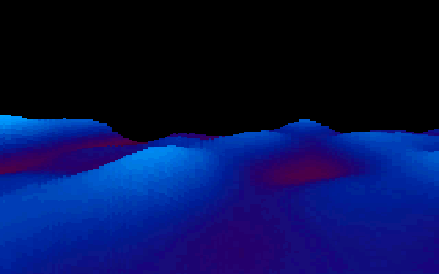
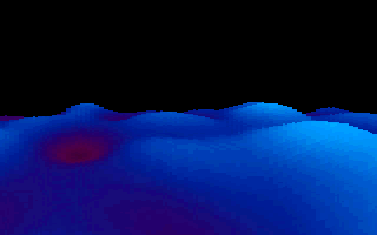
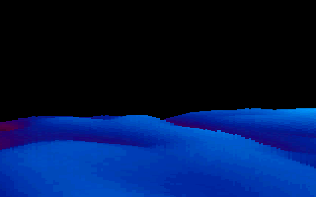

# 3DSINFLD: the 3D sinus field

3DSINFLD is the flight over the rolling blue landscape: smooth hills in blue and cyan with dark
purple-red hollows. The camera skims low across them and sways from side to side. The terrain
rises into view from the bottom of the screen at the start, and at the end it sinks away, as if
the camera were climbing, until the screen is black. It comes after [RAYSCRL](RAYSCRL) and before
[JPLOGO](JPLOGO). In a full run it starts about 7:25 in (boot frame 31,224) and runs about 29
seconds. The upstream directory is `COMAN/`, after the 1992 helicopter game *Comanche*, whose
"voxel" terrain the technique follows. The demo's planning file `SCRIPT` lists "Comanche" under PSI
([SCRIPT#L19](https://github.com/mtuomi/SecondReality/blob/071a82eddb7a7390dbaa491a8a473e0e923a55c2/SCRIPT#L19-L19))
and describes "Comanche = 3D-Sinusfield": a wavy desert surface, with the camera finally rising
as the effect darkens to black
([SCRIPT#L159-L162](https://github.com/mtuomi/SecondReality/blob/071a82eddb7a7390dbaa491a8a473e0e923a55c2/SCRIPT#L159-L162)).

## What you see








## The trick

### A height field marched one screen column at a time

The landscape is a **height field**: a function `h(u, v)` with no polygons. To draw it, the
program casts one ray per screen column, from the camera out over the ground, and marches it
forward in fixed steps. At each step it compares the ray's height with the ground's:

```text
ray starts at camera height 0, pointing down steeply (the bottom row of the screen)
for step j = 0, 1, 2, ...:
    ground = h(position along the ray at step j)
    while ray height at step j < ground:          (the ground blocks this row)
        paint the current screen row with a colour from 'ground'
        move up one screen row: tilt the ray up a notch
    ray height += ray slope                       (advance to step j+1)
```

The trick is that tilting the ray up does not restart the march. A ray that leaves the camera with
slope `d` is at height `j·d` after `j` steps. Raising the slope by `δ` at step `j` therefore only
needs `j·δ` added to the current height, and the march continues from the same step. Each column is
one pass from near to far: a pixel is painted once, the bottom rows first. Near ground hides far
ground automatically, because once a row is painted the ray has moved past it. There is no depth
buffer and no sorting.

```text
one screen column            side view
  top     ......  sky        camera ●──__
          ▒▒▒▒▒▒  far hill               ‾‾──__      ← the ray, tilted up after each hit
          ░░░░░░  near hill     ▁▂▃▅▃▂▁▁▂▅▇▅▂▁ ‾‾──__
  bottom  ██████  foreground  ─────────────────────────  ground h(u,v)
```

### The numbers

The march is the generated routine `theloop`, described below. In its terms:

- **Slope.** The bottom row's ray starts at slope `−130·2560/65536` (the horizon is 130 rows
  above it), and each row up adds `2560/65536`. At step `j`, moving up a row adds `j·2560/65536`
  to the ray height.
- **Steps.** 64 single steps, then 64 double steps, 192 units of distance in all. Beyond the first
  64 the ray takes double strides and checks the ground half as often, a cheap level of detail for
  the distance.
- **Ground.** `h = W1[p] + W2[q] − 240 + zwave[j]`. `W1` and `W2` are two 64 KB tables of signed
  words. `p` and `q` are 16-bit byte offsets into them, and each moves by a fixed amount per step,
  so the field wraps and tiles forever. `zwave[j] = 16·sin(2π·3j/192)` is a small swell that depends
  only on the distance.
- **Colour.** `((h + 140 − j/8) & 255) / 2`. Higher ground is a higher palette index, and distance
  moves it a few entries down the palette (one entry per eight steps). The march's colours, 0..127, run from near-black through a purple-red band
  (around entry 37) to blue (entry 100 is `0,27,54` out of 63) and cyan.

The wave tables were generated once by `MAIN.C`'s `CALCW12` branch, which is switched off in the
shipped build, and saved as `W1DTA.BIN` and `W2DTA.BIN`. Each entry is the sum of two
copies, at different frequencies, of the hand-shaped 1,024-entry wave in `WAVE.H` (7 and 3 cycles across `W1`, 5 and 2 across
`W2`), each scaled, plus a little random noise in `W1`.

### Fixed point with the halves swapped

The ray height and the slope are 16.16 fixed-point numbers, but the generated code keeps them with
the **halves swapped**: the integer part in the low word (`ax`, `cx`) and the fraction in the high
word. The point of the swap is that `cmp ax,bx` compares the ray's integer height with the ground
directly, with no shift. An `add eax,…` adds both halves at once, and the carry out of the fraction,
which lands in CF at the top of the register, is folded back into the integer with `adc ax,…`.
`DOLOOP.C`'s `wflip` makes the constants in this layout.

### Turning and flying

Each frame computes a heading from a sine that is itself driven by a sine
(`rot2 += 4`, `rot += sin(rot2)/15`, heading `r = rot/8`), so the camera swings smoothly left and
right. For the 160
columns `a`, with `x = a − 80` and a fixed forward distance `y = 160`, the per-step advances are

```text
xa = (x·cos r  + y·sin r ) / 256        (through W1)
ya = (y·cos r2 − x·sin r2) / 256        (through W2, r2 = r + 177/1024 of a turn)
```

The two tables are walked along different directions, so their swells cross. The camera moves
forward four steps of the centre column's ray every frame.

### Drawing half the columns

Only 160 columns are marched. The screen is in unchained mode (see
[Hardware primer](Hardware-primer)): one byte address covers four pixels, one in each plane. The
copy writes the even column's byte to planes 0 and 1 and the odd column's byte to planes 2 and 3,
so each column comes out two pixels wide. One 32-bit store writes four addresses in two planes,
eight pixels. Two pages, 32 KB
apart, alternate through CRTC register `0x0C`: the program shows one page and draws into the other.

The rise and the sink are a single offset. The copy's destination moves down by one row (80 bytes)
per unit of `startrise`. That starts at 160 and counts down to 0 at the start, and it counts back up
once the music's end signal arrives.

## How the original did it

The column loop in `MAIN.C`. `b` is the offset of the column's bottom in the 160-byte-wide `vbuf`,
with even columns in the left half and odd columns in the right:
([COMAN/MAIN.C#L85-L98](https://github.com/mtuomi/SecondReality/blob/071a82eddb7a7390dbaa491a8a473e0e923a55c2/COMAN/MAIN.C#L85-L98))

```c
for(a=0;a<160;a++)
{
	x=(a-80);
	y=160;
	xa=(int)(((long)x*(long)rcos+(long)y*(long)rsin)/256L);
	ya=(int)(((long)y*(long)rcos2-(long)x*(long)rsin2)/256L);
	b=(a&1)*80+(a>>1)+199*160;
	docol(xw,yw,xa,ya,b);
	if(a==80)
	{
		xwav+=xa*4;
		ywav+=ya*4;
	}
}
```

One step of the march, as `DOLOOP.C` generated it into the 5,230-line `THELOOP.INC`, here at step
10. The ground is fetched from both tables, then the hit loop paints and raises the ray by
`10·2560 = 0x6400` in the swapped layout:
([COMAN/THELOOP.INC#L443-L457](https://github.com/mtuomi/SecondReality/blob/071a82eddb7a7390dbaa491a8a473e0e923a55c2/COMAN/THELOOP.INC#L443-L457))

```asm
_@seek10:
add si,ds:theloop_xsina1
mov bx,fs:[si]
add di,ds:theloop_ysina1
add bx,gs:[di]
add bx,-227
cmp ax,bx
jge short _@seeko10
lea dx,[bx+139]
shr dl,1
_@hit10:
add eax,064000000h
adc ax,0
mov es:[bp],dl
cmp ax,bx
```

The hit loop is unrolled three rows deep. After it, `add ecx,01E000000h` raises the slope by three
rows' worth, and the miss path `_@seeko10` adds the slope to the height. The generator
([COMAN/DOLOOP.C#L101-L149](https://github.com/mtuomi/SecondReality/blob/071a82eddb7a7390dbaa491a8a473e0e923a55c2/COMAN/DOLOOP.C#L101-L149))
is easier to read than its output.

`docopy` in `ASM.ASM` clears 18 rows and then copies 140. `rep stosd` leaves `di` past the cleared
rows, so the copy starts at row 70, not row 52:
([COMAN/ASM.ASM#L173-L183](https://github.com/mtuomi/SecondReality/blob/071a82eddb7a7390dbaa491a8a473e0e923a55c2/COMAN/ASM.ASM#L173-L183))

```asm
	mov	dx,3c4h
	mov	ax,0f02h
	out	dx,ax
	mov	es,[bp+6]
	mov	ds,cs:_vbuf[2]
	mov	si,60*160
	mov	di,52*80
	mov	cx,18*80/4
	xor	eax,eax
	rep	stosd
	mov	cx,140
```

Each copied row then goes out twice through the sequencer's map mask: `0302h` selects planes 0
and 1 for the left 80 bytes, and `0C02h` selects planes 2 and 3 for the right 80
([COMAN/ASM.ASM#L190-L211](https://github.com/mtuomi/SecondReality/blob/071a82eddb7a7390dbaa491a8a473e0e923a55c2/COMAN/ASM.ASM#L190-L211)).

## How the port does it

The part is
[`bins/secondreality/src/parts/coman.rs`](https://github.com/waffleking32/SecondRealityRust/blob/main/bins/secondreality/src/parts/coman.rs)
(`Coman`, registered as `3dsinfld`, which is not a valid Rust identifier).

- `theloop` translates `THELOOP.INC` instruction for instruction, swapped halves and carries
  included. A test parses the shipped `THELOOP.INC`, executes it, and compares the whole 64 KB
  `vbuf` against `theloop`.
- `docol` applies the original's `~1` mask and calls the march. `Coman::render` is the camera and
  the 160 columns.
- `docopy` writes a 256 KB four-plane video array, with the plane-pair doubling and the 18-row clear
  that moves the copy. `compose` reads the shown page out as 320 pixels a line.
- `palette` is `MAIN.C`'s palette formula, overruns included.
- `Coman::iteration` is one loop pass. A render costs two vertical retraces, so `Part::frame` runs an
  iteration every second tick.

The timeline, the music seek and the per-keyframe mapping are in
[`docs/fidelity/3dsinfld.md`](https://github.com/waffleking32/SecondRealityRust/blob/main/docs/fidelity/3dsinfld.md).
All four reference frames match exactly.

## Quirks kept

- `docopy`'s clear advances `di`, so the picture starts at row 70. Rows 52..69 stay black, and the
  bottom 10 rows of `vbuf` never show
  ([bugs.md §20.1](https://github.com/waffleking32/SecondRealityRust/blob/main/docs/fidelity/bugs.md)).
- `docol` masks all four coordinates with `~1`, the directions as well as the positions
  ([bugs.md §20.2](https://github.com/waffleking32/SecondRealityRust/blob/main/docs/fidelity/bugs.md)).
- `combg` is a 16-byte array that the palette and the background setup both read far past, and the
  background copy is not assembled, so there is no background. DAC entries 240..255 come from past
  the array (zeros in the port), and the march's colours never reach them
  ([3dsinfld.md §2](https://github.com/waffleking32/SecondRealityRust/blob/main/docs/fidelity/3dsinfld.md)).
- `cameralevel` is set to −270 and passed into the march, which stores it and never reads it
  ([3dsinfld.md §7](https://github.com/waffleking32/SecondRealityRust/blob/main/docs/fidelity/3dsinfld.md)).
- At frame 4 the loop re-uploads the palette it already has. Only the extra vertical retrace it waits shows
  ([3dsinfld.md §3](https://github.com/waffleking32/SecondRealityRust/blob/main/docs/fidelity/3dsinfld.md)).
- A render takes a fixed two vertical retraces, where the original averages about 1.99, so the port drifts a
  few frames against it across the part
  ([APPROXIMATIONS.md A26](https://github.com/waffleking32/SecondRealityRust/blob/main/docs/fidelity/APPROXIMATIONS.md)).

---

**Previous:** [RAYSCRL](RAYSCRL) · **Next:** [JPLOGO](JPLOGO)
