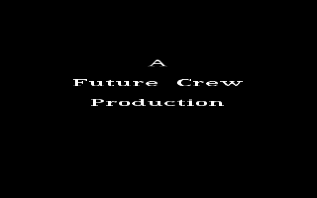
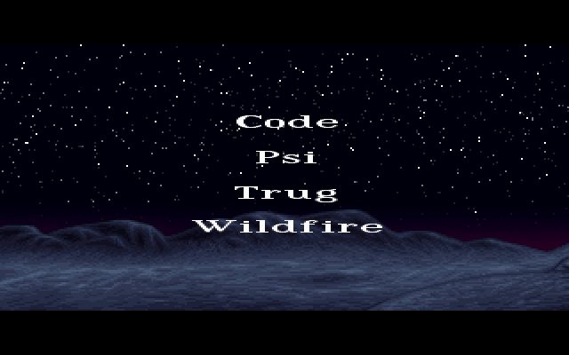
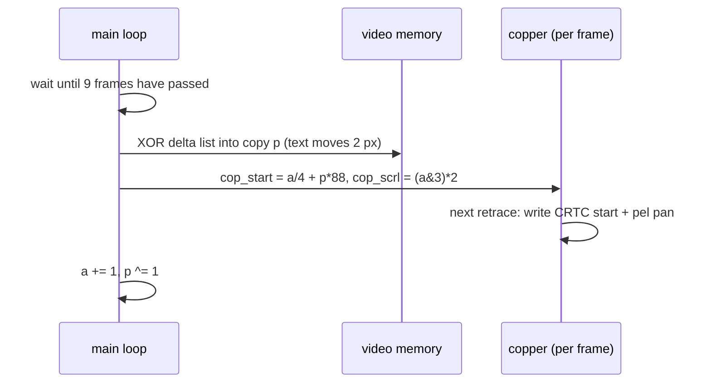

# ALKU: the opening credits and the horizon pan

ALKU ("beginning" in Finnish) opens the demo. The screen stays black while the music starts, then three title cards fade in and out: *A Future Crew Production*, *First Presented at Assembly 93*, and *in Dolby Surround*. After that a night landscape fades up, a starry sky over blue rock with a faint red glow on the horizon. It pans slowly to the left, one pixel every nine frames, while four batches of credits fade in and out over it, translucent and fixed in place on the screen. The part runs from about 6 s to about 85 s into the demo, and its last frame is the hand-over to [U2A](U2A), which carries on over the same landscape. The demo's own part table labels it `Alkutekstit I (WILDF)`, opening credits part I, by Wildfire. The source is in the upstream `ALKU/` directory.

## What you see






## The trick

ALKU uses three hardware tricks: hardware scrolling, palette-indexed transparency, and text that moves by XOR deltas. Together they let a 386 pan a 256-colour picture with anti-aliased, translucent text over it, and the CPU never redraws the screen. (The [Hardware primer](Hardware-primer) covers unchained "Mode X" memory, the CRTC start address and the DAC.)

### 1. Panning with the start address

The picture is a 640×200 image (`HOI.U`), and 150 of its rows are used. `tw_opengraph` sets an unchained 320×400 mode with a **176-byte line**. In unchained mode one byte address holds four pixels, one in each plane, so a line is 704 pixels wide and the visible window is 80 bytes (320 pixels) of it. Each picture row is written to **two** consecutive lines, which turns the 150 rows into 300 lines (memory lines 50-349). The text, as shown below, is drawn at the full 400-line resolution.

The landscape never gets copied to scroll it. The window moves by reprogramming two registers once a frame:

- the CRTC **start address** (`cop_start = a/4 + p*88`), which moves the window in 4-pixel steps (one byte address);
- the attribute controller's **horizontal pel panning** (`cop_scrl = (a&3)*2`), which supplies the 0-3 pixel remainder. In 256-colour mode its unit is half a pixel, hence the `*2`.

`a` is the pan position in pixels. It steps once every 9 frames (`SCRLF`), which gives about 7.8 pixels a second over 320 pixels, or roughly 41 seconds.

```
one memory line = 176 bytes = 704 pixels
byte 0                     88                     176
|------ copy 0 -------------|------ copy 1 ---------|
   [ window: 80 bytes ]          [ window: 80 bytes ]
   start = a/4                   start = a/4 + 88
                    ^ new column written at a/4+86 (and +88+86)
```

Each line holds the picture **twice**, 88 bytes apart (`outline` is called at `a` and `a+88`). The window alternates between the two copies on every step (`p ^= 1`), for the reason given in §3. Only 88 picture columns (352 pixels) fit in a copy, so every fourth step `do_scroll` streams in the next 4-pixel column at byte `a/4+86`, a few bytes past the window's right edge (`a/4+79`), and at the same place in the other copy. As `a` grows, the window and these writes run past byte 176. VGA memory is one linear array, so the bytes beyond a line's end are the start of the next line. Because every picture row occupies two lines and the refresh writes both, each overflowing byte lands where the reading line expects it. The code never needs a wrap-around case.

### 2. Transparency in the palette

The picture uses only colour indices **0-63**. The font has three anti-alias levels, stored as **0x40, 0x80 and 0xC0**: only the top two bits of a pixel byte. Text is combined with the picture by setting those two bits, and the palette decides what the result looks like.

- In the picture's own palette `palette`, entries 64-255 are copies of 0-63 (`palette[a]=palette[a-192]`). So entry `v` shows as entry `v mod 64`, and text bits in video memory are **invisible**.
- In `palette2`, entry `64k + v` (k = 1, 2, 3 for the three text levels) is a mix of text colour `T` (palette entries 1-3) and picture colour `P` (entry `v`):

  ```
  out = (T*63 + P*(63-T)) >> 6        ≈ T + P·(1 − T/63)
  ```

  This is close to a "screen" blend: dark text levels let the stars and rocks show through, and the brightest level is almost white.

To make the text appear, the part fades the DAC from `palette` to `palette2`. To make it vanish it fades back. Writing text into video memory or clearing it (`ffonapois` ANDs every byte with 63) costs nothing visible, because it happens while the text entries alias the picture.

The title cards use the same idea the other way round. While they show, the landscape is already in video memory, and the palette `fade2` has entries 0-63 black and 64-255 set to the three text colours. The cards are drawn with `prtc`, which ORs the glyph bits into the pixels, and `fonapois` clears them again with `&63`.

The picture's fade-in and the credits' fades run in **8.8 fixed point** inside the copper interrupt. `textin[c] = (palette2[c] − palette[c]) * 256 / 64` is the per-frame increment, and `copper3` adds its low byte to a fraction byte and its high byte, plus the carry, to the colour byte. That is 64 frames for a text fade and 128 frames (`picin`, from black) for the picture's fade-in. The title cards' fades are simpler: `dofade` mixes two palettes in C, `(pal1·(64−a) + pal2·a) >> 6` for `a` = 0..63, and hands each step to the copper to upload on the next retrace.

### 3. Text that slides with the picture

The credits stay still on screen while the landscape pans beneath them, so in video memory the text has to move right at the pan speed. Redrawing a 320×183 block every step would be far too slow. Instead `fmaketext` makes a **list of differences** once per batch. For every pixel where the text buffer differs from itself two pixels to the left, it stores the address and `tbuf[x] ^ tbuf[x-2]`. XORing that list into memory at an offset moves the text two pixels, and it touches only the glyph edges.

That is why there are two copies. On each step `do_scroll(1)` XORs the list into copy `p` and then points the display at copy `p`. Each copy is updated every other step, while the other copy is on screen, so it moves 2 pixels while the window has moved 2 pixels. The text never tears, because the copy being edited is the hidden one.



### 4. Pacing on the music

The cards and batches start on music cues: `dis_sync()` returns a code that rises as the song passes marked positions (see [Music](Music)). Card *n* waits for code *n*, and the fourth code starts the picture. A credits batch is built first and then shown only once `dis_sync()` reaches `4 + tptr` with `a` even; `tptr` has already been incremented by then, so the four batches wait for codes 5 to 8. The waits sit inside the drawing routines: `faddtext` and `fmaketext` call `do_scroll(0)` between glyphs and columns, so the pan keeps its 9-frame cadence while the CPU builds the next batch.

## How the original did it

The scroll step, `MAIN.C`'s `do_scroll`. Mode 0 returns at once if the 9 frames are not up yet, which is how the slow routines interleave with the pan:

```c
do_scroll(int mode)
	{
	if(mode==0 && frame_count<SCRLF) return(0);
	while(frame_count<SCRLF);
	frame_count-=SCRLF;
	if(mode==1) ascrolltext(a+p*352,dtau);
	cop_start=a/4+p*88; cop_scrl=(a&3)*2;

	if((a&3)==0)
		{
		outline(MK_FP(FP_SEG(hzpic),FP_OFF(hzpic)+(a/4+86)*4+784), MK_FP(0x0a000,(a/4+86)+176*50));
		outline(MK_FP(FP_SEG(hzpic),FP_OFF(hzpic)+(a/4+86)*4+784), MK_FP(0x0a000,(a/4+86)+176*50+88));
		}
	a+=1; p^=1;
	return(1);
```
[ALKU/MAIN.C#L397-L411](https://github.com/mtuomi/SecondReality/blob/071a82eddb7a7390dbaa491a8a473e0e923a55c2/ALKU/MAIN.C#L397-L411)

Building the text palette: entries 0-63 are the picture, and the rest blend a text colour over it (the 128-191 and 192-255 branches repeat this with entries 2 and 3):

```c
	for(y=0;y<768;y+=3)
	{
		if(y<64*3)
		{
		palette2[y+0]=palette[y+0];
		palette2[y+1]=palette[y+1];
		palette2[y+2]=palette[y+2];
		}
		else if(y<128*3)
		{
			palette2[y+0]=(fade2[y+0]=palette[0x1*3+0])*63+palette[y%(64*3)+0]*(63-palette[0x1*3+0])>>6;
```
[ALKU/MAIN.C#L184-L194](https://github.com/mtuomi/SecondReality/blob/071a82eddb7a7390dbaa491a8a473e0e923a55c2/ALKU/MAIN.C#L184-L194). The alias itself is one line further down, `for(a=192;a<768;a++) palette[a]=palette[a-192];` ([L212](https://github.com/mtuomi/SecondReality/blob/071a82eddb7a7390dbaa491a8a473e0e923a55c2/ALKU/MAIN.C#L212-L212)).

The delta list, built a plane at a time (`m` is the plane, so `x` steps by 4):

```c
	for(m=0;m<4;m++)
		{
		for(x=m;x<320;x+=4) {
			for(y=1;y<184;y++) if(tbuf[y][x]!=tbuf[y][x-2]) {
				*p1++=x/4+y*176+100*176;
				*p1++=tbuf[y][x]^tbuf[y][x-2];
				}
			do_scroll(0);
			}
```
[ALKU/MAIN.C#L443-L451](https://github.com/mtuomi/SecondReality/blob/071a82eddb7a7390dbaa491a8a473e0e923a55c2/ALKU/MAIN.C#L443-L451). After the list, the same routine XORs the whole new text once into both copies, a column at a time, and then waits until the pan has reached the batch's start position.

`ascrolltext` replays it. It selects the plane with the sequencer's map mask (port `3c4h`), then XORs, unrolled 20 times:

```asm
@@l3:
	REPT	20
	add	si, 4d
	mov	bx, [si-4]
	cmp	bx, -1
	je	@@l2
	mov	ax, [si-2]
	xor	[es:bx+di], al
	ENDM
	jmp	@@l3
```
[ALKU/ASMYT.ASM#L37-L46](https://github.com/mtuomi/SecondReality/blob/071a82eddb7a7390dbaa491a8a473e0e923a55c2/ALKU/ASMYT.ASM#L37-L46)

The 8.8 fade in the copper routine `copper3`. `fadepal` holds the colour bytes and, 768 bytes later, their fractions:

```asm
	lds	si, [cs:cop_fadepal]
	mov	di, OFFSET fadepal
	mov	cx, 768/16d
@@l4:
	ccc=0
	REPT 	16
	mov	ax, [ds:si+ccc*2]
	add	[cs:di+ccc+768], al
	adc	[cs:di+ccc], ah
	ccc=ccc+1
	ENDM
	add	di, 16d
	add	si, 32d
	dec	cx
	jnz	@@l4
```
[ALKU/COPPER.ASM#L126-L140](https://github.com/mtuomi/SecondReality/blob/071a82eddb7a7390dbaa491a8a473e0e923a55c2/ALKU/COPPER.ASM#L126-L140)

The two other copper routines are just as small: `copper1` writes `cop_start` to CRTC registers 0Dh/0Ch and `cop_scrl` to the attribute controller, and `copper2` counts frames and uploads a pending palette ([COPPER.ASM#L64-L104](https://github.com/mtuomi/SecondReality/blob/071a82eddb7a7390dbaa491a8a473e0e923a55c2/ALKU/COPPER.ASM#L64-L104)).

## How the port does it

The part is [`bins/secondreality/src/parts/alku.rs`](https://github.com/waffleking32/SecondRealityRust/blob/main/bins/secondreality/src/parts/alku.rs), type `Alku`. The original is a straight-line C program that busy-waits on `frame_count` inside its loops. The port's `Part::frame` runs once a tick, so the same control flow becomes a state machine. `Stage` covers the sync waits, the cards, the picture fade, the main loop, the final fade and the hand-over. `MainPhase` covers the main loop's `f` chain, the batch wait, `fmaketext`'s tail and the blocking `do_scroll(1)`. The original's routines keep their names and their arithmetic: `outline`, `refresh`, `prt`/`prtc`, `fmaketext`, `ascrolltext`, `fonapois`/`ffonapois`, `do_scroll`/`scroll_step`.

Video memory is kept as the original's flat byte array, with plane byte `A` at pixel `4*A + plane` and a 704-pixel line, so the start-address arithmetic and the past-the-end writes behave as they do on the hardware. The three copper routines are `CopperState::slot0` (the 8.8 fade), `slot1` (start address and pel pan, applied to the engine's `View`) and `slot2` (frame count and palette upload), installed in the engine's copper slots as `init_copper` installs them (see [How the port works](How-the-port-works)).

The port runs the **shipped** `ALKU.EXE`'s loop where it differs from `MAIN.C`. That covers the loop's last step, the `fmaketext` limit, the 29-row font, and a closing routine that compacts the last window into a 320×200 page for U2A. Each difference is a constant in the module that cites its offset in the unpacked image, and [docs/fidelity/alku.md](https://github.com/waffleking32/SecondRealityRust/blob/main/docs/fidelity/alku.md) §12 lists them all. The same note gives the timeline and the frame comparisons: all four reference frames match exactly ([How it is verified](How-it-is-verified)).

## Quirks kept

- The palette alias makes entry `v` show as `v mod 64`, which is what hides the text XOR ([bugs.md §10.1](https://github.com/waffleking32/SecondRealityRust/blob/main/docs/fidelity/bugs.md)).
- The column refresh at the end of the pan reads past the picture's 640-pixel row into the next row, in columns the window never shows ([bugs.md §10.2](https://github.com/waffleking32/SecondRealityRust/blob/main/docs/fidelity/bugs.md)).
- `memset(tbuf,0,186*320)` clears only part of the 186×352 text buffer ([bugs.md §10.3](https://github.com/waffleking32/SecondRealityRust/blob/main/docs/fidelity/bugs.md)).
- `switch(tptr++)` means the first credits batch waits for music code 5, not 4 ([bugs.md §10.4](https://github.com/waffleking32/SecondRealityRust/blob/main/docs/fidelity/bugs.md)).
- The linked picture's palette entries 1-3 (the text colours) differ from the `HOI.U` file in the tree, and the port uses the shipped ones ([APPROXIMATIONS.md A20](https://github.com/waffleking32/SecondRealityRust/blob/main/docs/fidelity/APPROXIMATIONS.md), [alku.md §7](https://github.com/waffleking32/SecondRealityRust/blob/main/docs/fidelity/alku.md)).
- The release's credits loop and closing routine are taken from the shipped executable. The point where its last pass ends depends on the original's CPU speed, so the port takes the frames' answer ([APPROXIMATIONS.md A20](https://github.com/waffleking32/SecondRealityRust/blob/main/docs/fidelity/APPROXIMATIONS.md)).
- On ESC the port ends without the original's one black frame ([APPROXIMATIONS.md A62](https://github.com/waffleking32/SecondRealityRust/blob/main/docs/fidelity/APPROXIMATIONS.md)).

---

**Previous:** [Home](Home) · **Next:** [U2A](U2A)
