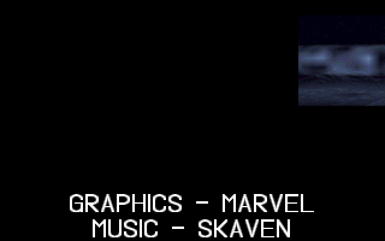
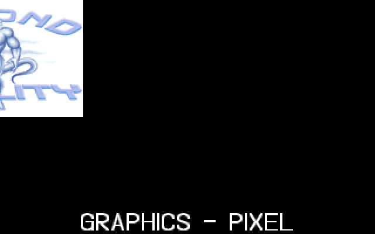
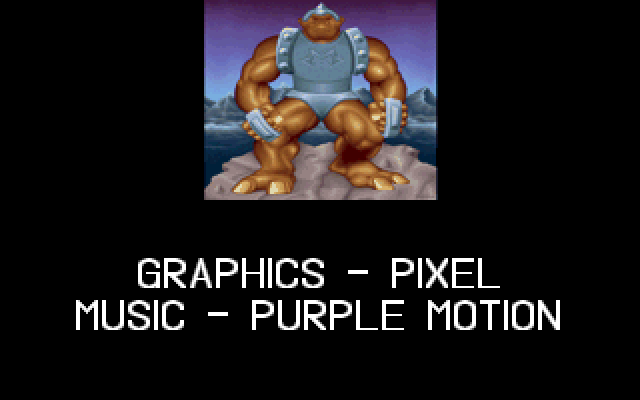

# CRED: the credit screens

CRED is the demo's credits: 21 screens, each pairing a small 160×100 picture, most of them
scenes from the demo's parts, with a centred caption naming who made it ("GRAPHICS -
MARVEL", "MUSIC - SKAVEN", "CODE - WILDFIRE" and so on). On each screen, the picture slides in
from the right while the caption rises from the bottom edge. Both decelerate into place, hold for
200 frames, then accelerate away, the picture to the left and the caption back down. CRED follows
[ENDLOGO](ENDLOGO)'s fade to black, a little over nine minutes into the demo, and runs for just under two minutes, until the
greetings scroller [ENDSCRL](ENDSCRL). The upstream directory is `CREDITS/`, and the shell's part
list labels it `Credits/Greetings scrl. (?)`. The source names no author. The shipped program is
not quite the tree's: its pictures and captions differ on several screens (screen 2, for example,
adds "OBJECTS - WILDFIRE"). The port reads the shipped data.

## What you see








## The trick

Nothing on a credit screen is redrawn while it moves. Each screen is drawn once into video memory,
and the motion comes from three display registers rewritten once a frame: the **display start**,
the **pel panning** and the **line compare** (the split screen). See
[Hardware primer](Hardware-primer) for what each one does.

### The memory layout

CRED runs in a "tweaked" 320×200 256-colour mode: chain-4 off, so each byte address holds four
pixels, one per plane. Its pen, `tw_putpixel`, addresses a logical line of 320 pixels (80 bytes).
The CRTC offset register is set to 160 bytes, though, so each displayed row advances **two**
logical lines. The display shows every second logical line, and which half it shows (even or odd)
depends on where the display start points.

The part uses that to keep two images in one screen:

```
logical lines 0..199   (even ones shown)  the caption, drawn from line 16
logical line  400      display start when parked: an empty line
logical lines 401..599 (odd ones)         the picture, 160 wide at x = 80..239
```

The picture is drawn with `tw_putpixel(400+x, 400+y*2, ...)`. x = 400 is past the end of a
320-pixel line, so the pixel lands 80 pixels into the *next* line: row `y` of the picture is on
logical line `401 + 2y`, columns 80..239. With the display start at line 401, the 100 displayed
rows of the top half are the picture's 100 rows, centred.

The caption sits at the bottom of video memory. Below the split (the line-compare row), the VGA
restarts its address counter at 0, so the lower part of the screen shows logical lines 0, 2, 4…
from the top of memory. At the hold, the split is at displayed row 100, and the caption's lines
start 8 rows below it. Because only even logical lines are shown, the 32-row font appears 16
rows tall, and the mode's double scan shows each row twice.

### Sliding the picture

Moving the display start by `yy` pixels moves everything left by `yy`. The part computes the
start as `160*200 + yy/4` bytes, which is logical line 400 plus `yy` pixels. A displayed row then
begins `yy` pixels into the empty line 400 and runs on into line 401, so picture column `x`
appears at screen x = `400 − yy + x`:

- `yy = 0`: the picture starts at screen x = 400, off the right edge.
- `yy = 320`: it is at 80..239, centred.
- `yy` → 640: it slides off the left edge.

The display start counts in bytes, which is four pixels in this mode. The last two bits of `yy`
go into the attribute controller's pel panning register (`13h`). In 256-colour modes that
register moves in half-pixel units, so the code writes `(yy & 3) * 2` to shift by `yy & 3` whole
pixels. Together the two registers give single-pixel positioning.

### Raising the caption

The split row comes from `tw_setsplit(y/128 + 200)`. The line compare counts scanlines in a
400-line signal, so a value of 400 puts the split at row 200, the bottom edge, and 200 puts it at
row 100, the middle. As the split rises, the caption, fixed to the top of the lower view, rises
with it.

### The two motion curves

Both registers are driven by one variable `y`, in fixed point with 7 fractional bits: `y/128` is added to the line compare (200 scanlines,
100 rows, down to 0), and `y/80` is the picture's offset (320 pixels down to 0).

- **In** (ease-out): `y` starts at 200·128 = 25,600 and is multiplied by 12/13 each frame.
  Each step removes a thirteenth of the remaining distance, so the motion is fast at first and
  creeps into place. It takes 102 steps, until the integer arithmetic reaches 0.
- **Out** (ease-in): `y` starts at 0 with a velocity `v` that grows by 15 each frame, so
  `y = 15·n(n−1)/2` after `n` frames: constant acceleration, like a dropped object. It leaves the
  screen in 59 steps.

```
frames:  0       1        2-103        104-303     304-362     = 363 per screen
         parked  draw     in, ×12/13   hold (200)  out, v += 15
```

21 screens of 363 frames is 7,623 frames, about 109 seconds at 70 Hz.

### A proportional font, found by scanning

The caption font is one long strip of glyphs, 1,500 pixels wide. No table gives each glyph's
position. Instead `init` scans the strip's columns: a run of columns with ink in any of the first
32 rows is the next character of the string `fonaorder`, in order. Each character gets a start
column (`fonap`) and a width (`fonaw`). The space is given a fixed blank 8 columns wide.
`prtc` centres a line by summing `fonaw + 2` over its characters and starting half that width
left of x = 160.

### The palette

Each picture carries its own palette, but the caption needs greys too. `init` moves every
picture's palette up by 16 entries and writes a grey ramp, `7·a` for `a` = 0..9, into the bottom
ten entries. The picture is then drawn at index `+16`, so the caption's pixel values (0..9) and
the picture's colours never collide. Each screen uploads its own repaired palette, so every
picture shows its own colours.

## How the original did it

`CREDITS/MAIN.C` is the part, over `CREDITS/TWEAK.ASM`'s `tw_*` routines. Each screen is one call
to `screenin(pic, text)`. Its first half parks the display, then draws everything
([MAIN.C#L165-L174](https://github.com/mtuomi/SecondReality/blob/071a82eddb7a7390dbaa491a8a473e0e923a55c2/CREDITS/MAIN.C#L165-L174)):

```c
	tw_setsplit(400);
	tw_clrscr();
	tw_setstart(160*200);
	dis_waitb();
	tw_setpalette(&pic[0][16]);
	pic=&pic[0][784];

	y=16;while(*(text=prtc(160,y,text))) y+=FONAY+10;

	for(x=0;x<160;x++) for(y=0;y<100;y++) tw_putpixel(400+x,400+y*2,pic[y][x]+16);
```

A caption is one C string with embedded NULs, one line per segment, ending at a double NUL.
`prtc` returns the pointer past its line, and the loop stops when that points at the final NUL.
Several captions begin with `"\0"`, an empty first line, which pushes a short caption one line
lower.

The slide-in
([MAIN.C#L176-L190](https://github.com/mtuomi/SecondReality/blob/071a82eddb7a7390dbaa491a8a473e0e923a55c2/CREDITS/MAIN.C#L176-L190)).
`0x33` is register `13h` with bit 5 set, which keeps the screen enabled while the attribute
controller is addressed:

```c
	for(y=200*128;y>0;y=y*12L/13)
		{
		dis_waitb();
		tw_setsplit(y/128+200);
		yy=320-y/80;
		for(a=0;a<10000;a++);
		tw_setstart(160*200+(yy/4));
		asm	{
			mov	dx, 0x3c0
			mov	al, 0x33
			out	dx, al
			mov	ax, yy
			and	ax, 3
			shl	ax, 1
			out	dx, al
```

The empty `for` loop is a delay that keeps the writes in step with the display; in the shipped
build it is a wait on the status register instead. The hold and the start of the slide-out
([MAIN.C#L194-L200](https://github.com/mtuomi/SecondReality/blob/071a82eddb7a7390dbaa491a8a473e0e923a55c2/CREDITS/MAIN.C#L194-L200)):

```c
	for(a=0;a<200 && !dis_exit();a++) dis_waitb();

	for(y=0,v=0;y<128*200;y=y+v,v+=15)
		{
		dis_waitb();
		tw_setsplit(y/128+200);
		yy=320+y/80;
```

The palette repair, repeated in `init` for each of the 21 pictures
([MAIN.C#L294-L297](https://github.com/mtuomi/SecondReality/blob/071a82eddb7a7390dbaa491a8a473e0e923a55c2/CREDITS/MAIN.C#L294-L297)),
after a `memmove(&pic1[16*3+16],&pic1[16],768-16*3)` for each that shifts the palette up 16
entries:

```c
	for(a=0;a<10;a++)
		{
		pic1[a*3+0+16]=pic1[a*3+1+16]=pic1[a*3+2+16]=7*a;
		pic2[a*3+0+16]=pic2[a*3+1+16]=pic2[a*3+2+16]=7*a;
```

(The `+16` here skips each picture blob's 16-byte header; the palette starts at byte 16.)

`tw_opengraph`
([TWEAK.ASM#L18-L60](https://github.com/mtuomi/SecondReality/blob/071a82eddb7a7390dbaa491a8a473e0e923a55c2/CREDITS/TWEAK.ASM#L18-L60))
sets the mode: Mode 13h, then chain-4 off, a clear of all video memory, CRTC byte mode, offset
`50h` (160 bytes, "640 wide" in its comment) and CRTC 9 = 1, which shows each row twice.

## How the port does it

The part is
[`bins/secondreality/src/parts/cred.rs`](https://github.com/waffleking32/SecondRealityRust/blob/main/bins/secondreality/src/parts/cred.rs)
(`Cred`, registered as `cred`). Its `init` unpacks the shipped `assets/MAIN/DATA/CRED.EXE` and
finds `main`'s 21 `screenin` calls in the code, which name each picture and caption. It reads
the font raster and `fonaorder` from where the program's `init` reads them. `scan_metrics` is the
column scan and `repair_palette` the palette shift and grey ramp.

The engine's surface is chunky (one byte per pixel), so the pen (`put`) writes flat pixel
`320·y + x`, the pixel the original's planar address (`y*80 + x/4` in plane `x & 3`) names. The display is the engine's `View`
with a 640-pixel line stride and a `Split` whose lower view reads from address 0, as the VGA's
does. The three registers of one frame are a `Display` (`origin`, `line_compare`, `pan`).
`open_ramp` and `close_ramp` replay the two loops' `y` values. `Part::frame` counts ticks within
a screen: the parked tick, the draw tick (`show_screen`), then a `Display` per tick from
`iris_display`, or nothing during the hold.

The part registers no copper callbacks, because the original installs none. The tick map, the
measurement of the pan unit against the reference's wipe frames and the shipped image's layout
are in
[docs/fidelity/cred.md](https://github.com/waffleking32/SecondRealityRust/blob/main/docs/fidelity/cred.md).

## Quirks kept

- `tw_setsplit(400)` while parked puts the split below a 200-row display, so it does nothing
  ([bugs.md, index](https://github.com/waffleking32/SecondRealityRust/blob/main/docs/fidelity/bugs.md)).
- The routine reads 32 rows of a font strip that has 40; the port reads the same 32
  ([APPROXIMATIONS.md A8](https://github.com/waffleking32/SecondRealityRust/blob/main/docs/fidelity/APPROXIMATIONS.md)).
- The original spends 3 to 4 extra frames per screen drawing between screens, a pixel at a time;
  the port draws in no time, so its screens run slightly early
  ([APPROXIMATIONS.md A11, A53](https://github.com/waffleking32/SecondRealityRust/blob/main/docs/fidelity/APPROXIMATIONS.md)).
- Three differences in the shipped program are not modelled: a leftover `printf` at the start,
  the status-register wait in place of the delay loop, and an attribute flip-flop reset
  ([cred.md §9](https://github.com/waffleking32/SecondRealityRust/blob/main/docs/fidelity/cred.md)).

---

**Previous:** [ENDLOGO](ENDLOGO) · **Next:** [ENDSCRL](ENDSCRL)
