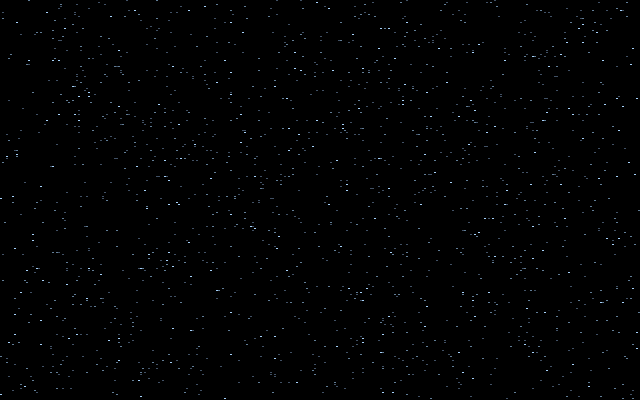
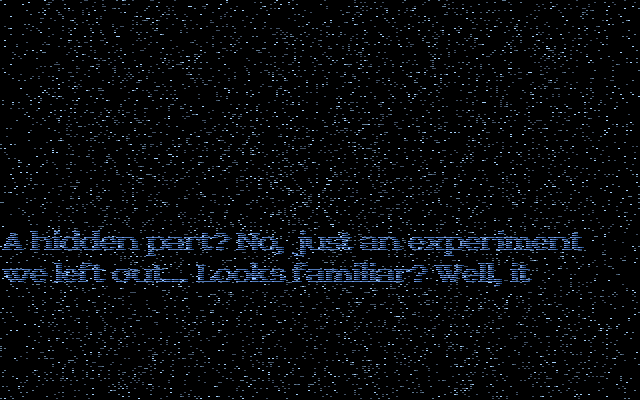
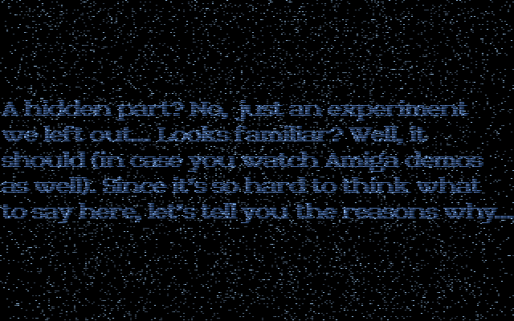
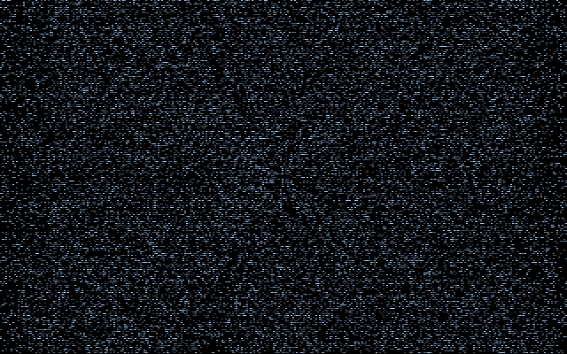

# DDSTARS: the hidden starfield

DDSTARS is the demo's hidden part. A normal run never reaches it. It plays only when the demo is
started as `SECOND U`, and then on its own: the shell restarts the first music module at order 70
and runs this part alone (in the port, `--block U` or `--part ddstars`). In the shell's run order
its slot sits between [U2E](U2E) and [ENDLOGO](ENDLOGO). It shows a field of blue-white stars
rushing towards the viewer. A text box later rises out of a line across the lower middle of the
screen: "A hidden part? No, just an experiment we left out... Looks familiar? Well, it should (in
case you watch Amiga demos as well)...". A second block of text follows later. The part has no
end of its own and runs until the viewer leaves. The demo's part table labels it
`Desert Dream Stars (PSI)`, and the text itself says the effect should look familiar to Amiga
demo watchers. Its source is the upstream
`DDSTARS/` directory: `KOE.ASM` is the program, and it includes `STARS.ASM`, which holds the
effect. The text is the two-plane picture `TEXTS.16`, linked in as `_textpic`.

## What you see









## The trick

A starfield is the oldest effect in the book: a table of points `(x, y, z)`, each frame
`z` decreases, and each point is drawn at `(x/z, y/z)`. DDSTARS does exactly that, and it does it
cheaply. It draws only the top half of the screen and mirrors it for the bottom. It draws into
off-screen buffers that are never erased. It uses bit planes so that a star is one or two ORs into a byte.
The never-erased buffers are what give the part its look.

### 1. A 16-colour, 400-line screen

`init_stars` calls the BIOS with `mov ax,13`. The assembler's default radix is decimal, so this
is mode 13 = 0Dh, the EGA-style 320×200 **16-colour planar** mode, not the 256-colour Mode 13h.
In it a pixel's colour is four bits spread over four planes, and each byte of a plane covers 8
pixels (see the [Hardware primer](Hardware-primer)). The part then clears bit 7 of CRTC register
9 and works with a 320×400 screen: 400 rows of 40 bytes a plane, two pages of it at `A000h` and
`A400h`, flipped by the CRTC start address every frame.

The layers are kept apart by the row they use:

```
even scanlines   stars, planes 0 and 1   colours 1-3 (three blues, dim to bright)
odd  scanlines   text,  plane 2 forced   colours 4-7 (black and three text blues)
```

A star needs only one bit set in one or two planes. Its colour is fixed by its depth:

| z (far = 255) | planes set | colour |
|---|---|---|
| 180-255 | 0 | 1, dimmest |
| 110-179 | 1 | 2 |
| 0-109 | 0 and 1 | 3, brightest |

### 2. Projection by table

There are 1,024 stars. `z` is a byte, and the stars start spread evenly over depth: the table
is filled with four descending sweeps of 255..0. `x` and `y` are random in −512..511, from a 32-bit
linear congruential generator. Each pass subtracts 2 from `z`. When `z` wraps below 0, the star is
given a new random `x` and `y` and starts again at the far end. A star takes 128 frames to come all
the way in.

The division by depth comes from two 256-entry tables built once at start-up:

```
muldivy[z] = (108·65536 / (150 + 4z)) / 2        row    = (y · muldivy[z]) >> 14  + 100
muldivx[z] = (144·65536 / (150 + 4z)) / 2        column = (x · muldivx[z]) >> 14  + 160
```

That works out to `row = 100 + 216·y/(150+4z)` and `column = 160 + 288·x/(150+4z)`: a
perspective divide by `150 + 4z`, done with one table lookup and one multiply per axis per star. The
result is compared as an unsigned number against 99 and 319. Only rows 0-99 survive, which
means only stars with negative `y`, the upper half of the view.

### 3. A ring of 64 star buffers that are never cleared

Stars are not drawn to the screen. They are ORed into one of 64 **units**, 8 KB buffers in EMS
memory. Each unit holds a 100-row, 40-byte-wide image for plane 0 and another for plane 1. Every
frame the part advances to the next unit `u`, ORs that frame's stars into it, and copies it to
the back page:

```
each frame: u = (u + 1) mod 64
           OR this frame's stars into unit u
           top half    (rows 0..198, even)  <- unit u, rows 0..99
           bottom half (rows 200..398, even) <- unit (u+32) mod 64, rows 99..0   (upside down)
```

Nothing ever erases a unit. When unit `u` comes round again 64 frames later, it still holds every
star drawn into it 64, 128, 192, ... frames earlier, and the new positions are added on top. The
screen therefore shows the moving stars together with a growing deposit of old ones. The sky fills
up over the course of the part, from sparse points to a dense blue haze.

The bottom half is the top half's mirror image, but taken from the unit drawn 32 frames earlier.
The time shift hides the symmetry, and only the top half ever has to be drawn.

The program also changes the field in stages, keyed on a frame counter `starframe`:

- **Frames 1-900.** `staradd` moves the first 512 stars. A limit lets only the first `N` of them
  draw, and `N` grows by one each call. Start-up has already made 100 calls, so about a hundred
  stars draw on the first frame and all 512 by frame 412: the field starts thin and fills in.
- **Frames 901-1200.** No stars are drawn at all. The ring is just replayed, a 64-frame loop.
- **Frames 1201 on.** `staradd2` moves all 1,024 stars and ORs each one into **two** units, `u`
  and `u+17`. The second copy reappears 17 frames later as an echo. At frame 1500 the limit is
  reset, and the stars draw again four more a frame.

### 4. The rising text

At frame 1200 (and again at 3200, with the second block) the program arms `risetext`'s wipe. Two
counters drive it: an opening counter set to −256 that climbs by one a frame up to 99, and a
closing counter set to 1500 that falls by one a frame. The band's height is the smaller of the
two, so nothing shows for the first 256 frames (the first text appears around frame 1460).
The band is a run of odd scanlines whose bottom text row is fixed at scanline 293. It grows upward
by one text row (two scanlines) a frame, up to 95 text rows plus its blank edge rows. Each frame the band is
refilled from the top with source rows from the start of the text block, so the text appears to
rise out of a slot. About 1,400 frames after the mark the closing counter drops below 99, the
band shrinks again, and the text sinks back down the slot. Text is written to planes 0 and 1 from the picture,
and plane 2 is forced on with the VGA's **set/reset** registers in the same store. That puts the
text in colours 4-7 without a second pass. The star blits write only even rows, so text and stars
never touch each other's pixels.

### 5. The fade-in

For the first 33 frames, the three star colours are uploaded multiplied by `starpalfade·8/256`
(capped at 255/256), so the field fades up from black. Colour 4 is black, and colours 5-7 (the
text) are written at full value every time, but no text is on screen until around frame 1460.

## How the original did it

The mode set, in decimal, and the CRTC 9 write:

```asm
init_stars PROC NEAR
	mov	ax,13
	int	10h
```
[DDSTARS/STARS.ASM#L56-L58](https://github.com/mtuomi/SecondReality/blob/071a82eddb7a7390dbaa491a8a473e0e923a55c2/DDSTARS/STARS.ASM#L56-L58)

```asm
	mov	dx,3d4h
	mov	al,9
	out	dx,al
	inc	dx
	in	al,dx
	and	al,127
	out	dx,al
```
[DDSTARS/STARS.ASM#L72-L78](https://github.com/mtuomi/SecondReality/blob/071a82eddb7a7390dbaa491a8a473e0e923a55c2/DDSTARS/STARS.ASM#L72-L78)

One of the projection tables:

```asm
	mov	di,OFFSET muldivy
	mov	cx,256
	mov	bp,150
@@2b:	mov	dx,108
	xor	ax,ax
	div	bp
	shr	ax,1
	stosw
	add	bp,4
	loop	@@2b
```
[DDSTARS/STARS.ASM#L141-L150](https://github.com/mtuomi/SecondReality/blob/071a82eddb7a7390dbaa491a8a473e0e923a55c2/DDSTARS/STARS.ASM#L141-L150)

A star's step and its row. `jc` catches the byte `z` wrapping, `jb` is the count limit, and the
unsigned `ja` rejects every row outside 0..99:

```asm
@@1:	movzx	bx,ds:[si]
	sub	bl,2
	mov	ds:[si],bl
	jc	@@4
	cmp	bp,cs:starlimit
	jb	@@2
	shl	bx,1
	mov	ax,ds:[si+4]
	imul	ds:muldivy[bx]
	shld	dx,ax,2
	add	dx,100
	cmp	dx,99
	ja	@@2
```
[DDSTARS/STARS.ASM#L288-L300](https://github.com/mtuomi/SecondReality/blob/071a82eddb7a7390dbaa491a8a473e0e923a55c2/DDSTARS/STARS.ASM#L288-L300)

The depth colouring, one OR per plane (`es` is the current unit; plane 1 is 4,096 bytes in):

```asm
	mov	cl,ds:[si]
	cmp	cl,180
	jb	@@sc1
	or	byte ptr es:[bx],ch
	jmp	@@2
@@sc1:	cmp	cl,110
	jb	@@sc2
	or	byte ptr es:[bx+4096],ch
	jmp	@@2
@@sc2:	or	byte ptr es:[bx],ch
	or	byte ptr es:[bx+4096],ch
```
[DDSTARS/STARS.ASM#L317-L327](https://github.com/mtuomi/SecondReality/blob/071a82eddb7a7390dbaa491a8a473e0e923a55c2/DDSTARS/STARS.ASM#L317-L327)

The frame's schedule: next unit, then nothing, `staradd` or `staradd2` by frame number:

```asm
	call	starfetch0
	cmp	cs:starframe,1200
	ja	@@stz
	cmp	cs:starframe,900
	ja	@@stz0
	call	staradd
	jmp	@@stz0
@@stz:	call	staradd2
```
[DDSTARS/STARS.ASM#L669-L676](https://github.com/mtuomi/SecondReality/blob/071a82eddb7a7390dbaa491a8a473e0e923a55c2/DDSTARS/STARS.ASM#L669-L676)

The bottom half: unit `+32`, read from its last row upward into every other screen row (the
commented-out lines are the star clip, below):

```asm
	mov	ax,cs:emmpage4
	add	ax,32
	and	ax,63
	call	fetch4ax
	mov	ds,ax
	mov	di,200*40
	mov	si,99*40
	mov	dx,3c4h
	mov	ax,0102h
	out	dx,ax
	mov	cx,100
@@5:	zzz=0
;	cmp	di,cs:_nostar1
;	jl	@@5g
;	cmp	di,cs:_nostar2
```
[DDSTARS/STARS.ASM#L726-L740](https://github.com/mtuomi/SecondReality/blob/071a82eddb7a7390dbaa491a8a473e0e923a55c2/DDSTARS/STARS.ASM#L726-L740)

The text's set/reset. Graphics register 0 = 04h sets plane 2 to ones, register 1 = 0Ch enables
that for planes 2 and 3 (so plane 3 gets zeros), and the map mask `0Dh` writes plane 0's data
together with them:

```asm
	mov	dx,3ceh
	mov	ax,0400h
	out	dx,ax
	mov	ax,01h+400h+800h
	out	dx,ax

@@tc1:	mov	dx,3c4h
	mov	ax,0102h+400h+800h
	out	dx,ax
```
[DDSTARS/STARS.ASM#L479-L487](https://github.com/mtuomi/SecondReality/blob/071a82eddb7a7390dbaa491a8a473e0e923a55c2/DDSTARS/STARS.ASM#L479-L487)

## How the port does it

The part is
[`bins/secondreality/src/parts/ddstars.rs`](https://github.com/waffleking32/SecondRealityRust/blob/main/bins/secondreality/src/parts/ddstars.rs)
(`Ddstars`). One `frame` is one `do_stars` iteration (`Ddstars::advance`). The 64 EMS units are
one flat `ring` buffer, with no page mapping (`starfetch0` just picks an offset). The stars are
`Star { z: u8, x, y }` from the original's generator (`Lcg`, which returns `dx`, bits 32-47 of the
64-bit product, as the assembly does). `project` is the table lookup with the unsigned bounds check,
`star_planes` the depth colouring, and `star_pass` both `staradd` and `staradd2`.

The VGA side is modelled at the plane level, because the effect depends on it. Each of the two
pages is a `Page` with three plane arrays (plane 3 is always 0). `blit` and `risetext` write
planes as the original does, including the set/reset forcing of plane 2, and `Page::compose_row`
turns the touched rows into the 320×400 indexed surface the engine displays. The text strip is
read from `TEXTS.16` in its original two-plane format. As in the original, the text goes into the
page on screen and the stars into the back page, so a displayed frame holds the text of tick `t`
and the stars of tick `t−1`. See [How the port works](How-the-port-works) for how parts hand
the engine a surface and palette. Timeline, mapping and measurements are in
[docs/fidelity/ddstars.md](https://github.com/waffleking32/SecondRealityRust/blob/main/docs/fidelity/ddstars.md).

## Quirks kept

- The star clip under the text is assembled out. `risetext` still computes `_nostar1`/`_nostar2`, but the guards that used them are commented out, so stars are drawn under the text band, as the shipped build shows ([APPROXIMATIONS.md A57](https://github.com/waffleking32/SecondRealityRust/blob/main/docs/fidelity/APPROXIMATIONS.md), [bugs.md §27](https://github.com/waffleking32/SecondRealityRust/blob/main/docs/fidelity/bugs.md)).
- The units are cleared once and only ever ORed into, so the field accumulates for as long as the part runs ([ddstars.md §4](https://github.com/waffleking32/SecondRealityRust/blob/main/docs/fidelity/ddstars.md)).
- Text is written into the displayed page and stars into the back page, one frame apart ([ddstars.md §3](https://github.com/waffleking32/SecondRealityRust/blob/main/docs/fidelity/ddstars.md)).
- The two-row case of `risetext`'s clear writes 80 bytes and covers a row pair ([ddstars.md §5](https://github.com/waffleking32/SecondRealityRust/blob/main/docs/fidelity/ddstars.md)).
- The port checks the exit flag at the top of a frame, so it leaves one frame earlier than the original, which draws the iteration first ([ddstars.md §7](https://github.com/waffleking32/SecondRealityRust/blob/main/docs/fidelity/ddstars.md)).

---

**Previous:** [U2E](U2E) · **Next:** [ENDLOGO](ENDLOGO)
