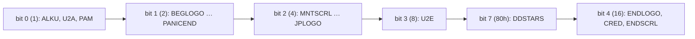

# Demo structure: one shell, twenty parts, and a clock made of music

Second Reality is not one program. It is a small resident **shell** that runs some twenty
separate DOS programs, one after another, and keeps the music and the timer going underneath them.
The parts are by several coders (PSI, WILDF and TRUG wrote most of them), in Turbo C, Turbo Pascal
and assembly. A part talks to the shell through one software interrupt. When a part ends is
decided by the music, not by a frame count. This page covers the shell, the order of the parts,
the blocks you can start from, the interface the parts use, and how the music cues the changes.

## SECOND.EXE

The release is two files: `SECOND.EXE` and `REALITY.FC`, the music data. `SECOND.EXE` is the
shell, built from `MAIN/U2.ASM` as `U2.EXE` and renamed. Linked into it are:

- the file loader, `MAIN/U2A.ASM`. The part EXEs and their data are appended to `SECOND.EXE`
  itself (`MAIN/PACK.C`; the manifest is `MAIN/PACKFINA.INC`), so the demo is a single file.
- the copper, `MAIN/COPPER.ASM`, the timer-driven raster scheduler described in the
  [Hardware primer](Hardware-primer#retrace-and-the-copper).
- the **Demo Interrupt Server** (DIS), `DIS/DISINT.ASM`, the services the parts call.
- the music player **STMIK**, `MAIN/STMIK.300`, shipped as an object file with no source (see
  [Music](Music)).

The setup screen that asks for a sound card is a separate program, `START.EXE`, and the shell
runs it first. Then each part is loaded, executed until it returns, and replaced by the next. The
music keeps playing across the gaps because the player belongs to the shell, not to any part.

After every part the shell resets all three copper slots to an empty routine, so a part cannot
leave a routine running for the next one:

```asm
partexecute PROC NEAR
        call    ctrldown
        jc      @@skip
        mov     ax,cs
        mov     ds,ax
        call    execute
        call    flushkbd
@@skip: mov     ax,OFFSET copper_intretf
        mov     word ptr cs:copper_int0[0],ax
        mov     word ptr cs:copper_int0[2],cs
        mov     word ptr cs:copper_int1[0],ax
        mov     word ptr cs:copper_int1[2],cs
        mov     word ptr cs:copper_int2[0],ax
        mov     word ptr cs:copper_int2[2],cs
        ret
```

[MAIN/U2.ASM:205-219](https://github.com/mtuomi/SecondReality/blob/071a82eddb7a7390dbaa491a8a473e0e923a55c2/MAIN/U2.ASM#L205-L219)

Holding Ctrl skips the part (`ctrldown`). The palette is *not* reset, so each part starts from
whatever colours the previous one left in the DAC. The port keeps that as well.

## The part order

The run order is written out as code, one `mov si,OFFSET exeN / call partexecute` pair per part,
in `MAIN/U2.ASM:790-918`. The port copies it as
[`PART_ORDER`](https://github.com/waffleking32/SecondRealityRust/blob/main/bins/secondreality/src/shell/plan.rs).
The authors' handles come from the shell's own commented-out labels. The start times are rough
minutes into a full run, from the measured first frames of each part.

| # | Part | Source dir. | Label in `U2.ASM` | Starts |
|---|---|---|---|---|
| 1 | [ALKU](ALKU) | `ALKU` | Alkutekstit I (WILDF) | 0:00 |
| 2 | [U2A](U2A) | `VISU/C` | Alkutekstit II (PSI) | 1:19 |
| 3 | [PAM](PAM) | `PAM` | Alkutekstit III (TRUG/WILDF) | 1:44 |
| 4 | [BEGLOGO](BEGLOGO) | `BEG` | (none) | 1:47 |
| 5 | [GLENZ](GLENZ) | `GLENZ` | Glenz (PSI) | 1:55 |
| 6 | [TUNNELI](TUNNELI) | `TUNNELI` | Dottitunneli (TRUG) | 2:33 |
| 7 | [TECHNO](TECHNO) | `TECHNO` | Techno (PSI) | 2:48 |
| 8 | [PANICEND](PANICEND) | `PANIC` | Panicfake (WILDF) | 3:45 |
| 9 | [MNTSCRL](MNTSCRL) | `FOREST` | Vuori-Scrolli (TRUG) | 3:51 |
| 10 | [LNS&ZOOM](LNS-ZOOM) | `LENS` | Lens (PSI) + Rotazoomer (PSI) | 4:20 |
| 11 | [PLZPART](PLZPART) | `PLZPART` | Plasma (WILDF) + Plasmacube (WILDF) | 5:07 |
| 12 | [MINVBALL](MINVBALL) | `DOTS` | MiniVectorBalls (PSI) | 6:14 |
| 13 | [RAYSCRL](RAYSCRL) | `WATER` | Peilipalloscroll (TRUG) | 6:50 |
| 14 | [3DSINFLD](3DSINFLD) | `COMAN` | 3D-Sinusfield (PSI) | 7:20 |
| 15 | [JPLOGO](JPLOGO) | `JPLOGO` | Jellypic (PSI) | 7:48 |
| 16 | [U2E](U2E) | `VISU/C` | Vector Part II | 8:01 |
| — | [DDSTARS](DDSTARS) | `DDSTARS` | Desert Dream Stars (PSI) | `SECOND U` only |
| 17 | [ENDLOGO](ENDLOGO) | `END` | Endpictureflash (?) | 8:55 |
| 18 | [CRED](CRED) | `CREDITS` | Credits/Greetings scrl. (?) | 9:04 |
| 19 | [ENDSCRL](ENDSCRL) | `ENDSCRL` | Credits/Greetings scrl. (?) | 10:54 |

ENDSCRL then scrolls for about five and a half minutes. The times come from the full-run seam
table `FULLRUN_SEAMS` (the original's column, in emulator frames from boot, minus the first
graphics frame 404, divided by 70.086). The port's transcription of the whole runner, with every
line cited, is
[`docs/fidelity/part-sequence.md`](https://github.com/waffleking32/SecondRealityRust/blob/main/docs/fidelity/part-sequence.md).

## Blocks and `partsmask`

`SECOND 2` starts the demo at the title screen, `SECOND 3` at the landscape scroller, and so on.
The argument selects one byte from a table, and each bit of that byte switches on one **block**
of parts:

```asm
looping	db	0
whattorun db    7fh      
;&1=start, &2=logo..panic &4=mount..comanche &8=vector, &16=scrollers
partsmask LABEL BYTE
db 11111b ;0
db 11111b ;1
db 11110b ;2
db 11100b ;3
db 11000b ;4
db 10000b ;5
db 00000b ;6
db 00000b ;7
db 80h 	  ;8
db 00000b ;9
```

[MAIN/U2.ASM:107-120](https://github.com/mtuomi/SecondReality/blob/071a82eddb7a7390dbaa491a8a473e0e923a55c2/MAIN/U2.ASM#L107-L120)



`SECOND n` sets every bit from block *n* onward, so the run starts at block *n* and plays to the
end. No argument is the same as `SECOND 1`. The hidden part is in the code but not in the
README: `SECOND U` picks entry 8, `80h`, which has no other bit set, so it plays DDSTARS **alone**
with its own music. No other entry has bit 7, so a normal run never reaches it. A run starts
through a guard like this one at the top of the sequence, which is also where loop mode jumps
back to:

```asm
@@partsagain:
	mov	cs:notextmode,1
        test    cs:whattorun,1
        jz      @@skipp1
        mov     si,OFFSET exe1
        call    partexecute
        mov     si,OFFSET exe2
        call    partexecute
        mov     si,OFFSET exe3a
        call    partexecute
@@skipp1:
```

[MAIN/U2.ASM:790-800](https://github.com/mtuomi/SecondReality/blob/071a82eddb7a7390dbaa491a8a473e0e923a55c2/MAIN/U2.ASM#L790-L800)

The port's `--block 1`..`5` and `--block U` take the same masks
([`BLOCKS`](https://github.com/waffleking32/SecondRealityRust/blob/main/bins/secondreality/src/shell/plan.rs)).

## Music restarts

The shell owns two modules: MUSIC0 and MUSIC1. A full run plays MUSIC0 from the start, switches
to MUSIC1 at order 0 just before GLENZ, and returns to MUSIC0 at order 18 just before U2E:

```asm
        test    cs:whattorun,1
        jz      @@skip2b
        mov     ax,1
        mov     bx,0
        mov     cx,48700
        call    restartmus
@@skip2b:        
        mov     si,OFFSET exe4
        call    partexecute
```

[MAIN/U2.ASM:813-821](https://github.com/mtuomi/SecondReality/blob/071a82eddb7a7390dbaa491a8a473e0e923a55c2/MAIN/U2.ASM#L813-L821)

(`ax` is the module, `bx` the order.) The other restarts serve **entry points**. `SECOND 3` starts
MUSIC1 at order 42, and `SECOND 5` starts MUSIC0 at order 25: those are where a full run's music
has got to by then. Each of these restarts is guarded by "the block before this one did not
run", so a full run never hears them. Starting mid-demo therefore gives the same music at the
same picture.

## The DIS: what a part can ask for

A part reaches the shell through `int 0FCh`, with a function number in `bx`. The C side is
`DIS/DIS.H`, a dozen functions with comments:

```c
extern int dis_waitb(void);
/* waits for border, retuns number of frames since last call.
** (currently returns always 1)
*/

extern int dis_exit(void);
/* returns 1 if part should exit, 0 if not.
** Currently any key press sets dis_exit return status to 1.
*/
```

[DIS/DIS.H:17-25](https://github.com/mtuomi/SecondReality/blob/071a82eddb7a7390dbaa491a8a473e0e923a55c2/DIS/DIS.H#L17-L25)

The ones the parts use:

| call | what it does |
|---|---|
| `dis_partstart()` | check that the DIS is there (or exit to DOS), and clear the exit flag |
| `dis_waitb()` | wait for the next frame; returns how many frames passed |
| `dis_exit()` | has the viewer pressed ESC? (the header says any key; the code sets the flag on ESC only) |
| `dis_setcopper(n, f)` | install copper routine *n*: 0 near the top, 1 before retrace, 2 in retrace |
| `dis_sync()` | a code from a table keyed on the music's (order, row) |
| `dis_musplus()` | the position against the music's next cue: negative (down to −32) while one is coming, then for 32 rows the rows since it |
| `dis_musrow()` | the current row |
| `dis_setmframe(n)`, `dis_getmframe()` | set and read a counter that advances with the music player's ticks |
| `dis_indemo()` | is the part running inside the demo, or alone from DOS? |
| `dis_msgarea(n)` | four 64-byte mailboxes for passing data between parts |

The header's comment on `dis_waitb` is out of date. Inside the demo it waits for the copper's
frame counter to change, returns the count and *then* zeroes it:

```asm
waitb_1 PROC NEAR
        call    checkkeys
        IFDEF INDEMO
        sti
        mov     ax,cs:copperframecount
@@v:    cmp     cs:copperframecount,ax
        je      @@v
@@q:    mov     ax,cs:copperframecount
        mov     cs:copperframecount,0
```

[DIS/DISINT.ASM:161-169](https://github.com/mtuomi/SecondReality/blob/071a82eddb7a7390dbaa491a8a473e0e923a55c2/DIS/DISINT.ASM#L161-L169)

A part whose drawing overran by *k* frames gets *k+1*, and parts use the value to keep their
animation in step: TUNNELI runs its movement `for sync := 1 to frames`. Run alone from DOS, the
same call polls `3DAh` and returns 1.

## Waiting for the music

A typical part starts by waiting for a musical cue, runs its effect, and leaves at another cue.
GLENZ opens by spinning until the music reaches its entrance, then zeroes the music-tick counter
that times its intro:

```c
    dis_partstart();

    while(!dis_exit() && dis_musplus()<-19) ;
    dis_setmframe(0);
```

[GLENZ/MAIN.C:288-291](https://github.com/mtuomi/SecondReality/blob/071a82eddb7a7390dbaa491a8a473e0e923a55c2/GLENZ/MAIN.C#L288-L291)

PAM waits on `dis_sync()`, which looks the current position up in a table of
`(order<<8 | row, code)` pairs:

```asm
ordersync1 LABEL BYTE ;startpart
dw      0000h,0
dw      0200h,1
dw      0300h,2
dw      032fh,3
dw      042fh,4
dw      052fh,5
dw      062fh,6
dw      072fh,7
dw      082fh,8
dw      0900h,9
dw      0d00h,10
```

[DIS/DISINT.ASM:428-439](https://github.com/mtuomi/SecondReality/blob/071a82eddb7a7390dbaa491a8a473e0e923a55c2/DIS/DISINT.ASM#L428-L439)

```asm
sync_10 PROC NEAR
        IFDEF INDEMO
        mov     es,cs:stmikseg
        mov     dh,byte ptr es:_np_ord
        mov     dl,byte ptr es:_np_row
        mov     bx,OFFSET ordersync1
        mov     cx,16
@@2:    cmp     dx,cs:[bx]
        jbe     @@1
        add     bx,4
        loop    @@2
@@1:    mov     ax,cs:[bx-2]
```

[DIS/DISINT.ASM:449-460](https://github.com/mtuomi/SecondReality/blob/071a82eddb7a7390dbaa491a8a473e0e923a55c2/DIS/DISINT.ASM#L449-L460)

The loop stops at the first entry at or above the position and returns `[bx-2]`. That is the code
of the **previous** entry, and at position (0, 0) it is the word before the table. This
off-by-one is in the release, and ALKU's and PAM's timings depend on it, so the port keeps it
([bugs.md §3](https://github.com/waffleking32/SecondRealityRust/blob/main/docs/fidelity/bugs.md)).
PAM's `while(dis_sync()<10&&!dis_exit());` therefore opens only once the position is past
`0d00h`, at order 13, row 1.

`dis_getmframe()` is a trap for anyone reimplementing the demo: it counts the **player's** ticks,
not video frames. That is 48 a second under MUSIC0's patched tempo of 120, and 52 under MUSIC1's
130. A part waiting for `dis_getmframe() < 300` waits 300 music ticks. The traces behind these
figures are in
[`docs/fidelity/music-clock.md`](https://github.com/waffleking32/SecondRealityRust/blob/main/docs/fidelity/music-clock.md).

### The wait between PANICEND and MNTSCRL

At one seam the shell waits on the music itself. After PANICEND's fake ending it loops on
`dis_waitb`, the exit flag and the music position until the music crosses a boundary. This lines
MUSIC1 up with the landscape scroller:

```asm
@@zh5:  mov	bx,1
	int	0fch
	mov	bx,2
	int	0fch
	or	ax,ax
	jnz	@@skip5
	mov     bx,6
        int     0fch
        cmp     dx,0
        jge     @@zh5
```

[MAIN/U2.ASM:833-842](https://github.com/mtuomi/SecondReality/blob/071a82eddb7a7390dbaa491a8a473e0e923a55c2/MAIN/U2.ASM#L833-L842)

The first loop waits while the cue value in `dx` is zero or positive. A second loop, the same
three calls, then waits while it is zero or negative, and the shell starts MNTSCRL once it turns
positive.

## Looping and the ending

The setup screen offers looping. With it on, the shell skips ENDSCRL, fades the music out over
64 frames, restarts MUSIC0 at order 0 and jumps back to `@@partsagain`. Before it jumps it resets
the mask to `7fh`, so pass 2 plays the whole demo whatever block pass 1 started at. Without
looping, the shell fades the music, switches to text mode, waits twenty retraces and prints the
closing screen, `U2END.BIN`.

## How the port maps this

- The shell is
  [`bins/secondreality/src/shell/`](https://github.com/waffleking32/SecondRealityRust/tree/main/bins/secondreality/src/shell):
  `plan.rs` holds `BLOCKS`, `PART_ORDER` and `block_plan`, `music.rs` the start and restart
  points, and `sequence.rs` the `Sequence` that runs a plan, the cue wait, the loop seam and the
  ending.
- Parts are modules in one binary, not separate programs. A part hands over to the next in one
  tick, and the loader's frames between the original's EXEs are not modelled
  ([A53](https://github.com/waffleking32/SecondRealityRust/blob/main/docs/fidelity/APPROXIMATIONS.md)).
- The DIS becomes the `Part` trait and its `PartCtx`, and the music calls become methods on the
  music seam. [How the port works](How-the-port-works) has the table.
- The `dis_sync` table is the shipped shell's own bytes, off-by-one included.
