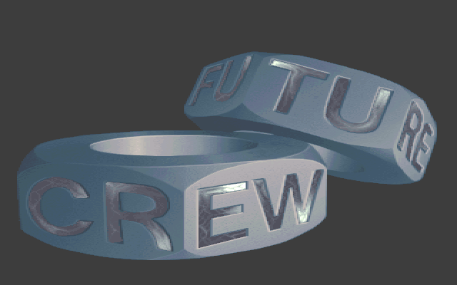

# ENDLOGO: the Future Crew logo, out of white and into black

ENDLOGO is the end picture. After [U2E](U2E)'s vector city, the screen turns white, and the
Future Crew logo (the words FUTURE and CREW carved into two chunky metal rings) fades in out of
that white. It holds until the music reaches its cue, then fades to black, and the credits in
[CRED](CRED) begin. In a full run it starts about nine minutes into the demo and lasts roughly nine
seconds. The upstream directory is `END/`, and the shell's part list labels it
`Endpictureflash (?)`. It is also where the loader's `SECOND 5` entry starts ("starts from the end
credits", see [Demo structure](Demo-structure)). The planning file `SCRIPT` lists the
"FC-logo (loppuun)" ("for the end") as a 320×400 picture by Marvel with code by PSI
([SCRIPT#L40](https://github.com/mtuomi/SecondReality/blob/071a82eddb7a7390dbaa491a8a473e0e923a55c2/SCRIPT#L40-L40)),
but its script section credits the end picture to Pixel
([SCRIPT#L172](https://github.com/mtuomi/SecondReality/blob/071a82eddb7a7390dbaa491a8a473e0e923a55c2/SCRIPT#L172-L172)).
The credit screen in CRED that shows this logo also names Pixel.

ENDLOGO is a near-copy of [BEGLOGO](BEGLOGO), the title card: the same `lineblit`, `setpalarea`
and `readp`, and the same fade from white. This page covers what ENDLOGO adds, which is a wait on
the music and a fade to black. The BEGLOGO page explains the shared pieces in more detail.

## What you see





## The trick

As in BEGLOGO, the picture is drawn once and does not move. From then on the part only changes
the palette. A VGA pixel is an 8-bit index into the DAC's table of 256 colours (see
[Hardware primer](Hardware-primer)), so rewriting the table changes every pixel on the screen at
once, without touching video memory.

The part has five steps.

1. **White out the DAC.** The part points the DAC's write index at 0 and sends 765 bytes of 63
   (full intensity): entries 0..254 become white. Entry 255 is never written. The part does not
   clear video memory, so the screen still holds whatever was there before. Under an all-white
   table, that does not matter: in a `SECOND 5` run it is the shell's cleared screen (all index 0),
   and in a full run it is U2E's last frame. Either way, the viewer sees white.
2. **Switch to 400 lines.** CRTC register 9 is read back, and its double-scan bit and its five
   "maximum scan line" bits are cleared, so each memory row is one scanline. On the unchained
   ("Mode X") screen the part inherits, with chain-4 off and four planes, that gives 320×400. The display start is set to 0, and the
   attribute controller's overscan register (`11h`) is set to 0, so the border shows entry 0,
   which is white for now.
3. **Wait, then draw unseen.** After 32 more vertical retraces, the part decodes the 400 rows of
   `PIC.UH` into video memory. Every index the picture uses (0..71) is white, so nothing visible
   happens.
4. **Fade in.** For `c` = 0..128, one step per vertical retrace, every channel becomes
   ```
   pal2[a] = ((128 − c) · 63 + palette[a] · c) / 128
   ```
   That is linear interpolation from white (63) at `c = 0` to the picture's own value at
   `c = 128`, in integer arithmetic with the weights summing to 128.
5. **Wait for the music, then fade out.** The part polls the music once a frame until the
   position passes a cue, and then runs 64 steps toward black:
   ```
   pal2[a] = (palette[a] · c) / 64        c = 63, 62, …, 0
   ```
   This is a plain scale, not the fade-in run backwards: the fade-in comes from white, the fadeout
   goes to black. Even its first step, `c = 63`, is a little darker than the held picture, because
   the division truncates (a channel of 63 becomes 62).

The timeline of a `SECOND 5` run, in frames of about 1/70 s:

```
tick   0        a blank
tick   1        DAC entries 0..254 white
tick   2-3      a blank, then the white written again
tick   4-35     32 blanks
tick  36        the picture is decoded into video memory (still white)
tick  37-46     still white (frames the code does not account for, see Quirks kept)
tick  47-175    129 steps of white -> picture
tick 176-...    wait for dis_musplus() > -16 (at most 5000 frames)
then  64 steps  picture -> black, and the part returns
```

### Waiting for the music

The hold is the only part of ENDLOGO whose length is not fixed by the code. The loop calls
`dis_musplus()` (see [Music](Music)) after each vertical retrace. When the music flags that a
marker is coming, that value is `row − 64`, clamped so it never drops below −32: it counts up
towards the marker at the end of the pattern. `> -16` is therefore "row 49 of that pattern or
later". In a `SECOND 5` run the shell has
restarted the music at order 25 just before the part starts, and the hold lasts 567 frames. In a
full run the music has kept playing since U2E, so the same cue comes sooner. The loop gives up
after 5000 frames, about 71 seconds, if the cue never arrives.

## How the original did it

`END/END.C` is 130 lines of Microsoft C over `END/ASM.ASM` and `END/READP.C`. Both are BEGLOGO's
line for line. After the register writes, the second white, the 32-blank wait and the blit
([END.C#L89-L99](https://github.com/mtuomi/SecondReality/blob/071a82eddb7a7390dbaa491a8a473e0e923a55c2/END/END.C#L89-L99)):

```c
	dis_waitb();
	outp(0x3c8,0);
	for(a=0;a<768-3;a++) outp(0x3c9,63);
	for(a=0;a<32;a++) dis_waitb();

	readp(palette,-1,pic);
	for(y=0;y<400;y++)
	{
		readp(rowbuf,y,pic);
		lineblit(vram+(unsigned)y*80U,rowbuf);
	}
```

`768-3` is 765 bytes, so the loop stops one entry short of 255. `lineblit` stores one row of 320
pixels as four passes of 80 bytes, one pass per plane, with the sequencer's map mask picking the
plane: in unchained memory, byte `y*80 + x/4` of plane `x & 3` holds pixel (x, y).

The fade-in, the music wait and the fadeout
([END.C#L101-L117](https://github.com/mtuomi/SecondReality/blob/071a82eddb7a7390dbaa491a8a473e0e923a55c2/END/END.C#L101-L117),
lines 101-111 shown):

```c
	for(c=0;c<=128;c++)
	{
		for(a=0;a<768-3;a++) pal2[a]=((128-c)*63+palette[a]*c)/128;
		dis_waitb();
		setpalarea(pal2,0,255);
	}
	for(a=0;a<5000 && !dis_exit();a++)
	{
		dis_waitb();
		if(dis_musplus()>-16) break;
	}
```

The fadeout (lines 112-117) is the same shape with `pal2[a]=(palette[a]*c)/64` and `c` counting
down from 63. After it, a text-mode epilogue that would have printed a short scroller ("Second
Reality has entirely been created by the Future Crew in 1993") is commented out, and `main()`
returns.

ENDLOGO sets no video mode of its own: its `int 10h` and `inittwk()` calls are commented out
(lines 64-66). For a `SECOND 5` run, the shell does it, after restarting the music. When U2E has
run (`whattorun & 8`), all of that is skipped and the parts run on the screen U2E left
([MAIN/U2.ASM#L900-L913](https://github.com/mtuomi/SecondReality/blob/071a82eddb7a7390dbaa491a8a473e0e923a55c2/MAIN/U2.ASM#L900-L913)):

```asm
        test    cs:whattorun,8
        jnz      @@skip6b
        mov     ax,0
        mov     bx,25
        mov     cx,45000
        call    restartmus
	mov	ax,13h
	int	10h
	call	inittwk
@@skip6b:
        mov     si,OFFSET exe2021
        call    partexecute
        mov     si,OFFSET exe22
        call    partexecute
```

`exe2021` is ENDLOGO and `exe22` is CRED.

`setpalarea(pal2,0,255)` has BEGLOGO's byte-count bug
([END/ASM.ASM#L106-L108](https://github.com/mtuomi/SecondReality/blob/071a82eddb7a7390dbaa491a8a473e0e923a55c2/END/ASM.ASM#L106-L108)):

```asm
	mov	cx,[bp+12]
	shl	cx,1
	add	cx,ax
```

That is `count*2 + start` bytes, not `count*3`: 510 bytes, which is entries 0..169 exactly. The
logo uses indices 0..71, so the fade looks right. Entries 170..254 stay white for the whole part,
and CRED inherits them.

## How the port does it

The part is
[`bins/secondreality/src/parts/endlogo.rs`](https://github.com/waffleking32/SecondRealityRust/blob/main/bins/secondreality/src/parts/endlogo.rs)
(`Endlogo`, registered as `endlogo`). The pieces it shares with BEGLOGO live in
[`parts/logo.rs`](https://github.com/waffleking32/SecondRealityRust/blob/main/bins/secondreality/src/parts/logo.rs):
`load_picture` decodes `assets/END/PIC.UH`, `set_400_line_view` stands in for the CRTC and
overscan writes, `blit` writes the decoded picture to the engine's chunky surface,
`white_to_picture` is the fade-in formula, and `setpalarea` copies the `2*count + start` upload.

One `dis_waitb()` is one engine tick. `Part::init` does the register writes that cost no frame and
refuses a run with no music player, because the part's hold has nothing else to wait on. Then
`Part::frame` runs a small state machine, `Phase`:

- `LeadIn` covers the blanks, the two white writes (`white_dac_tick`), the blit at tick 36 and the
  129 fade-in steps.
- `Gate` is the music loop: one iteration a tick, against the run's player (`ctx.music()`), with
  the 5000-iteration cap. The hold length is not stored anywhere in the part; the music decides
  it.
- `FadeOut` applies `fade_out_step` for `c` = 63 down to 0.
- `Done` returns `PartStatus::Finished`.

Two timing details come from matching the original's frames. The check reads the previous tick's
music position, because in the original the music is polled a fifth of a frame after the vertical
blank the part waits on. And the fadeout starts one tick after the break (`GATE_ALIGNMENT_TICKS`),
where the reference frames put it. The tick map, the derivation of the fade's start and end frames
and the alignment are in
[docs/fidelity/endlogo.md](https://github.com/waffleking32/SecondRealityRust/blob/main/docs/fidelity/endlogo.md).
[How the port works](How-the-port-works) describes the engine and the music seam the gate reads.

## Quirks kept

- `setpalarea` uploads `2*count + start` = 510 bytes, so entries 170..254 stay white
  ([bugs.md §4](https://github.com/waffleking32/SecondRealityRust/blob/main/docs/fidelity/bugs.md)).
- The white loop writes 765 bytes, so DAC entry 255 keeps whatever the previous part left, and
  video memory is never cleared
  ([bugs.md, index](https://github.com/waffleking32/SecondRealityRust/blob/main/docs/fidelity/bugs.md)).
- The original's fade-in starts ten frames later than the code accounts for; the port holds the
  white for those frames without modelling a cause
  ([APPROXIMATIONS.md A7](https://github.com/waffleking32/SecondRealityRust/blob/main/docs/fidelity/APPROXIMATIONS.md)).
- The fadeout begins one tick after the music check breaks, to match the reference frames
  ([APPROXIMATIONS.md A7](https://github.com/waffleking32/SecondRealityRust/blob/main/docs/fidelity/APPROXIMATIONS.md),
  [endlogo.md §5.2](https://github.com/waffleking32/SecondRealityRust/blob/main/docs/fidelity/endlogo.md)).
- The `!dis_exit()` half of the wait is the shell's ESC handling, not the part's
  ([endlogo.md §5](https://github.com/waffleking32/SecondRealityRust/blob/main/docs/fidelity/endlogo.md)).

---

**Previous:** [DDSTARS](DDSTARS) · **Next:** [CRED](CRED)
