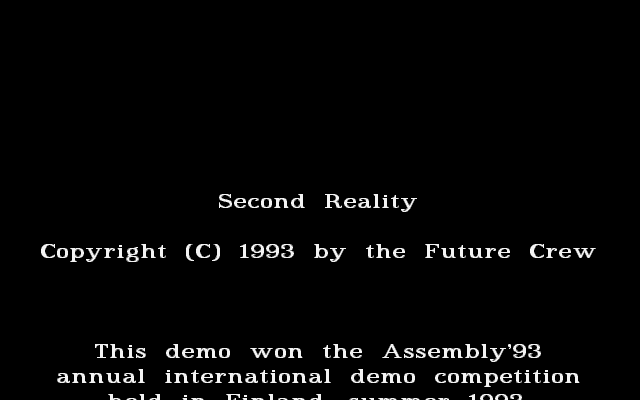
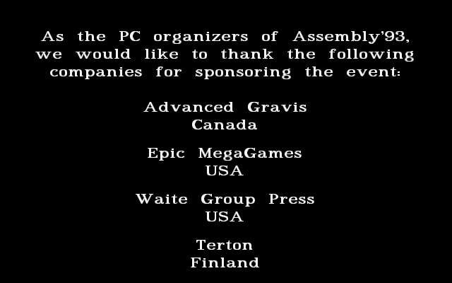
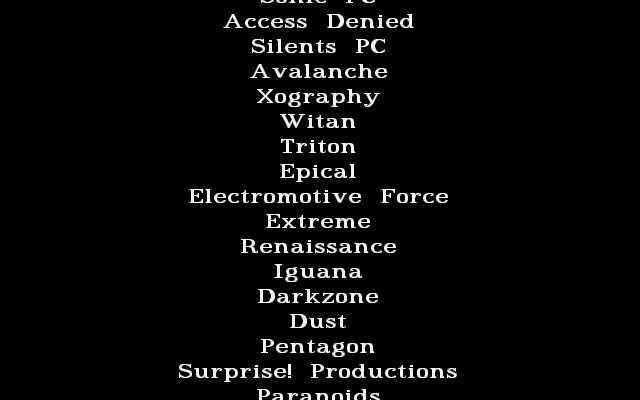

# ENDSCRL: the greetings scroller

ENDSCRL is the last part of the demo: white-on-black text on a 640×400 screen, scrolling
smoothly upwards one scanline at a time. It gives the copyright, thanks the Assembly '93
sponsors, explains how to contact Future Crew, and then greets a long list of other groups. It
follows [CRED](CRED)'s last credit screen about eleven minutes into the demo and scrolls for about five and a half
minutes, until a marker line in the text ends it and the shell closes the demo. With looping
switched on in the setup screen, the shell skips it. The upstream directory is `ENDSCRL/`, and the
shell's part list labels it `Credits/Greetings scrl. (?)`. The planning file `SCRIPT` leaves the
"EndScroller" coder as `?` and imagines something else: a 320×400 256-colour scroller in which
"the small pictures from the credits scroll"
([SCRIPT#L174-L178](https://github.com/mtuomi/SecondReality/blob/071a82eddb7a7390dbaa491a8a473e0e923a55c2/SCRIPT#L174-L178)).
Its picture list credits the end-scroller font to Marvel
([SCRIPT#L37](https://github.com/mtuomi/SecondReality/blob/071a82eddb7a7390dbaa491a8a473e0e923a55c2/SCRIPT#L37-L37)).

## What you see







## The trick

A scroller has to move 400 lines of text up by one line every step. Copying the whole screen up
by one line would mean moving all four planes, 128,000 bytes, every step. ENDSCRL never moves
anything in video memory. Each step it draws **one new scanline**
at the bottom and moves the CRTC's **display start** down by one line, so the screen shows a
window that slides through memory.

### A ring with a second copy

The screen is 16-colour planar: four planes of 80 bytes per line, one bit per pixel in each.
The part keeps a ring of 401 lines, and each new line is written **twice**: at ring line
`yscrl` and again 401 lines further on, at `yscrl + 401`. The display start is then set to line
`yscrl + 1`, after `yscrl` has been advanced:

```
memory line:  0 ............ 400 | 401 ........... 801
              first copy           second copy of 0..400

window (400 lines) after writing ring line w (w < 400):
              starts at w+2 ---------------------> ends at w+401 (the copy just written)
after writing w = 400, yscrl wraps to 0 and the window is lines 1..400
```

Wherever the window starts in the first copy, its 400 lines are contiguous in memory: the lines
past 400 are the second copies of the ring's start. The newest line is always the bottom row. No
CRTC wrap-around is needed, and 802 lines of 80 bytes (64,160 bytes) fit in each plane's 64 KB.

### Drawing a line one scanline at a time

The text is never rendered as whole characters. A text line is `FONT_ROWS` scanlines tall (25 in
the shipped program), and the part keeps a counter `line` for the scanline within it. Each step:

1. If `line` is 0, read the next text line up to its newline, sum the widths of its characters
   (`fonaw[c] + 2` each, for a two-pixel gap), and centre it: `tstart = (639 − width) / 2`.
2. Clear a four-plane, one-line buffer (`scanbuf`, 4 × 80 bytes).
3. Walk the characters from `tstart`. For each pixel column `b` of each character, take font
   row `line` at column `fonap[c] + b`, and set the pixel's bit in each plane whose bit is set in
   the font value. The bit within the byte is `mtau[x & 7]`, `128 >> (x & 7)`, so the leftmost
   pixel of a byte is its top bit.
4. Copy each plane's 80 bytes to the two ring positions, selecting the plane with the
   sequencer's [map mask](Hardware-primer).
5. Advance the ring, advance `line`, and set the display start.

The font's values are 0..3, and the palette makes entry 1 a dark grey (20), entry 2 a mid grey
(40) and entries 3..15 near-white (60). The glyphs' edges are drawn in the darker greys, which
is why the text looks smooth at 640×400.

### The font: a strip and a scan

As in CRED, the font is a single long strip (1,550 columns in the shipped program), and the code
finds its glyphs by scanning. A run of columns with ink in any of the scanned rows is the next
character of `fonaorder` ("ABCDEFGHIJKLMNOPQRSTUVWX", the lower case, the digits, punctuation and
a few more), so each character gets its own width. The space is a fixed 16-column blank.

### Pace

The main loop is `if(dis_waitb()==1) dis_waitb(); do_scroll();`. Inside the demo, `dis_waitb()`
returns the number of frames that have passed since it was last called. If only one has, the loop
waits for a second frame. The scroll therefore moves one scanline every two frames, 35 lines a
second, and a 25-row text line passes in about 0.7 seconds. A step that overran a frame would
skip the second wait.

### Control lines and the end

The shipped program reads two kinds of special line in the text:

- A line starting with `[` draws nothing and lasts its own count of rows, the next two
  characters read as a decimal number: `[15` is a 15-row gap. Ordinary lines, including empty
  ones, last 25 rows.
- A line starting with `%` ends the part: the step that reads it draws it and calls `exit(0)`.

The shipped text has its `%` at line 537 of 542, so the part ends by itself after 22,967 frames.

## How the original did it

The tree's `ENDSCRL/MAIN.C` is an earlier version of the shipped program. It has the same
structure, but with a 30-row line, a 1,500-column font, no control lines and no `%` exit; the
shipped build's differences are listed in
[endscrl.md §1](https://github.com/waffleking32/SecondRealityRust/blob/main/docs/fidelity/endscrl.md).
The excerpts below are the tree's.

The set-up and the loop
([MAIN.C#L19-L27](https://github.com/mtuomi/SecondReality/blob/071a82eddb7a7390dbaa491a8a473e0e923a55c2/ENDSCRL/MAIN.C#L19-L27)).
Mode `0Eh` is a 640-pixel 16-colour mode whose rows are shown twice. Writing 0 to CRTC register
9 stops that, giving 400 distinct lines (the comment's "640x350" is not what the mode is):

```c
main()  {
	dis_partstart();
	dis_waitb();
	asm	mov	ax, 0eh
	asm   	int 	10h	      	// 640x350 16c
	asm	mov	ax, 9h
	asm	mov	dx, 3d4h
	asm	out	dx, ax
	setrgbpalette(1,20,20,20);
```

Reading and centring the next text line
([MAIN.C#L66-L74](https://github.com/mtuomi/SecondReality/blob/071a82eddb7a7390dbaa491a8a473e0e923a55c2/ENDSCRL/MAIN.C#L66-L74)):

```c
	if(line==0)
		{
		for(a=0,tstart=0,chars=0;*tptr!='\n';a++,chars++)
			{
			textline[a]=*tptr;
			tstart+=fonaw[*tptr++]+2;
			}
		textline[a]=*tptr++; tstart=(639-tstart)/2;
		}
```

Rendering one scanline into the four plane buffers
([MAIN.C#L77-L88](https://github.com/mtuomi/SecondReality/blob/071a82eddb7a7390dbaa491a8a473e0e923a55c2/ENDSCRL/MAIN.C#L77-L88)).
The buffer starts cleared, so the `^=` sets the bit:

```c
	for(a=0,x=tstart;a<chars;a++,x+=2) for(b=0;b<fonaw[textline[a]];b++,x++)
		{
		m=mtau[x&7];
		if(font[line][fonap[textline[a]]+b]&1)
			scanbuf[0][x/8]^=m;
		if(font[line][fonap[textline[a]]+b]&2)
			scanbuf[1][x/8]^=m;
		if(font[line][fonap[textline[a]]+b]&4)
			scanbuf[2][x/8]^=m;
		if(font[line][fonap[textline[a]]+b]&8)
			scanbuf[3][x/8]^=m;
		}
```

Writing the line twice, plane by plane, and moving the window
([MAIN.C#L89-L95](https://github.com/mtuomi/SecondReality/blob/071a82eddb7a7390dbaa491a8a473e0e923a55c2/ENDSCRL/MAIN.C#L89-L95)).
`outport(0x3c4,0x0102)` selects plane 0 through the map mask, `0x0202` plane 1, and so on;
`setstart` (in `ASMYT.ASM`) writes CRTC registers `0Ch` and `0Dh`:

```c
	outport(0x3c4,0x0102); memcpy(MK_FP(0x0a000,80*yscrl),scanbuf[0],80); memcpy(MK_FP(0x0a000,80*(yscrl+401)),scanbuf[0],80);
	outport(0x3c4,0x0202); memcpy(MK_FP(0x0a000,80*yscrl),scanbuf[1],80); memcpy(MK_FP(0x0a000,80*(yscrl+401)),scanbuf[1],80);
	outport(0x3c4,0x0402); memcpy(MK_FP(0x0a000,80*yscrl),scanbuf[2],80); memcpy(MK_FP(0x0a000,80*(yscrl+401)),scanbuf[2],80);
	outport(0x3c4,0x0802); memcpy(MK_FP(0x0a000,80*yscrl),scanbuf[3],80); memcpy(MK_FP(0x0a000,80*(yscrl+401)),scanbuf[3],80);
	yscrl=(yscrl+1)%401;
	line=(line+1)%FONAY;
	setstart(yscrl*80+80*1);
```

The text is read from `endscrol.txt` by `open` and `read`
([MAIN.C#L101](https://github.com/mtuomi/SecondReality/blob/071a82eddb7a7390dbaa491a8a473e0e923a55c2/ENDSCRL/MAIN.C#L101-L101)).
In the demo the shell serves that file from its packed data: it is `MAIN/DATA/ENDSCROL.TXT`, not
the short test text beside the source. `open` is not given `O_BINARY`, so Borland's runtime reads
in text mode and drops the carriage returns, and the lines end in a bare `\n`.

## How the port does it

The part is
[`bins/secondreality/src/parts/endscrl.rs`](https://github.com/waffleking32/SecondRealityRust/blob/main/bins/secondreality/src/parts/endscrl.rs)
(`Endscrl`, registered as `endscrl`). It ports the shipped program, not the tree's: `init` unpacks
`assets/MAIN/DATA/ENDSCRL.EXE` and reads the font raster and `fonaorder` from the image, and
`Strip::scan` is the image's glyph scan. `read_text_mode` is Borland's text-mode `read`, and
`line_rows` gives a line's height, including the control lines' counts.

- `read_line`, `render_line` and `do_scroll` are the source's steps. `render_line` builds the four
  plane buffers with the same `mtau` bits, then folds them back into one 4-bit value per pixel,
  because the engine's surface is chunky.
- The engine's beam wraps around the end of its surface (400 lines of 640 pixels), so the port
  writes each line once into a 400-line ring. The second copy exists only because the VGA's
  address does not wrap; a test checks that both rings show the same 400 rows at every step of a 500-line run.
- `Part::frame` maps the ticks: tick 0 still shows CRED's screen, tick 1 sets the mode and the
  greys (`enter_mode`), and `do_scroll` runs on ticks 3, 5, 7…. The part returns
  `PartStatus::Finished` on the step that reads the `%` line.

The part registers no copper callbacks, because the original installs none. The tick map, the
text and the frame comparison are in
[docs/fidelity/endscrl.md](https://github.com/waffleking32/SecondRealityRust/blob/main/docs/fidelity/endscrl.md).
[Demo structure](Demo-structure) describes what the shell does after the last part.

## Quirks kept

- A control line's count is read as two characters, so `[8` uses its newline as the second digit
  and lasts 8·10 + 10 − 48 = 42 rows, not 8
  ([endscrl.md §3](https://github.com/waffleking32/SecondRealityRust/blob/main/docs/fidelity/endscrl.md)).
- The line reader would run past the 64,000-byte text array if the text had no `%` line; the
  shipped text has one, so it never does
  ([bugs.md, index](https://github.com/waffleking32/SecondRealityRust/blob/main/docs/fidelity/bugs.md)).
- In a `SECOND 5` run the port starts the part 82 frames earlier than the original, because the
  original's CRED takes longer to draw its screens
  ([APPROXIMATIONS.md A11](https://github.com/waffleking32/SecondRealityRust/blob/main/docs/fidelity/APPROXIMATIONS.md)).

---

**Previous:** [CRED](CRED) · **Next:** [The Vault](The-Vault)
