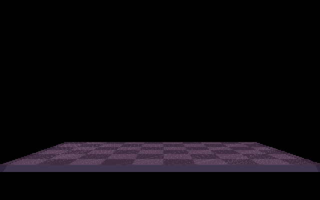
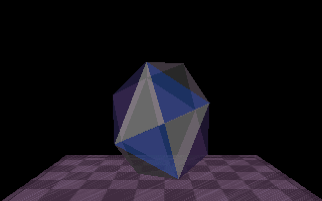
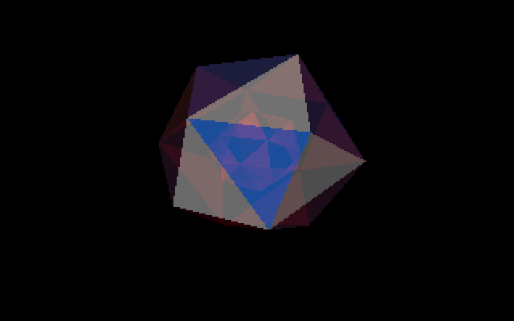
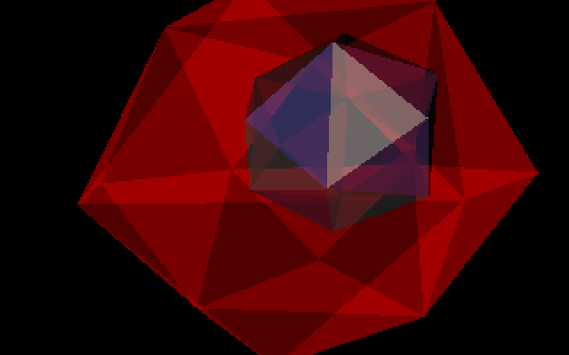

# GLENZ: see-through polyhedra

GLENZ is the "glenz vector" part. A faceted, glassy solid drops onto a checkered plate, bounces
and wobbles like jelly, and spins. Then the plate goes away, and a second, red glass solid grows
around the first one. Through every face you can see whatever lies behind it. GLENZ follows
[BEGLOGO](BEGLOGO) and holds BEGLOGO's title picture while it waits for the music. It starts about
1:55 into a full run (boot frame 8,057) and plays until a music cue hands over to
[TUNNELI](TUNNELI), about 2:39 in. The demo's part list credits it as
[`Glenz (PSI)`](https://github.com/mtuomi/SecondReality/blob/071a82eddb7a7390dbaa491a8a473e0e923a55c2/MAIN/PARTS#L4-L4),
and the code is in `GLENZ/`, which has its own vector library separate from the one the
[U2A](U2A)/[U2E](U2E) engine uses.

## What you see









## The part, in order

1. **Wait for the music.** The title picture stays on screen until `dis_musplus()` reaches −19.
2. **The wipe** (`zoomer2`). On BEGLOGO's 400-line screen, black bands of index 255 close in, one
   down from the top and one up from the bottom. The first 128 palette entries fade toward grey.
   After 47 frames only a thin strip, rows 261..273, is left. Then everything is cleared.
3. **The plate.** The part switches to [Mode 13h](Hardware-primer) (320×200). The top 100 rows of the plate picture
   `FC.UH`, a checker floor drawn in perspective, are stretched over the band from row `130 + y/2`
   to row `130 + 3y/2`, with eight rows of the plate's front edge under it. `y` falls under
   gravity (its speed `ya` grows by one every frame); when it passes 48 it bounces back at
   two-thirds of its speed (`ya = -ya*2/3`), and it stops once that speed is under 4. That takes
   177 frames.
4. **Snapshot.** Once the music's frame counter reaches 300, the finished screen is copied into
   `bgpic`, the background every later frame is painted over.
5. **The main loop**, one step per vertical retrace. The first solid drops in from above under
   gravity (`yposa += 31`) and rebounds off the floor height. Its x/y/z scale is driven by a damped
   spring (`jello`), which squashes it on each landing. Frames 701..764 fade the plate's 16 colours
   to black. Frames 765..789 erase it, two rows per frame, and rebuild the low 16 palette entries
   for the red solid (on frames 786..789). From frame 803 the red solid's scale `bscale` grows to 180, larger than the
   first, and both spin and drift on `sin1024` paths. Near frame 2010 everything shrinks, and
   frames 2070..2133 fade to black.

## The trick

A polygon filler that only writes "colour N" gives you opaque faces. Glenz faces look like tinted
glass. They take the colour of what is behind them, and you can see the back faces through the
front ones. GLENZ gets this from three cooperating ideas. None of them blends any pixels.

### 1. Split the pixel byte into bit fields

A pixel is an 8-bit palette index. GLENZ reads it as fields:

```
 bit:  7 6 5 4 | 3 2 1 0
       face    | background / back faces / red solid
       group   |
```

- The **background** (`bgpic`) uses only indices 0..15, the low nibble.
- A **front face** of the first solid gets a group number in the high nibble: index `16·k`.
- A **back face** of the first solid contributes bit 2 (value 4) on every other face (those whose
  colour word has bit 1 set), and 0 on the rest.
- The **red solid** uses only bits 0..2: its front faces are 0 or 1, its back faces keep their
  table colour, 2 or 4.

A pixel's final index is the **XOR of every polygon that covers it, ORed with the background**:

```
index = (colour(poly1) XOR colour(poly2) XOR …) | bgpic[pixel]
```

The fields hardly overlap, so this simply packs "which front face, which back faces, which part of
the red solid, which background colour" into one byte.

### 2. Make the palette do the blending

Each front face gets a **group of 16 DAC entries**, `16k .. 16k+15`. Entry `16k + j` is set to the
face's own colour plus a quarter of whatever colour the low nibble `j` would show alone:

```
DAC[16k + j] = clamp63( face_rgb + backpal[j] / 4 )
```

So the 16 entries are the face's tint over each of the 16 possible things behind it. When the
compositor ORs a face group onto a background pixel, the DAC shows "glass over this colour" with no
arithmetic per pixel. There are 15 groups (even slots 2..30, i.e. indices 16..240), and a face only
keeps a group while it faces the camera. A face that turns away gives its group back for the next
face that turns forward. A convex solid of 24 faces never shows more than about half of them, so
15 is enough.

The low 16 entries hold the background colours while the plate is there. After the plate is
erased, they hold a bit-weighted red palette (`bit0 +10 red`, `bit1 +30`, `bit2 +20`,
`bit3 +16 grey`). Overlapping red front and back faces then add up to different shades of red, and
the first solid's groups tint whatever red is behind them.

### 3. Fill by XOR toggling along the whole screen

The filler (`NEW.ASM`) never draws a polygon by itself. It collects the edges of every polygon in
the frame, then walks the 200 rows. At each live edge it emits a **boundary**: a screen position
`y·320 + x` together with that polygon's colour. All the boundaries go into one list sorted by
position. Painting walks the list with a running colour: at each boundary,
`running ^= boundary.colour`, and every pixel up to the next boundary gets `running | bgpic`.

A convex polygon's left edge XORs its colour in and its right edge XORs it back out. Where two
polygons overlap, both colours are in the running value, which is exactly the XOR in idea 1. Depth
sorting, clipping one face against another and per-pixel tests all become unnecessary.

### Lighting, back faces, projection

For each projected triangle, `checkhiddenbx` computes the 2-D cross product

```
cross = (x0−x1)(y0−y2) − (y0−y1)(x0−x2)
```

which is twice the triangle's signed screen area. A negative value means the face points away from
the camera (a back face). A positive value is also used as the **brightness**: `cross >> 7`,
clamped to 0..63. A face seen head-on covers more screen than the same face seen edge-on, so area
is a cheap stand-in for "how directly it faces the viewer". Once the red solid outgrows the first,
`lightshift` changes this to `cross/256 + cross/512`, three quarters as bright. Bit 1 of a face's
colour word chooses a blue tint (R small, G = shade/2, B = shade) or a grey one (R = G = B = shade).
That is why the first solid alternates blue and white facets.

Both solids are the same shape: a cube whose six faces each carry a low pyramid. That gives 14
vertices (8 corners and 6 apexes at 1.7 or 1.75 times the half-edge) and 24 triangles. Rotation
uses a 3×3 matrix of 16-bit fixed-point words, where 1.0 = 32768: each output coordinate is the sum
of three 64-bit products, shifted right by 15.
Angles are in tenths of a degree, from a 900-word sine quarter that reads on into a 3,600-word
cosine table. Projection is a 1/z divide with aspect correction:

```
sx = 160 + 256·x / z        sy = 130 + 213·y / z       (z clamped to ≥ 128)
```

213/256 ≈ 0.83, roughly the 5:6 squeeze that makes 320×200 pixels square up on a 4:3 monitor.
While the first solid is falling, `ccliplist` clamps every vertex's y to the floor height, so the
solid flattens against the floor when it lands.

## How the original did it

`GLENZ/MAIN.C` drives everything: the physics, the palette phases and the calls into `VEC.ASM`
(the matrix, projection, polygon lists and colour rules) and `NEW.ASM` (the compositor). Here is
the plate's bounce, which stretches the 100 picture rows across the current band with a
fixed-point step `b = 25600/(y2−y1)` (a row step in 1/256ths):

```c
        y=yy/16;
        y1=130+y/2;
        y2=130+y*3/2;
        if(y2!=y1) b=25600/(y2-y1);
        pd=vram+(y1-4)*320; pdy=y1;
        for(ry=y1-4;ry<y1;ry++,pd+=320)
        {
            if(ry>199) continue;
            memset(pd,0,320);
        }
        for(c=0,ry=y1;ry<y2;ry++,pd+=320,c+=b)
        {
            if(ry>199) continue;
            memcpy(pd,fcrow[c/256],320);
        }
```
[GLENZ/MAIN.C#L329-L343](https://github.com/mtuomi/SecondReality/blob/071a82eddb7a7390dbaa491a8a473e0e923a55c2/GLENZ/MAIN.C#L329-L343)

When a face becomes visible, `demo_glz` finds it a group. `rolcol` maps the face to its slot, and
`rolused` records which of the 15 even slots are taken:

```asm
	movzx	bx,es:[bx-2]
	mov	al,cs:rolcol[bx]
	cmp	al,0
	jne	@@rc1
	mov	cx,15
	mov	bp,2
@@rc3:	cmp	cs:rolused[bp],0
	je	@@rc4
	add	bp,2
	loop	@@rc3
@@rc4:	mov	ax,bp
@@rc2:	mov	cs:rolcol[bx],al
	mov	cs:rolused[bp],1
```
[GLENZ/VEC.ASM#L450-L462](https://github.com/mtuomi/SecondReality/blob/071a82eddb7a7390dbaa491a8a473e0e923a55c2/GLENZ/VEC.ASM#L450-L462)

Then, every frame and for every visible face, it writes the group's 16 entries, adding a quarter
of each background colour to the face's shaded colour (`setpalxxx` clamps each channel to 63 and
outputs it):

```asm
	zzz=0
	REPT	16
	mov	al,cs:_backpal[zzz*3+0]
	shr	al,2
	add	cl,al
	mov	al,cs:_backpal[zzz*3+1]
	shr	al,2
	add	bl,al
	mov	al,cs:_backpal[zzz*3+2]
	shr	al,2
	add	bh,al
	setpalxxx
```
[GLENZ/VEC.ASM#L486-L497](https://github.com/mtuomi/SecondReality/blob/071a82eddb7a7390dbaa491a8a473e0e923a55c2/GLENZ/VEC.ASM#L486-L497)

The compositor's span fill is the `| bgpic` step. `fs` points at the background, `es` at the
screen:

```asm
fillmacro MACRO
	local	l1,l2
	jcxz	l2
	push	ax
l1:	mov	ah,al
	or	ah,fs:[di]
	mov	es:[di],ah
	inc	di
	loop	l1
	pop	ax
l2:	ENDM
```
[GLENZ/NEW.ASM#L54-L64](https://github.com/mtuomi/SecondReality/blob/071a82eddb7a7390dbaa491a8a473e0e923a55c2/GLENZ/NEW.ASM#L54-L64)

And this is the toggle. After filling up to a boundary, the running colour `al` is XORed with that
boundary's colour (the high word of the boundary record):

```asm
	fillmacro
	pop	cx
@@31:	mov	di,cx
	shr	ecx,16
	xor	al,cl
	mov	ecx,ds:[si]
	add	si,4
	jmp	@@21
```
[GLENZ/NEW.ASM#L97-L104](https://github.com/mtuomi/SecondReality/blob/071a82eddb7a7390dbaa491a8a473e0e923a55c2/GLENZ/NEW.ASM#L97-L104)

`ng_pass3` actually walks two lists, this frame's and the previous frame's, and only repaints spans
whose colour changed, which saves video-memory writes.

## How the port does it

The module is
[`bins/secondreality/src/parts/glenz/`](https://github.com/waffleking32/SecondRealityRust/blob/main/bins/secondreality/src/parts/glenz/mod.rs),
split the way the original is:

- [`mod.rs`](https://github.com/waffleking32/SecondRealityRust/blob/main/bins/secondreality/src/parts/glenz/mod.rs):
  `Glenz` (the `Part`), its `Phase` state machine (music wait, zoomer, bounce, the two music-frame
  waits, main loop) and `MainState::step`, the main loop's physics and palette phases in 16-bit
  `i16` arithmetic. It keeps the original's two buffers, `vram` and `bgpic`, and copies `vram` to
  the engine surface every tick.
- [`intro.rs`](https://github.com/waffleking32/SecondRealityRust/blob/main/bins/secondreality/src/parts/glenz/intro.rs):
  `Zoomer` (the wipe) and `Bounce` (the plate).
- [`math.rs`](https://github.com/waffleking32/SecondRealityRust/blob/main/bins/secondreality/src/parts/glenz/math.rs)
  and [`tables.rs`](https://github.com/waffleking32/SecondRealityRust/blob/main/bins/secondreality/src/parts/glenz/tables.rs):
  `matrix_yxz`, `rotate`, `project` (with the `INIT_320X200` constants) and `clip_y`, keeping the
  original's register widths. `tables.rs` parses the vendored `MATHSIN.INC` in a test and checks
  every word.
- [`poly.rs`](https://github.com/waffleking32/SecondRealityRust/blob/main/bins/secondreality/src/parts/glenz/poly.rs):
  `build` (the `ceasypolylist` walk and the cross product) and `ColourState::face` (the two colour
  rules and the group allocator).
- [`span.rs`](https://github.com/waffleking32/SecondRealityRust/blob/main/bins/secondreality/src/parts/glenz/span.rs):
  `Compositor`, with `clear`, `add` and `paint` matching `cglenzinit`, `cglenzpolylist` and
  `cglenzdone`.

One engine tick is one `dis_waitb`. The original's copper callback only re-uploads palette entries
0..15 every retrace. The port does that upload once per tick, and the face groups are written as
they are allocated, so the DAC is the same when each frame is composed. The fidelity note
[`docs/fidelity/glenz.md`](https://github.com/waffleking32/SecondRealityRust/blob/main/docs/fidelity/glenz.md)
has the timeline, the measured music waits and the reference comparisons.

## Quirks kept

- `int` is 16 bits: `-yposa*boingm/boingd` and `oyp -= b*b/2` overflow and wrap, and the
  animation depends on it
  ([bugs.md §23](https://github.com/waffleking32/SecondRealityRust/blob/main/docs/fidelity/bugs.md)).
- The palette is uploaded before the new one is computed, so each frame shows the previous frame's
  `pal` ([bugs.md §23](https://github.com/waffleking32/SecondRealityRust/blob/main/docs/fidelity/bugs.md)).
- The compositor clamps boundaries to columns 1..319. Its same-x merge compares the wrong register
  and never fires. A freshly allocated group is shaded 0 on its first frame. Pixel 63,999 is never
  painted
  ([bugs.md §5](https://github.com/waffleking32/SecondRealityRust/blob/main/docs/fidelity/bugs.md)).
- The source keys the visible path by the full colour word, but the release's frames show the low
  byte, so the port uses the low byte
  ([APPROXIMATIONS.md A37](https://github.com/waffleking32/SecondRealityRust/blob/main/docs/fidelity/APPROXIMATIONS.md)).
- The port repaints every span over `bgpic` instead of walking the previous frame's list, with
  identical pixels
  ([APPROXIMATIONS.md A39](https://github.com/waffleking32/SecondRealityRust/blob/main/docs/fidelity/APPROXIMATIONS.md)).
- The main loop's phase against the music is a few ticks off the reference capture
  ([APPROXIMATIONS.md A36](https://github.com/waffleking32/SecondRealityRust/blob/main/docs/fidelity/APPROXIMATIONS.md),
  [A38](https://github.com/waffleking32/SecondRealityRust/blob/main/docs/fidelity/APPROXIMATIONS.md)).

---

**Previous:** [BEGLOGO](BEGLOGO) · **Next:** [TUNNELI](TUNNELI)
