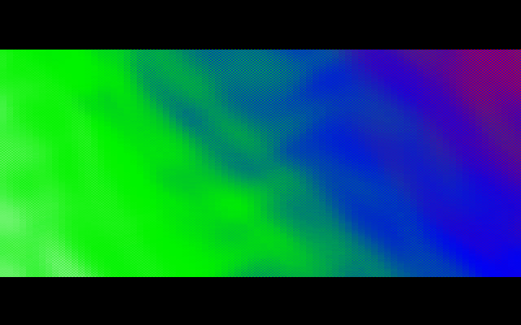
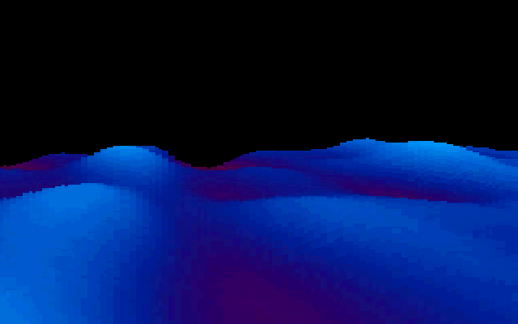
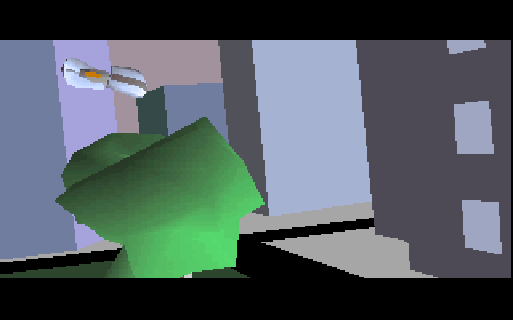

# Second Reality, in Rust

**Second Reality** is the demo the Finnish group **Future Crew** released at **Assembly '93**,
where it won the PC demo competition. It runs for about sixteen minutes on a DOS PC with a VGA
card and a Sound Blaster or Gravis UltraSound. It plays two Scream Tracker 3 modules, and its
two dozen effects are cut to the music: an intro over a horizon, a translucent "glenz" polyhedron,
a dot tunnel, a plasma that falls off the screen, a rolling sine-field landscape, a flight through a polygon
city and a long greetings scroller. In 2013 the group published the complete source tree in the
public domain. It is vendored in this repository at
[`upstream/SecondReality`](https://github.com/mtuomi/SecondReality/tree/071a82eddb7a7390dbaa491a8a473e0e923a55c2).

**This port** is a native Rust program that plays the whole demo. It treats the original source
as the specification. Each effect's fixed-point maths, lookup tables and rounding are translated
routine by routine, and so are the original's bugs. The two music modules play through a
transcription of the demo's own player and mixer. The port reads the original data files in their
own formats. It is checked frame by frame against captures of the original 1993 release running
in an emulator, and every place where it still differs is measured and recorded.

## Getting it and running it

- **Prebuilt packages** for Windows x64, Linux x64 and macOS (Apple Silicon) are on the
  [Releases](https://github.com/waffleking32/SecondRealityRust/releases) page. Each one's readme
  says how to start it.
- **Building it yourself** needs a Rust toolchain, CMake and a C compiler (SDL 2 is compiled in).
  The [README](https://github.com/waffleking32/SecondRealityRust/blob/main/README.md) lists the
  Linux packages and every flag. Run it from the repository root:
  `cargo run --release --bin secondreality`.
- A settings screen opens first and stands in for the original's sound-card setup. **ESC** ends
  the part that is playing, and **Ctrl** skips it. `--block 1`..`5` starts at the same places as
  the original's `SECOND 1`..`5`. `--block U` plays the hidden part, `--part glenz` plays one part
  on its own, and `--vault` plays three effects that never shipped.

## Reading order

Start with the background pages. Then read the parts in the order the demo plays them.

**Background**

1. [Hardware primer](Hardware-primer): Mode 13h and Mode X, the 6-bit palette, retrace and the
   "copper", split screens, panning and page flipping. Every part page assumes it.
2. [Demo structure](Demo-structure): how `SECOND.EXE` runs its parts, the blocks, and how the music
   decides when a part ends.
3. [Music](Music): the two modules, the scrambled patterns, and the player's clock that every part
   synchronises to.
4. [How the port works](How-the-port-works): the crates, the `Part` trait, the emulated copper and
   the 70.086 Hz clock.
5. [How it is verified](How-it-is-verified): the emulator oracle, the reference frames, and the
   registers of kept bugs and measured approximations.

**The parts, in running order**

| # | Part | What it is |
|---|---|---|
| 1 | [ALKU](ALKU) | the opening credits over a panning horizon |
| 2 | [U2A](U2A) | the first vector scene: the landing pad and the saucer |
| 3 | [PAM](PAM) | the explosion animation |
| 4 | [BEGLOGO](BEGLOGO) | the title picture, fading in from white |
| 5 | [GLENZ](GLENZ) | translucent "glenz" polyhedra |
| 6 | [TUNNELI](TUNNELI) | the dot tunnel |
| 7 | [TECHNO](TECHNO) | the techno bars and their interference |
| 8 | [PANICEND](PANICEND) | the fake ending: the screen collapses to a dot |
| 9 | [MNTSCRL](MNTSCRL) | the landscape scroller |
| 10 | [LNS&ZOOM](LNS-ZOOM) | the lens and the rotozoomer |
| 11 | [PLZPART](PLZPART) | the plasma and the plasma cube |
| 12 | [MINVBALL](MINVBALL) | dot figures and their shadows on a floor |
| 13 | [RAYSCRL](RAYSCRL) | the mirror-ball scroller |
| 14 | [3DSINFLD](3DSINFLD) | the ray-marched sine-field landscape |
| 15 | [JPLOGO](JPLOGO) | the wobbling jelly logo |
| 16 | [U2E](U2E) | the city flight, the second vector part |
| — | [DDSTARS](DDSTARS) | the hidden part, `SECOND U` only |
| 17 | [ENDLOGO](ENDLOGO) | the end picture |
| 18 | [CRED](CRED) | the credits |
| 19 | [ENDSCRL](ENDSCRL) | the greetings scroller |

**Beyond the release**

- [The Vault](The-Vault): GRID, HARD and TWIST, three development effects that are in the source
  tree but not in the demo.

## Where the details live

This wiki explains how each effect works. The repository holds the evidence:

- [`docs/design.md`](https://github.com/waffleking32/SecondRealityRust/blob/main/docs/design.md):
  the architecture.
- [`docs/fidelity/`](https://github.com/waffleking32/SecondRealityRust/tree/main/docs/fidelity):
  one note per part, with its keyframes and measurements.
- [`docs/fidelity/bugs.md`](https://github.com/waffleking32/SecondRealityRust/blob/main/docs/fidelity/bugs.md):
  the original's bugs that the port keeps.
- [`docs/fidelity/APPROXIMATIONS.md`](https://github.com/waffleking32/SecondRealityRust/blob/main/docs/fidelity/APPROXIMATIONS.md):
  every place where the port knowingly differs, with the measured difference.

The port is MIT licensed. The original source and the demo's media are public domain under the
Unlicense.
