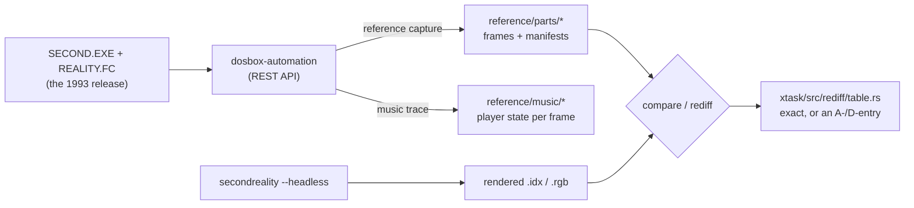

# How it is verified

The port's aim is to be **pixel-identical** to the 1993 release, not to look like it. Checking
that needs something to compare against. Here that is the original `SECOND.EXE` running in an
instrumented emulator, from which reference frames are captured and filed in the repository. Every
part's frames are re-rendered and compared against those references on every change. Where the
port is not identical, the difference is counted to the pixel and recorded, with its reason. This
page describes the pieces.



## The oracle: the original, in an emulator

The reference is **dosbox-automation**, a DOSBox fork with a REST API. It runs the distributed
release (`reference/original/SECOND.EXE` and `REALITY.FC`), not a build of the vendored source,
because the two differ in places. The port's tooling drives it from
[`xtask/src/oracle/`](https://github.com/waffleking32/SecondRealityRust/tree/main/xtask/src/oracle),
behind a trait so that the rest of the tooling does not depend on one emulator. The API calls
that matter:

- `GET /api/v1/video/frame?format=raw`: the current frame as BGRX pixels. This endpoint never
  returns palette indices.
- `GET /api/v1/memory/{segment}/{offset}/{len}`: guest memory. With chain-4 off, each of the four
  planes is read separately (the graphics controller's read map select picks one), so the capture
  can rebuild the frame's **indices**: `idx(x,y) = plane[x % 4][y*stride + x/4]`, with the stride
  taken from CRTC `13h` (80 bytes for a plain 320-pixel screen). A screen too big for that read,
  such as [ALKU](ALKU)'s 176-byte rows, is filed as RGB only.
- `PUT`/`GET /api/v1/io/port`: the DAC, read entry by entry through `3C7h` and `3C9h`, so a frame's
  palette is known exactly, at 6 bits.
- `/api/v1/input/...`: key presses.

The recipe that makes captures reproducible took effort to find. The guest types its own keys at
boot to get past the setup screen and pick a Sound Blaster (`AUTOTYPE` in the emulator's
`[autoexec]`). The CPU speed is pinned at 30,000 cycles, and the emulator runs **silent**,
because a real audio device makes the animation drift against the frame counter. Under that
recipe the same boot frame shows the same screen in every session: the setup menu is up at frame
16, and the demo's first graphics frame is **404**. The full recipe and its pitfalls are in
[`CLAUDE.md`](https://github.com/waffleking32/SecondRealityRust/blob/main/CLAUDE.md) and decisions
D14 and D17 in
[`docs/decisions.md`](https://github.com/waffleking32/SecondRealityRust/blob/main/docs/decisions.md).

**Boot-relative numbering.** Every index under `reference/` is an emulator frame counted from
boot. The port numbers its own runs in that space where it can (see
[How the port works](How-the-port-works#the-shell)), so "frame 900" means the same moment on both
sides. Where a part's start cannot be pinned to one frame, its note gives a mapping
`boot = X + tick`, and the comparison uses that.

**What does not repeat.** Held screens repeat byte for byte. A *moving* screen can be one animation
frame out between sessions, because of how the emulator paces itself against the host. The
comparison therefore allows a rendered frame to answer for the index on either side of it and
reports the offset it used. Anything further out is refused. Captures also carry **support
frames**, `K-1, K, K+1`, around each keyframe that moves.

## What is filed

```
reference/
  original/     the release: SECOND.EXE, REALITY.FC, README.1ST
  parts/<part>/ keyframes per part (.rgb, and .idx where the indices could be read) + manifest.json
  parts/fullrun the whole SECOND 1 run, frames at every part boundary
  parts/loop    the loop-mode seam
  music/<run>/  per-frame traces of the original player's state
```

Every manifest records the emulator's version, the upstream commit, the cycles, the arguments, the
boot recipe, the keys, the indices and a SHA-256 digest of each frame. `cargo xtask reference verify` checks the tree against those digests.
The `reference/` tree is input only: no tool writes into it except a capture.

## Comparing: `xtask compare`

`cargo xtask compare` pairs the port's dumped frames with a capture by index. For each frame it
reports the share of differing pixels, the largest channel difference and a diff image.

- If both sides have indices, it compares **indices**. That is stricter than RGB, since two
  entries may widen to the same colour, and it makes the 6-to-8-bit widening irrelevant.
  Otherwise it compares RGB.
- The exit codes mean **0** identical, **1** they differ, **2** it could not compare (a geometry
  mismatch, a missing frame, a malformed manifest). A script can always tell "different" from
  "could not tell".

## Re-diffing everything: `xtask rediff` and its table

The central check is one command:

```bash
cargo xtask rediff
```

It re-renders **every** filed frame under `reference/parts` with the release binary and compares
each one at exactly the index the table states, with no ±1 search. The table is
[`xtask/src/rediff/table.rs`](https://github.com/waffleking32/SecondRealityRust/blob/main/xtask/src/rediff/table.rs).
Each entry is one capture and the run arguments that answer it. Each row is one frame: the
reference index, the rendered index, the plane (indices or RGB), the **registered**
differing-pixel count, and what justifies that count:

```rust
// §4.3's keyframes at boot numbering (anchor 404), all 0; …
Entry {
    capture: "alku",
    args: &["--part", "alku"],
    frames: &[
        rgb0(900, 900),
        rgb0(1719, 1719),
        rgb0(2719, 2719),
        rgb0(5859, 5859),
    ],
},
```

`rgb0`/`idx0` mean `exact`: zero pixels differ, and nothing stands between the port and the
reference. Any other count must name the approximation (an `A`-number) or decision (a `D`-number)
that explains it. A count that moves in
**either** direction fails the run. A frame that unexpectedly becomes *better* is a regression too
until it is understood. Counts are measured, never fitted, and a count is re-registered only with
the measurement that moved it.

The same table runs as a cargo test,
[`tests/reference_frames.rs`](https://github.com/waffleking32/SecondRealityRust/blob/main/bins/secondreality/tests/reference_frames.rs):

```bash
cargo test --release -p secondreality --test reference_frames
```

## The full run

Single parts are not enough: the hand-overs, the music restarts and the cue waits only happen in
a whole run. [`tests/fullrun.rs`](https://github.com/waffleking32/SecondRealityRust/blob/main/bins/secondreality/tests/fullrun.rs)
plays block 1 headless from ALKU to two thousand frames into [ENDSCRL](ENDSCRL) (boot frame 48,277), and
checks:

- **the part order and the seams**, against `FULLRUN_SEAMS` in the rediff table. For each of the
  19 parts the table holds the original's first frame, the port's first frame and the tick the
  port starts the part at. The residuals are registered as
  [A53](https://github.com/waffleking32/SecondRealityRust/blob/main/docs/fidelity/APPROXIMATIONS.md):
  the port hands over in one tick, and does not model the DOS loader's frames between two EXEs.
- **the frames at every boundary**, against `reference/parts/fullrun`.
- **the music at every frame**, against block 1's music traces.

It runs in release builds only:

```bash
cargo test --release -p secondreality --test fullrun
```

The binary has further integration tests for what frame diffs cannot see. `tests/parts.rs` checks
each part run alone (numbering, music, the part's end), `tests/blocks.rs` each `--block` chain's
hand-overs, `tests/loop.rs` the loop seam, and `tests/cli.rs` the command line.

## Music traces

The emulator runs silent, so the music cannot be compared by ear or by waveform. What *can* be
read is the original player's own state. `MAIN/STMIK.H` publishes the words STMIK keeps its
position in, and the object file `STMIK.300` gives their offsets. `cargo xtask music trace` boots
the original, finds the player's segment in guest memory and writes one row per video frame:

```
frame,ord,row,pat,loop,speed,tempo,zinfo,zplus,zframe
148,0,0,0,0,6,125,0,0,0
```

These traces, under `reference/music/`, are the music's oracle. They establish when each module
starts, the player's tick rate under each tempo, that `dis_getmframe()` counts player ticks rather
than frames, and where the cues the parts wait on fall. The port's position, the `(order, row)`
it publishes each tick, is held to them within three frames, after removing one fixed offset per
trace. Even two sessions of the original under the same recipe disagree by a frame at some row
changes. The analysis is in
[`docs/fidelity/music-clock.md`](https://github.com/waffleking32/SecondRealityRust/blob/main/docs/fidelity/music-clock.md),
and the [Music](Music) page explains the player.

## The two registers

**Preserved bugs:**
[`docs/fidelity/bugs.md`](https://github.com/waffleking32/SecondRealityRust/blob/main/docs/fidelity/bugs.md).
The original's artefacts are part of its look, so the port must reproduce them. Each entry gives
what the original does, the source file and line, the port item that keeps it, a reference frame
that shows it, and a test that fails if someone "fixes" it. Examples:

- [PLZPART](PLZPART)'s palette fade clears only the colour half of its 16-bit accumulators, so each new
  palette's fade starts from the last one's fractions and the plasma carries broad bands (§1).
- [MINVBALL](MINVBALL) draws each dot's shadow and ball in the dot's own order with no depth sort, so shadows
  paint over nearer dots (§2).
- `dis_sync()` returns the previous table entry's code (§3; see [Demo structure](Demo-structure)).

**Approximations:**
[`docs/fidelity/APPROXIMATIONS.md`](https://github.com/waffleking32/SecondRealityRust/blob/main/docs/fidelity/APPROXIMATIONS.md).
This lists every place where the port knowingly differs. Each entry names the part, the
original's technique, what the port does instead, why, and the **measured** difference, with the
command or test that reproduces the figure. Entries are numbered A1 onwards and never renumbered.
An entry that no longer registers a difference stays as a one-line tombstone. Examples:

- A1: the overscan border is drawn as a flat pad, not scanned out by a modelled CRTC.
- A53: the full run's hand-overs, one tick each.
- A56: `dis_muscode()` returns 0, the only value the original's player ever showed in a trace.

Each part also has its own note, `docs/fidelity/<part>.md`. It gives the boot-to-tick mapping,
the music cue, the keyframes and their measurements, and any long investigation.

## When the reference and the source disagree

The vendored source is a development snapshot, and it is not exactly the build that shipped.
When a faithful port of the source disagrees with a reference frame, a fixed procedure decides
what to do:

1. Measure what the release actually does, from its own frames.
2. Check whether the source could produce that at all.
3. Then decide. Where possible, read the answer from the release's own part EXE, which the port
   can unpack. Otherwise adopt the release's value if it is a single derivable constant, or keep
   the source's behaviour and register the difference.

[TUNNELI](TUNNELI) is an example of an adopted value. Its source writes `(64-x)*3 div 4` and the release's
frames use `div 5`, which is exact at every entry the frames show and unique among 81 candidate
pairs
([A6](https://github.com/waffleking32/SecondRealityRust/blob/main/docs/fidelity/APPROXIMATIONS.md)).

## The rule behind all of it

Every number the documentation states can be reproduced, by `cargo xtask rediff`, by a named test
that stays in the tree, or by a named command. A value fitted to the very frames it is tested
against does not count as a measurement. There is no pixel tolerance and no
similarity measure: a frame is either at its registered count or the check fails.

The limit is the oracle itself. The reference is DOSBox's rendering of the VGA, not a real 1993
card, and its fidelity in Mode X and CRTC behaviour is an assumption the port inherits.
