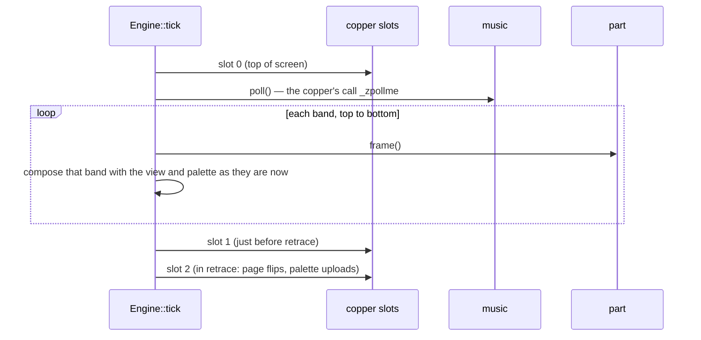

# How the port works

The original is a DOS shell that runs twenty programs against real VGA hardware (see
[Demo structure](Demo-structure)). The port is a single Rust binary. Underneath it is a small
software model of exactly the parts of the VGA that change what the viewer sees. This page
describes that model, the crates around it, and the clock that drives everything. The full
architecture is
[`docs/design.md`](https://github.com/waffleking32/SecondRealityRust/blob/main/docs/design.md).

## The crates

| crate | what it holds |
|---|---|
| [`crates/sr-engine`](https://github.com/waffleking32/SecondRealityRust/tree/main/crates/sr-engine) | the software VGA: `Surface`, `View`, `Palette`, the copper, the `Tick`, beam compose, presentation, the `Part` trait, the `Music` seam, `Machine` and `Engine`. It has no runtime dependencies. |
| [`crates/sr-audio`](https://github.com/waffleking32/SecondRealityRust/tree/main/crates/sr-audio) | the S3M player and the original player STMIK's mixer: pattern descrambling, the tracker, the effects, the mixing engine. It has no runtime dependencies. |
| [`crates/sr-assets`](https://github.com/waffleking32/SecondRealityRust/tree/main/crates/sr-assets) | decoders for the original's file formats, plus an OMF object reader and an unpacker for the shipped, compressed part EXEs. It depends on `sr-engine` only. |
| [`bins/secondreality`](https://github.com/waffleking32/SecondRealityRust/tree/main/bins/secondreality) | the program: the shell, one module per part, the SDL window, headless mode, the sound card, the settings screen and the vault menu. |
| [`xtask`](https://github.com/waffleking32/SecondRealityRust/tree/main/xtask) | the developer's tools: capturing reference frames from the emulated original, comparing, re-diffing, the music traces, the asset checks and the wiki's pictures. |

SDL lives only in the binary, so the engine and the player can be tested without a display or a
sound card. Two tests read the manifests and fail if either crate gains a dependency.

## The software VGA

### Surface: no planes

[`Surface`](https://github.com/waffleking32/SecondRealityRust/blob/main/crates/sr-engine/src/surface.rs)
is a plain 8-bit indexed canvas, up to 640×400. Parts write into it with the original's own
coordinate maths. The Mode X plane arithmetic ([Hardware primer](Hardware-primer)) disappears,
because it only decided how *fast* pixels were written, never *which* pixels got *which* value.
Where a part relies on the memory layout itself, such as a row stride wider than the screen or a
split that reads from address 0, the part addresses the surface to match. Where the model differs
from the hardware's layout, the difference is registered. For example, the vector engine's four
pages are packed at 64,000 pixels rather than 65,536
([A35](https://github.com/waffleking32/SecondRealityRust/blob/main/docs/fidelity/APPROXIMATIONS.md)).

### View: the CRTC as a struct

[`View`](https://github.com/waffleking32/SecondRealityRust/blob/main/crates/sr-engine/src/view.rs)
is the register set that says how the beam reads the surface:

```rust
pub struct View {
    pub width: u16,
    pub height: u16,
    pub start_addr: u32,            // CRTC 0Ch/0Dh, in pixels rather than plane bytes
    pub x_offset: u16,
    pub y_line_offset: Option<u16>, // CRTC 13h; None = the surface's own row stride
    pub pan: u8,                    // AC 13h, converted to pixels
    pub double_scan: bool,          // CRTC 9
    pub split: Option<Box<Split>>,  // line compare: a second View below a scanline
    pub border: Option<u8>,         // AC 11h
}
```

A part that wrote `out 3d4h` in the original writes a field here instead. The units are pixels,
not the register's own units. A start address in plane bytes is multiplied by four, and a
256-colour pel-pan value is halved.

### Palette: 6 bits all the way

[`Palette`](https://github.com/waffleking32/SecondRealityRust/blob/main/crates/sr-engine/src/palette.rs)
has 256 entries of 6-bit RGB, as the DAC does. It is widened to 8 bits (`dac_expand`, the
emulator's `round(255c/63)`) only when a frame is presented. A part that changes the palette
mid-frame produces a `PaletteTimeline`, which records the palette in force from each band down.

### The copper: three real slots

The original's three copper routines become three slots of `CopperFn` closures in a
[`CopperRegistry`](https://github.com/waffleking32/SecondRealityRust/blob/main/crates/sr-engine/src/copper.rs).
A part registers them with `ctx.set_copper(slot, f)`, as it called `dis_setcopper`. Here is
[PLZPART](PLZPART)'s slot 1 (comments trimmed), the start-address and pan writer from
[PLZPART/COPPER.ASM:67-84](https://github.com/mtuomi/SecondReality/blob/071a82eddb7a7390dbaa491a8a473e0e923a55c2/PLZPART/COPPER.ASM#L67-L84):

```rust
let shared = Rc::clone(&self.copper);
ctx.set_copper(
    1,
    Box::new(move |ctx| {
        let mut state = shared.borrow_mut();
        state.display_start = state.cop_start;
        state.display_pan = state.cop_scrl / 2;
        apply_plasma_view(&state, ctx);
    }),
);
```

([`parts/plzpart/copper.rs`](https://github.com/waffleking32/SecondRealityRust/blob/main/bins/secondreality/src/parts/plzpart/copper.rs))

The copper is never stubbed out. Earlier ports that skipped it lost [TECHNO](TECHNO)'s interference seam
among other things. When a part starts, the engine clears all three slots, as the shell's
`partexecute` does after every part.

### Machine and Engine: one tick

[`Machine`](https://github.com/waffleking32/SecondRealityRust/blob/main/crates/sr-engine/src/machine.rs)
is the surface, view, palette and copper together. The
[`Engine`](https://github.com/waffleking32/SecondRealityRust/blob/main/crates/sr-engine/src/engine.rs)
owns one machine and the run's music. `Engine::tick` runs one video frame in the original copper's
order
([MAIN/COPPER.ASM:449-468](https://github.com/mtuomi/SecondReality/blob/071a82eddb7a7390dbaa491a8a473e0e923a55c2/MAIN/COPPER.ASM#L449-L468)):



**Beam compose.** A part can split its frame into horizontal bands (`Part::band_count`). Each
band is composed as soon as it is drawn, through the view and palette as they stand at that
moment. A palette or memory write made between two bands therefore lands on the scanline the
beam was drawing, as it did on the hardware. The engine's test card exercises this with eight
bands; the demo's parts each draw in a single band. Writes in slots 1 and 2 land in the next frame,
because the beam has already finished this one.

## The Part trait: the DIS, minimised

Each part implements
[`Part`](https://github.com/waffleking32/SecondRealityRust/blob/main/crates/sr-engine/src/part.rs):

```rust
pub trait Part {
    fn name(&self) -> &'static str;
    fn init(&mut self, ctx: &mut PartCtx) -> Result<(), PartError>;
    fn frame(&mut self, ctx: &mut PartCtx) -> PartStatus; // Continuing or Finished
    fn band_count(&self) -> u16 { 1 }
    fn drains_after_exit(&self) -> bool { false }
}
```

The original parts are main loops that call `dis_waitb()` to wait for the next frame. A port part
is turned inside out: `frame()` is one pass of that loop, and the engine calls it once per tick.
`PartCtx` carries what the DIS handed out: the surface, the view, the palette, the frame counter,
the exit flag, the copper registration and the music.

| DIS (original) | port |
|---|---|
| `dis_partstart`, `dis_version` | constructing the part and `init` |
| `dis_waitb()` | the tick itself: `frame()` runs once a tick |
| `dis_exit()` | `ctx.exit_requested`; a part ends itself with `ctx.request_exit()` |
| `dis_setcopper(n, f)` | `ctx.set_copper(n, f)` |
| `dis_sync()`, `dis_musplus()`, `dis_musrow()` | `music.sync()`, `ctx.musplus()`, `ctx.musrow()` |
| `dis_setmframe`, `dis_getmframe` | `music.setmframe(n)`, `ctx.getmframe()`, counting player ticks |
| `dis_muscode()` | `music.muscode(n)`, which returns 0, the only value the original's trace ever shows ([A56](https://github.com/waffleking32/SecondRealityRust/blob/main/docs/fidelity/APPROXIMATIONS.md)) |

The DIS's own arithmetic, such as `dis_sync`'s table with its off-by-one, lives on the parts' side
of the seam in
[`sr_engine::music`](https://github.com/waffleking32/SecondRealityRust/blob/main/crates/sr-engine/src/music.rs).
The binary's `audio::PlayerMusic` adapts the real player to the `Music` trait.

The parts are in
[`bins/secondreality/src/parts/`](https://github.com/waffleking32/SecondRealityRust/tree/main/bins/secondreality/src/parts),
one module per part named by its registry name (`3dsinfld` is `coman.rs`). `parts/visu/` is the
vector engine that [U2A](U2A) and [U2E](U2E) share, and `parts/vault/` holds [GRID](The-Vault), HARD and TWIST.
[`parts.rs`](https://github.com/waffleking32/SecondRealityRust/blob/main/bins/secondreality/src/parts.rs)
is the registry that `--part` reads. Each module's doc comment describes how it mirrors its
original routine, with file and line citations.

## The clock

The demo runs at the VGA's 70.086 Hz frame rate, and the port runs a fixed logic tick at exactly
that rate
([`Tick`](https://github.com/waffleking32/SecondRealityRust/blob/main/crates/sr-engine/src/tick.rs)).
It is decoupled from the display:

- The window measures wall-clock time and feeds it to `Sequence::advance`, which runs as many
  whole ticks as are due. It then shows the newest finished frame. On a 60 Hz monitor some frames
  are simply never shown, and nothing is interpolated or re-timed.
- Nothing spin-waits. A stall longer than 250 ms is dropped, not caught up.
- The music advances only when the engine ticks. `Player::poll` runs once per tick and mixes one
  frame's worth of samples into a ring, and the sound card only drains that ring. The logic tick
  is the sync clock, not the audio device. This mirrors STMIK's polled mode, in which the copper
  calls the mixer once per frame.

As a result the picture and the music cannot drift apart. Every part that waits for a cue waits
for a position that the same tick counter produced. The [Music](Music) page covers the player.

## The shell

[`shell/`](https://github.com/waffleking32/SecondRealityRust/tree/main/bins/secondreality/src/shell)
is the port's `U2.ASM`. `Sequence` takes a plan (a block's parts, or one part), starts each part
with `Engine::start`, ticks it until it reports `Finished` or the exit flag ends it, and between
parts does the shell's own work: the music restarts, the post-[PANICEND](PANICEND) cue wait, loop mode and
the ending.

**Frame numbering.** A run's frames carry the same numbers as the reference captures:
emulator frames counted from boot, with the demo's first graphics frame at 404. A block run, or a
part that has a measured boot anchor, numbers itself in that space, so that frame 900 of the port
is frame 900 of the original. Other `--part` runs number from zero, and the window's title says
so.

## Window and headless

[`main.rs`](https://github.com/waffleking32/SecondRealityRust/blob/main/bins/secondreality/src/main.rs)
picks one of two front ends before anything starts. Both drive the same `Sequence`:

- **The window** ([`window.rs`](https://github.com/waffleking32/SecondRealityRust/blob/main/bins/secondreality/src/window.rs))
  presents through SDL 2 at 2× by default. Each pixel is duplicated into a block with no
  smoothing, so 320×200, 320×400 and 640×400 parts all fill the same 640×400 picture.
  `--aspect 4:3` resamples into a 4:3 box instead. The border is a flat pad of the overscan
  colour.
- **Headless** ([`headless.rs`](https://github.com/waffleking32/SecondRealityRust/blob/main/bins/secondreality/src/headless.rs))
  needs no display and no sound card. It ticks the sequence as fast as it can and writes the
  requested frames: an `.idx` (the raw indices), an `.rgb` (one pixel per source pixel, no border)
  and a `manifest.json`. `--positions` adds a CSV with the part and the music's order and row for
  every frame. The comparisons in [How it is verified](How-it-is-verified) use this mode.

```bash
cargo run --release --bin secondreality -- --headless --part glenz --dump-dir out/glenz --frames 700
```

## Assets in their own formats

Nothing is converted ahead of time. `sr-assets` reads the original files as they are: the Origin
PIC container behind most `.UH` and `.U` pictures, IFF ILBM and PBM, RIX3 (`.SCI`, `.CLX`),
headerless palettes, [PAM](PAM)'s FLI and `.ANI` animation, the vector engine's scene formats and font
strips. The extension never decides a format: a file is identified by its magic bytes, or, for a
format with none, loaded by the one routine that expects it. Palettes stay 6-bit. The released demo sometimes differs from the vendored
source tree, so where it matters the port reads data out of the shipped part EXEs, unpacked by
`sr_assets::exe`. The music is read from the original `.S3M` modules and descrambled at load. A
converted file would lose the palette precision and the music's sync data.

## Further reading

- [`docs/design.md`](https://github.com/waffleking32/SecondRealityRust/blob/main/docs/design.md):
  the architecture in full.
- [`docs/decisions.md`](https://github.com/waffleking32/SecondRealityRust/blob/main/docs/decisions.md):
  the rulings behind it, numbered D1 onwards.
- [`CLAUDE.md`](https://github.com/waffleking32/SecondRealityRust/blob/main/CLAUDE.md): the
  developer's guide to the tree.
