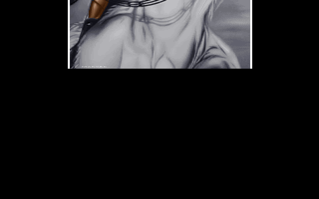
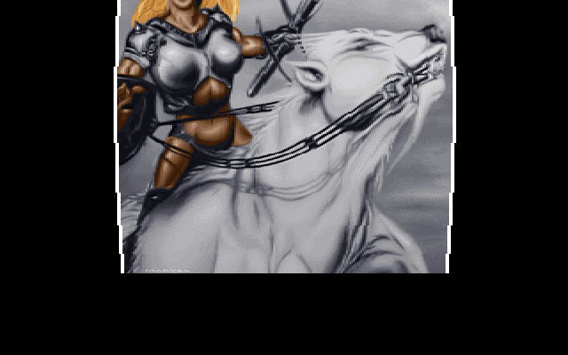
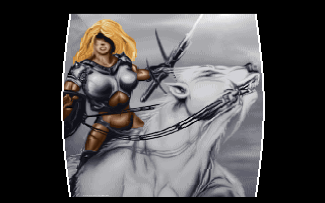
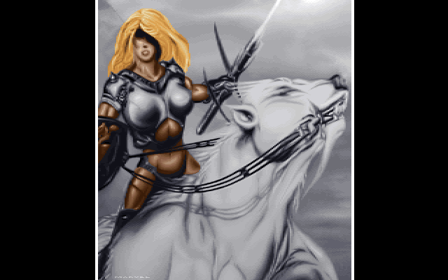

# JPLOGO: the jelly picture

JPLOGO is the short "jelly picture" that closes the demo's middle section. It follows the voxel
landscape of [3DSINFLD](3DSINFLD), just under eight minutes in, and lasts about twelve seconds
before [U2E](U2E) takes over. A tall painting of an armoured rider on a white horse drops in from
the top of the screen, hits the bottom, and wobbles like a block of jelly: it squashes and bulges
out at the waist, springs back up, stretches thin, and settles after a few bounces. The demo's part
table labels it `Jellypic (PSI)`. Its source is the upstream `JPLOGO/` directory: `JP.C` holds the
logic, `ASM.ASM` the mode set and the row zoomer, and `ZOOM.INC` is a 16,837-line file of unrolled
assembly that the small C program `DOL.C` generated.

## What you see









## The trick

The effect has three ingredients. A hardware scroll provides the drop. A spring simulation,
computed before the part starts, gives two numbers per frame: where the picture's top and
bottom edges are. A table of generated routines then redraws every screen row as some source
row, horizontally scaled to some width. Nothing is rotated or filtered. Each screen row is a
copy of one picture row, stretched or shrunk.

### 1. The screen and the drop

`inittwk` puts the VGA into the unchained 320×400 layout (see the
[Hardware primer](Hardware-primer): Mode X with CRTC register 9 at 0). A 320×400 screen is 32,000
bytes a plane, so the 256 KB card holds the picture with room to spare, and the memory below row
399 is left black.

The drop costs nothing to draw. The picture is drawn once, at its natural size, and then only the
CRTC start address moves. `scrolly(y)` points the top of the display at memory row `y`. The entry
loop starts at row 400, where the screen shows only black, and walks back to row 0 with an
accelerating step:

```
y = 400*64;  a = 64                 (rows in 1/64ths)
each retrace:  y -= a;  a += 6;  show row y/64
```

The step grows by 6/64 of a row every frame, which is constant acceleration, so the picture falls
in under gravity. It takes 83 retraces, and the last step is nearly 9 rows a frame, so the picture
arrives moving fast. The jelly simulation then starts with both edges moving down at 500/16 rows
a simulation step, which after the fourfold interpolation below is about 8 rows a frame.

### 2. The spring, simulated ahead of time

`main` runs a 200-step simulation of the picture's top edge `y1` and bottom edge `y2` before it
shows anything. Both are fixed point with 4 fractional bits (`400*16` is the screen height), and
both carry a velocity (`y1a`, `y2a`) that starts at 500, the falling speed.

Every step:

- **Gravity.** Both velocities gain 16.
- **The floor.** If the bottom passes row 400, it is pushed back and its velocity is reversed and
  scaled by `mika/8`. `mika` is 1 for the first bounce and 4 after that, so the first impact
  keeps only 1/8 of the speed and later ones keep half.
- **The jelly.** The stretch `a = (y2 - y1) - 400*16` is how far the picture is from its natural
  height. A spring pulls the two edges together or apart: `y1a += a/8` and `y2a -= a/8`.
- **Damping.** Whenever the stretch changes sign, the top's velocity is multiplied by 7/8.
- **Settling.** After step 90 the top is tied to the bottom (`y1 = y2 - 400*16`) and the bottom
  creeps down 8 units a step until it reaches the floor, where both stop.

Run as written, in 16-bit `int` arithmetic, the displayed height swings between 313 and 440 rows.
The top dips to row 82, flies up to row −132 (above the screen), comes back, and is still by step
95. The 200 steps
are then linearly interpolated, four entries per step, into two 800-entry tables `framey1t` and
`framey2t`. Each frame of the display loop reads one entry.

### 3. Mapping rows: vertical scale and the bulge

Each frame, `doit` reads `y1` and `y2` from the tables and fills every one of the 400 screen rows:

```
rows outside [y1, y2)   black
row y inside            source row  b = (y - y1) * 400 / (y2 - y1)
                        width       a = 184 + sin1024[b * 32/25] * xsc / 64     (rounded to even)
                        where       xsc = (400 - (y2 - y1)) / 8
```

The first formula is a plain vertical scale: the picture's 400 rows are spread over the
`y2 - y1` screen rows between the edges. The second formula makes it look like jelly. `xsc` is
positive when the picture is shorter than 400 rows (squashed) and negative when it is taller
(stretched). `b * 32/25` runs from 0 to 510 over the picture, half of the 1,024-step sine table,
so the sine goes from 0 up to its peak at the middle row and back to 0. The top and bottom rows
always keep their natural 184-pixel width. A squashed picture bulges at the middle, and a
stretched one is pinched in at the waist, as a real soft body conserving its volume would be. Over
the whole motion the widths stay between 164 and 224 pixels.

### 4. A routine for every width

Scaling a row horizontally the usual way means a loop with a fixed-point step per pixel, and in
Mode X a plane switch every pixel. JPLOGO instead unrolls the loop completely, once for each
width. `DOL.C` runs offline. For every even width `a` from 140 to
244 it computes, for each screen x, which source byte lands there:

```
le = 160 - a/2,  ri = 160 + a/2,  c = ri - le + 1
x in [le, ri]:   src = ((x - le) * 185 + c/2) / c       (185 = the 184 crop + its border byte)
otherwise:       black
```

It then prints one assembly routine `@zoomA` with those offsets baked in as constants. Each
routine:

1. With all four planes enabled and `ax` zero, stores zero words over every 8-pixel group that
   is entirely black (one store blacks 8 pixels), then zero bytes over the remaining all-black
   4-pixel groups.
2. For each plane `p` in turn, sets the map mask and writes the rest. Byte `n` of plane `p` is
   pixel `4n + p`, so neighbouring bytes are pixels `x` and `x + 4`; the generator loads both
   source bytes (or zero for a black pixel) into `al`/`ah` and writes them with one 16-bit store.

Every routine touches only the window x = 32..287, the span the widest routine needs; pixels
outside it are never written.

There are 54 routines (`@zoom0` for an all-black row, then 140, 142, ..., 244), and a 160-entry
jump table `zoomt` indexed by the width. Widths below 140 use `@zoom140` and widths above 244 use
`@zoom244`. No routine branches or multiplies: a row costs a fixed run of loads and stores.

### 5. Don't redraw what hasn't changed

`doit` keeps, for each screen row, the `(b, a)` pair it last drew there (`lasty`, `lasts`). A
row inside the picture is redrawn only when its source row or width changes. Once the jelly
settles, every row is `(y, 184)` and the loop draws nothing. Rows outside the picture are blacked
every frame, but blacking does not reset `lasty`/`lasts`. A row that leaves the picture and later
comes back with the same pair it last drew is therefore not redrawn, and keeps whatever is in it
now. How often that happens depends on how many retraces each `doit` pass takes (see Quirks), so
the exact patchwork depends on the machine. The port calls this "the palimpsest".

### The picture's colours

The source picture is 320×400, but only the 184 columns from x = 70 are kept, which is the figure
and horse. A 185th byte, index 65, is added to every row as a white edge on the right. Palette
entry 64 is set to black and every 0 in the picture is changed to 64. Index 0 stays the black of
the empty screen, and the picture's own blacks are a separate entry.

## How the original did it

The drop: the start address walks up from row 400 with growing steps.

```c
	a=64; y=400*64;
	while(y>0)
	{
		y-=a;
		a+=6;
		if(y<0) y=0;
		scrolly(y/64);
		dis_waitb();
	}
```
[JPLOGO/JP.C#L211-L219](https://github.com/mtuomi/SecondReality/blob/071a82eddb7a7390dbaa491a8a473e0e923a55c2/JPLOGO/JP.C#L211-L219)

The floor bounce, then the spring between the two edges:

```c
			y2a+=16;
			if(y2>400*16)
			{
				y2-=y2a;
				y2a=-y2a*mika/8;
				if(mika<4) mika+=3;
			}
	
			y1a+=16;
			
			la=a;
			a=(y2-y1)-400*16;
			if((a&0x8000)^(la&0x8000))
			{
				y1a=y1a*7/8;
			}
			y1a+=a/8;
			y2a-=a/8;
```
[JPLOGO/JP.C#L130-L147](https://github.com/mtuomi/SecondReality/blob/071a82eddb7a7390dbaa491a8a473e0e923a55c2/JPLOGO/JP.C#L130-L147)

The row loop in `doit`, with the bulge and the redraw guard:

```c
			if(y<y1 || y>=y2)
			{
				linezoom(vram+y*80,NULL,0);
			}
			else 
			{
				b=(long)(y-y1)*400L/(long)(y2-y1);
				a=184+(sin1024[b*32/25]*xsc+32)/64;
				a&=~1;
				if(lasty[y]!=b || lasts[y]!=a)
				{
					linezoom(vram+y*80,row[b],a);
					lasty[y]=b;
					lasts[y]=a;
				}
```
[JPLOGO/JP.C#L87-L101](https://github.com/mtuomi/SecondReality/blob/071a82eddb7a7390dbaa491a8a473e0e923a55c2/JPLOGO/JP.C#L87-L101)

The generator's mapping for one width:

```c
		le=160-(y/2);
		ri=160+(y/2);
		c=ri-le+1;
		for(x=0;x<320;x++)
		{
			if(x<le || x>ri) xt[x]=BLACK;
			else xt[x]=((long)(x-le)*185L+(c/2))/(long)c;
		}
```
[JPLOGO/DOL.C#L50-L57](https://github.com/mtuomi/SecondReality/blob/071a82eddb7a7390dbaa491a8a473e0e923a55c2/JPLOGO/DOL.C#L50-L57)

And the start of what it emits for width 184. `ax` is zero and all planes are enabled, so the
first stores black whole 8-pixel groups. Then plane 0 is selected (`dx` is the sequencer data
port) and source bytes 0, 4 and 8 go to pixels 68, 72 and 76:

```asm
@zoom184:
mov es:[di+8],ax
mov es:[di+10],ax
mov es:[di+12],ax
mov es:[di+14],ax
mov es:[di+64],ax
mov es:[di+66],ax
mov es:[di+68],ax
mov es:[di+70],ax
mov es:[di+16],al
mov al,1
out dx,al
mov ah,ds:[si+0]
mov es:[di+17],ah
mov al,ds:[si+4]
```
[JPLOGO/ZOOM.INC#L6166-L6180](https://github.com/mtuomi/SecondReality/blob/071a82eddb7a7390dbaa491a8a473e0e923a55c2/JPLOGO/ZOOM.INC#L6166-L6180)

## How the port does it

The part is
[`bins/secondreality/src/parts/jplogo.rs`](https://github.com/waffleking32/SecondRealityRust/blob/main/bins/secondreality/src/parts/jplogo.rs)
(`Jplogo`). `init` builds everything `main` builds: `spring_tables` runs the simulation in 16-bit
C `int` arithmetic (`wrap16`), `interpolate_800` makes the two 800-entry tables, `entry_scrolls`
precomputes the 83 start rows of the drop, and `Jplogo::read_rows` crops, remaps and borders the
picture. The view is 320×400 with 320-pixel rows, and `scrolly` becomes `View::set_origin(y*320)`.
See [How the port works](How-the-port-works) for views and origins.

`frame` is one tick: a drop step, the wait before `doit`, the music gate (`musplus >= 4`, see
[Music](Music)), then one `doit` iteration (`Jplogo::draw_doit_frame`). The port does not keep
`ZOOM.INC`'s 54 routines. `zoom_row` is a per-pixel model of them: it writes the fixed window
x = 32..287 that every generated routine covers, using `DOL.C`'s formula, with the same clamp and
dispatch for out-of-range widths. The module's tests pin the dispatch, the identity at width 184,
and the reachable width range of 164 to 224. Timeline, music alignment and keyframe evidence are in
[docs/fidelity/jplogo.md](https://github.com/waffleking32/SecondRealityRust/blob/main/docs/fidelity/jplogo.md).

## Quirks kept

- `setpalarea` uploads `2*count + start` = 512 bytes instead of 768. Entries 171-255 stay black from the cleared DAC, and U2E inherits that DAC ([bugs.md §4](https://github.com/waffleking32/SecondRealityRust/blob/main/docs/fidelity/bugs.md)).
- The crop is 184 bytes from x = 70, with a synthetic index-65 border ([bugs.md §21.1](https://github.com/waffleking32/SecondRealityRust/blob/main/docs/fidelity/bugs.md)).
- Entry 64 is blacked and source 0 is remapped to 64 ([bugs.md §21.2](https://github.com/waffleking32/SecondRealityRust/blob/main/docs/fidelity/bugs.md)).
- JPLOGO's own sine table has ±255 where the common copy has ±256 ([bugs.md §21.3](https://github.com/waffleking32/SecondRealityRust/blob/main/docs/fidelity/bugs.md)).
- The redraw guard leaves a repeated row's old pixels in place ([bugs.md §21.4](https://github.com/waffleking32/SecondRealityRust/blob/main/docs/fidelity/bugs.md)).
- The interpolation reads one entry past each 200-entry array. Those table entries are never displayed ([jplogo.md §2.1](https://github.com/waffleking32/SecondRealityRust/blob/main/docs/fidelity/jplogo.md)).
- The original advances its frame counter by however many retraces an iteration took, so its exact patchwork depends on the machine. The port advances it by one a tick ([APPROXIMATIONS.md A27](https://github.com/waffleking32/SecondRealityRust/blob/main/docs/fidelity/APPROXIMATIONS.md)).
- The Scroll Lock border colour in `doit` is not modelled, because the engine has no keyboard state ([jplogo.md §4](https://github.com/waffleking32/SecondRealityRust/blob/main/docs/fidelity/jplogo.md)).

---

**Previous:** [3DSINFLD](3DSINFLD) · **Next:** [U2E](U2E)
