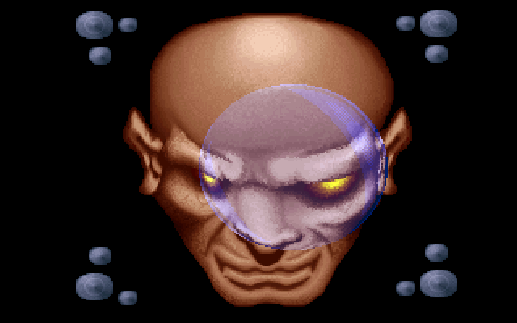
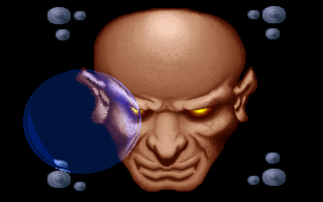
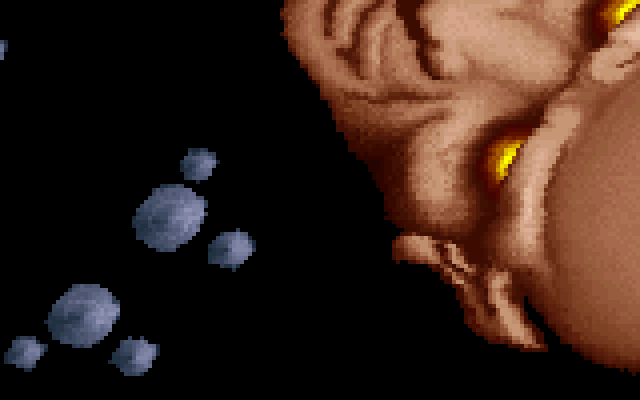
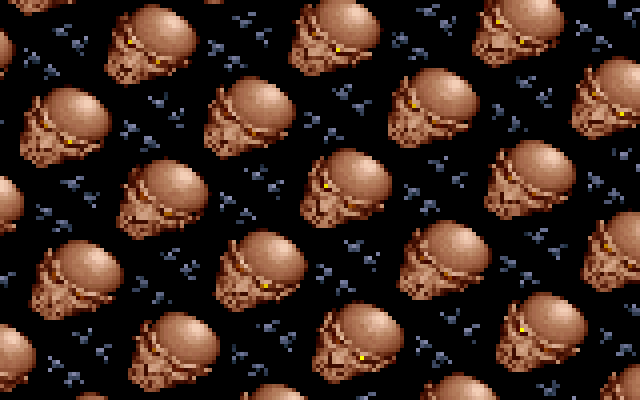

# LNS&ZOOM: the lens and the rotozoomer

LNS&ZOOM is the bald demon face. It wipes onto the screen from a diagonal seam, a glass ball
drops onto it and bounces around, magnifying and tinting what is underneath, and then the face
starts spinning and zooming, far out until it tiles the screen, and the part fades to white. The original's part list credits it as `Lens (PSI)` + `Rotazoomer (PSI)`: two effects in
one binary, from the `LENS` directory. It follows [MNTSCRL](MNTSCRL) in block 3 and hands over to
[PLZPART](PLZPART). In the port's full run it begins at frame 18,670, about 4 minutes 26 seconds
in. The lens runs about 10 seconds and the rotozoomer about 28.

## What you see






## The trick

The part has three acts. The first two each wait for a music position (`dis_musplus`, see
[Music](Music)); the third follows the lens directly and stops early if the music runs past a
later position.

### Act 1: the wipe

Each of the 200 rows gets two "edges" that start at the same x on a slanted line,
`x0 = 170 + (100 − y)·50/64`. One edge moves right and the other left, at speeds that depend on
the row, in 1/64-pixel fixed point. Wherever an edge is, the routine copies that one picture
pixel to the screen. It takes six steps per frame for 80 frames, at less than a pixel per step, so
no pixel is skipped. The face opens outwards from a diagonal seam. The source and destination
use the same offset, so an edge that runs off the end of its row still copies the correct pixel,
just in the neighbouring row.

### Act 2: the lens, as four lookup tables

A real lens bends light. This one is a lookup. Offline, `CALC.C` took a mask picture of the lens,
drawn in four colours, and for every lens pixel inside the mask computed where on the background
that pixel should sample:

```text
r²   = x² + (9y/8)²                  (x, y relative to the lens centre)
gain = 250 / (59² + 50² − r²)^0.69
src  = (x + jitter, y + jitter) · gain
```

The gain is smallest at the centre and grows towards the rim, so the centre shows a magnified
image and the edge compresses it, like a ball of glass. The small random jitter adds a little
texture to the glass. The results went into four files, one per mask colour:

| file | region | routine | what it writes |
|---|---|---|---|
| `LENS.EX1` | mask colours 1..3: the whole glass | `dorow` | a run of pixels, each `back[base + src] OR 0x40` |
| `LENS.EX2` | mask colour 2: two crescents inside the edge | `dorow2` | `(dest, src)` pairs, `OR 0x80` |
| `LENS.EX3` | mask colour 3: a small spot near the top right | `dorow2` | `(dest, src)` pairs, `OR 0xC0` |
| `LENS.EX4` | mask colour 4: a ring around the glass | `dorow3` | `back[a]` copied to the screen at the same `a` |

The `OR` is the colour trick. The face uses only palette entries 0..63. At start-up the program
builds three tinted copies of those 64 colours: entries 64..127 add `(0, 5, 15)` to each colour,
128..191 add `(0, 7, 26)`, and 192..255 add `(0, 9, 37)`, clamped at 63. OR-ing a pixel with 0x40,
0x80 or 0xC0 selects the same colour from a bluer copy. The body therefore reads as faintly
tinted glass, with brighter blue highlights where the colour 2 and 3 regions sit, without any
per-pixel arithmetic. Over black
background (entry 0) the tint is all that shows, which is the dark blue disc in the second picture.

`LENS.EX1` covers every lens pixel that is not colour 4, the highlight regions included; `EX2`
and `EX3` then redraw those regions with their own samples and stronger tints. `LENS.EX4` is the
eraser. Its ring of pixels around the glass gets the unmodified picture copied back at the same
offset, which wipes out whatever the lens drew there on the previous frame. As long as the ball
moves less than the ring's width per frame, it never needs a separate erase.

The lens's motion is a recording. With `SAVEPATH` defined, `MAIN.C` simulates a bouncing ball
(gravity `ya += 2`, a first bounce damped by 2/3 and later ones by 9/10, walls at x = 60 and 256)
and writes the positions to `LENS.EXP`. The shipped build plays back 715 recorded positions. The
first 96 frames also fade the tinted palette blocks (`fade2`): for 32 frames entries 64..255 hold
only the tint itself, so the glass is a plain blue disc, and over the next 64 the face shows
through it.

### Act 3: the rotozoomer

A rotozoomer draws a texture through a rotated, scaled grid. It walks a 2D vector `(xa, ya)`
along each screen row, and the perpendicular vector down the rows:

```text
along a row:      (u, v) += ( ya, −xa)
from row to row:  (u, v) += ( xa,  ya) · 307/256      (aspect correction)
```

One vector sets both the angle and the zoom: `|(xa, ya)|/1024` is texels per sample. The texture
`rotpic` is 256×256 bytes, built from the middle of the face with a 10/11 vertical resampling.
It is addressed as `v·256 + u`, so both coordinates wrap at 256 for free. That wrap is the tiling
in the last picture.

The routine's key insight is this. On a straight row, the offset from the row's first sample to
its n-th sample is **the same for every row**. `rotate` computes those 160 offsets once per frame
and writes them into the displacement fields of 160 unrolled `mov al, ds:[si+1234h]`
instructions (self-modifying code). Then for each of the 100 rows it only sets `si` to the row's
start and runs the block. The inner loop is one load per sample, with no adds and no multiplies.

```text
precompute once per frame:  d[n] = packed (v,u) integer offset of sample n
per row:                    si = (v_row << 8) | u_row
per sample:                 al = rotpic[si + d[n]]      ← d[n] is an instruction immediate
```

The offsets are packed as `(v << 8) | u` and added with a plain 16-bit add. When `u` wraps past
255, the carry nudges `v` by one row, a single-texel seam that the port reproduces.

When `|xa| > |ya|`, the routine switches to `rotpic90`, a copy of the texture rotated 90°, and
swaps the walk's axes to match.

`inittwk` switches the VGA to its unchained, planar layout (see
[Hardware primer](Hardware-primer)), with the CRTC's maximum scan line set to 3. Each byte row is four of the 400 scanlines, which gives 100 rows. Each row
writes 80 addresses twice: once with planes 0 and 1 enabled and once with planes 2 and 3. Every
address therefore shows two samples, each two pixels wide, as the pattern `(a, a, b, b)`. That is
160×100 = 16,000 samples a frame.

The camera path is also a recording: 2,000 frames of `(x, y, xa, ya)` in `LENS.EXP`, generated
by the `SAVEPATH` code's slowly accelerating spin and its scale curve. The palette flashes from
bright down to normal over the first 16 frames. It fades to white over the last 128, and the
part ends on an all-white palette.

## How the original did it

`drawlens` calls the four table walkers for each lens row
([`LENS/MAIN.C:57-65`](https://github.com/mtuomi/SecondReality/blob/071a82eddb7a7390dbaa491a8a473e0e923a55c2/LENS/MAIN.C#L57-L65)):

```c
	for(y=0;y<ys;y++)
	{
		if(u1>=0 && u1<=64000)
		{
			dorow(lens1,(unsigned)u1,y,0x40);
			dorow2(lens2,(unsigned)u1,y,0x80);
			dorow2(lens3,(unsigned)u1,y,0xC0);
			dorow3(lens4,(unsigned)u1,y,0);
		}
```

The rim walker reads a destination and a source offset per pixel and ORs in the tint block
([`LENS/ASM.ASM:118-125`](https://github.com/mtuomi/SecondReality/blob/071a82eddb7a7390dbaa491a8a473e0e923a55c2/LENS/ASM.ASM#L118-L125)):

```asm
@@3:	mov	bx,fs:[bp+2]
	mov	al,ds:[bx+di]
	or	al,dl
	mov	bx,fs:[bp]
	add	bp,4
	mov	es:[bx+si],al
	dec	cx
	jnz	@@3
```

The lens formula in the offline table generator
([`LENS/CALC.C:19-29`](https://github.com/mtuomi/SecondReality/blob/071a82eddb7a7390dbaa491a8a473e0e923a55c2/LENS/CALC.C#L19-L29)):

```c
void	lenscalc(int x,int y,int *px,int *py)
{
	double	now,new,fx,fy;
	now=full-(double)(x*x+(y*9/8)*(y*9/8));
	if(now<1.0) now=1.0;
	new=250.0/pow(now,0.69);
	fx=(double)(rand()-16384)/30000.0;
	fy=(double)(rand()-16384)/30000.0;
	*px=(int)(((double)x+fx)*new);
	*py=(int)(((double)y+fy)*new);
}
```

`rotate` accumulates the in-row offsets and patches them into the code. Here are two of each
group of four, with `@@moda`/`@@modb` labelling the two plane passes
([`LENS/ASM.ASM:337-346`](https://github.com/mtuomi/SecondReality/blob/071a82eddb7a7390dbaa491a8a473e0e923a55c2/LENS/ASM.ASM#L337-L346)):

```asm
	add	si,cx
	adc	al,bl
	add	di,dx
	adc	ah,bh
	mov	word ptr cs:[OFFSET @@moda+zzz+2],ax
	add	si,cx
	adc	al,bl
	add	di,dx
	adc	ah,bh
	mov	word ptr cs:[OFFSET @@modb+zzz+2],ax
```

The patched inner loop itself, for planes 0 and 1
([`LENS/ASM.ASM:389-395`](https://github.com/mtuomi/SecondReality/blob/071a82eddb7a7390dbaa491a8a473e0e923a55c2/LENS/ASM.ASM#L389-L395)):

```asm
@@moda:	zzz=1000h
	REPT	ZOOMXW/4
	mov	al,ds:[si+1234h]	;4
	mov	ah,ds:[si+1234h]	;4
	mov	es:[di+zzz],ax		;5
	zzz=zzz+2
	ENDM
```

`1234h` is a placeholder that the patch overwrites. The `;4` and `;5` comments are the
programmer's cycle counts.

## How the port does it

The part is
[`bins/secondreality/src/parts/lnszoom.rs`](https://github.com/waffleking32/SecondRealityRust/blob/main/bins/secondreality/src/parts/lnszoom.rs).
`Lnszoom` implements the `Part` trait, and its `Phase` steps through the three acts and their
gates (see [How the port works](How-the-port-works)).

- `load` reads `LENS.EX0`..`EX4`, `LENS.EXB` and `LENS.EXP` in their original layouts. It checks
  the lens dimensions and overlay triples, and makes the 1,536-byte copy past the picture's end
  that the lens tables can reach. `build_palette`, `build_fades`, `build_rotpic` and
  `build_rotpic90` are `main()`'s start-up arithmetic.
- `wipe` is act 1. `draw_lens` with `dorow`, `dorow2` and `dorow3` is act 2, on a 64 KB `video`
  buffer with 16-bit wrapping addresses as in the original.
- `displacements` builds the 160-entry table with the original's byte-wise carries. `rotate`
  walks the 100 rows and writes each sample two pixels wide, each row on two lines of the
  320×200 frame, which is what the `(a, a, b, b)` plane writes display. There is no self-modifying code: the table is an array.
- The part registers no copper callbacks.

The measurements are in
[`docs/fidelity/lnszoom.md`](https://github.com/waffleking32/SecondRealityRust/blob/main/docs/fidelity/lnszoom.md).
Two of the five reference keyframes are exact. The other three differ only by the face picture
(A25 below).

## Quirks kept

- `rotate` applies the 307/256 aspect ratio after the offset table is built, so only the
  row-to-row step is corrected
  ([bugs.md §16.1](https://github.com/waffleking32/SecondRealityRust/blob/main/docs/fidelity/bugs.md)).
- `if(dis_musplus>-30)` tests the function's address, not its result, so act 1's wait always runs
  ([lnszoom.md §3](https://github.com/waffleking32/SecondRealityRust/blob/main/docs/fidelity/lnszoom.md)).
- `memcpy(back+64000, back+64000-1536, 1536)` copies the picture's last 1,536 bytes past its end,
  and the lens reads them
  ([lnszoom.md §2](https://github.com/waffleking32/SecondRealityRust/blob/main/docs/fidelity/lnszoom.md)).
- Act 3's first palette upload is erased at once by `inittwk`'s DAC clear
  ([lnszoom.md §5](https://github.com/waffleking32/SecondRealityRust/blob/main/docs/fidelity/lnszoom.md)).
- The face is the source tree's `LENS.EXB`, which differs from the release's picture in 2,058
  forehead pixels. The lens-to-rotozoomer hand-over takes the release's eight frames, one more
  than the source's waits
  ([APPROXIMATIONS.md A25](https://github.com/waffleking32/SecondRealityRust/blob/main/docs/fidelity/APPROXIMATIONS.md)).
- In a full run the part starts at the port's frame 18,670, against the original's 18,656
  ([APPROXIMATIONS.md A53](https://github.com/waffleking32/SecondRealityRust/blob/main/docs/fidelity/APPROXIMATIONS.md)).
- Not modelled, and never visible: the Scroll Lock border-timing aid, the unused `rotatez`, and
  the `a > 3` frame-skip clamp, which cannot trigger at one frame a tick
  ([lnszoom.md §6](https://github.com/waffleking32/SecondRealityRust/blob/main/docs/fidelity/lnszoom.md)).

---

**Previous:** [MNTSCRL](MNTSCRL) · **Next:** [PLZPART](PLZPART)
