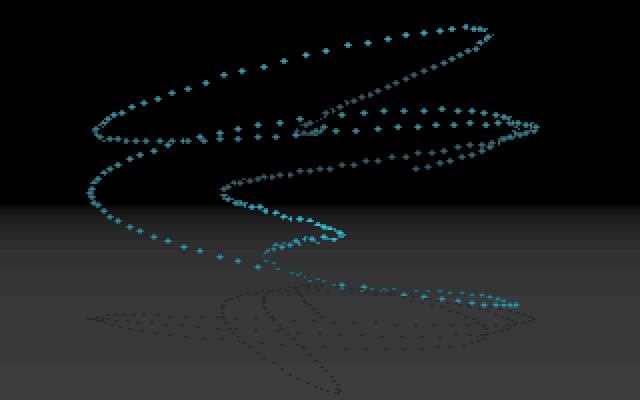
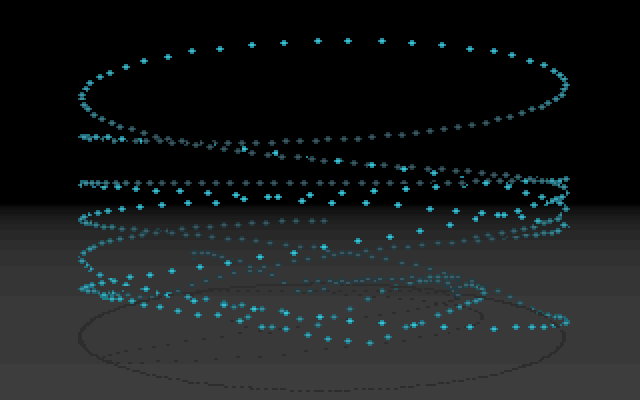
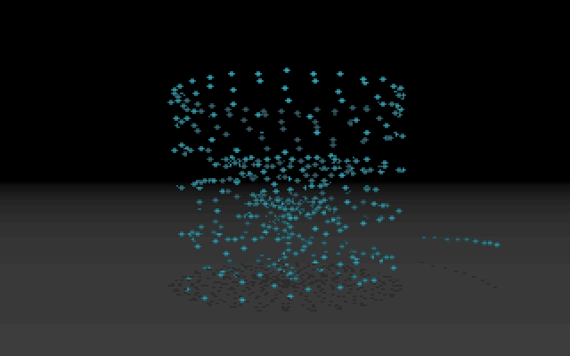
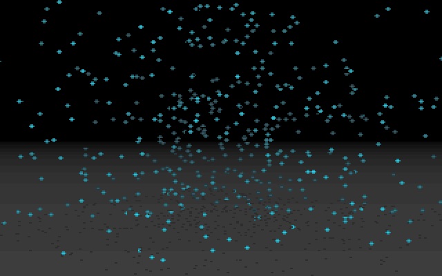

# MINVBALL: the mini vector balls

MINVBALL is the "mini vector balls" part: 512 small cyan balls tumble, bounce and float above a grey
floor, each with a dark dot of shadow beneath it. A stream of balls pours down and bounces, rings
of balls are thrown up, a fountain sprays from the middle, and finally the balls hang in a slowly
spinning cloud before the screen flashes white and fades to black. It comes after
[PLZPART](PLZPART) and before [RAYSCRL](RAYSCRL). In a full run it starts about 6:19 in (boot frame
26,569) and runs about 37 seconds. The upstream directory is `DOTS/`, and the demo's planning file
`SCRIPT` lists "Minivectorballs" under PSI
([SCRIPT#L22](https://github.com/mtuomi/SecondReality/blob/071a82eddb7a7390dbaa491a8a473e0e923a55c2/SCRIPT#L22-L22)),
with the brief "kaikkea kivaa, suihkulähde jne... pomppuja" ("all sorts of nice things, a
fountain etc... bounces")
([SCRIPT#L151-L154](https://github.com/mtuomi/SecondReality/blob/071a82eddb7a7390dbaa491a8a473e0e923a55c2/SCRIPT#L151-L154)).

## What you see









## The trick

### A particle system, one emitter, 512 particles

Every ball is a record of position `(x, y, z)`, a vertical velocity `yadd`, and the screen offsets
where its shadow and ball were last drawn. Nothing is ever created or destroyed. Each frame the
program picks **one** ball and moves it back to the emitter, then advances all 512 one step. The
ball it picks is `dottaul[j]`, with `j` counting round 0..511, so every ball is re-launched once
every 512 frames. On screen the balls are therefore the last 512 launches, a trail behind the
emitter. `dottaul` is a shuffled list of 0..511, so the shuffle only decides which array slot each
new ball takes, which is also its place in the drawing order.

The emitter is what changes between the acts. With `f` counting frames:

| frame | emitter | launch velocity |
|---|---|---|
| < 500 | a Lissajous curve: `x = 40·sin(11f)`, `y = 10·cos(13f) − dropper`, `z = 40·sin(17f)` | 0, so they fall |
| 500..899 | a circle of radius 55 (in table units) at height `dropper` | −260, thrown up |
| 900..1699 | a circle whose radius follows `sin(frame)/8`, on the floor | −300, a fountain |
| 1700..2359 | anywhere in a box: `x, z = rand() − 16384`, `y = 8000 − rand()/2` | 0, while gravity counts down to 0 |

(`sin` here is the 1,024-step table `SIN1024`, which peaks at 256. `dropper` starts at 22,000 and
falls by 100 a frame to 4,000.)

Gravity is one line of physics a frame. Positive `y` is down:

```text
yadd += gravity            (gravity = 3, later counted down to 0)
y    += yadd
if y >= 8105:              (the floor)
    yadd = -yadd * 13 / 16 (bounce, losing 3/16 of the speed)
    y   += yadd
```

### The camera: a rotation about the vertical axis and a perspective divide

The scene turns about the vertical axis by an angle `θ`. Up to frame 1,900 the angle sways,
`θ = sin(rots)` with `rots` going up by 2 a frame. After that the floor starts to spin, faster
and faster: `rot += rota/64`, and `rota` goes down by one every frame.

With `s` and `c` the table's sine and cosine (256 = 1.0), the assembler computes, all in 16- and
32-bit integers:

```text
depth   bp = 9000 + hi16(Z·64c) − hi16(X·64s)    ≈ 9000 + (Z·cosθ − X·sinθ)/4
        x' = X·64c + Z·64s                        (32-bit)
screen  sx = 160 + (x'/256 + x'/2048) / bp        ≈ 160 + 72·(X·cosθ + Z·sinθ)/bp
ball    sy = 100 + 64·Y / bp
shadow  sy = 100 + 524288 / bp                    (= 64·8192/bp)
```

So the centre of the scene sits at depth 9,000 in front of the eye. A ball's shadow is the same point pushed
down to `Y = 8192`, the floor plane, so it needs only one division. The floor check for bouncing
is 8,105, a little above that plane, so a ball resting on the floor still sits just above its
shadow. The horizon is row 100 because the projection's centre is row 100.

### Depth cueing through the palette

A ball is a 4×3-pixel sprite whose colours come from a table selected by depth:

```text
 .ee.        e = edge shade, m = middle shade,
 emme        both from the same 4-entry group
 .ee.
```

The [palette](Hardware-primer)'s first 64 entries are 16 groups of 4: black, then three shades of cyan
(`4,25,30`, `8,40,45`, `16,55,60`). In group `g` the green and blue are scaled by `(100 + 9g)/256`
(the red is left as it is), so group 15 is the brightest. Only the second and third shades are
used by the sprite. `depthtable1..3` hold the sprite's rows for each depth slot `a = bp/256`:

```text
c = clamp((a − 31)·3/4 + 8, 0, 15);   group = 15 − c
```

Near balls take a bright group and far ones a dim group, so the whole effect of distance is one
table lookup and three stores. The shadow is two pixels of colour 87.

### The floor and erasing without a back buffer

The floor is drawn once: rows 100..199 are filled with colours 64..163, and those entries hold a
grey ramp `c = 64 − 256/(a+4)`, squared, so it darkens towards the horizon. The program copies the
finished screen to `bgpic` and never draws the floor again.

There is no second page and no clear. Each ball erases itself: it remembers where it was drawn,
copies those few bytes back from `bgpic`, then draws at its new place, all directly in video
memory. A ball costs 14 bytes of erasing (two for the shadow, three rows of four for the ball) and
10 bytes of drawing, so all 512 cost about 12 KB of video writes a frame, far less than one full
64,000-byte screen.

### The finale, in the palette

Once the frame count passes 2,300 the program uploads its second palette `pal2` every frame. From 2,360 it raises
red and green by 3 and blue by 4 a frame towards 63, a flash to bluish white. From 2,400 it sets all
256 entries to the same grey `63 − 2a`, which falls to black. At frame 2,450 the loop ends.

## How the original did it

The emitter's first act, in `MAIN.C`. `i = dottaul[j]` is the ball re-launched this frame:
([DOTS/MAIN.C#L198-L208](https://github.com/mtuomi/SecondReality/blob/071a82eddb7a7390dbaa491a8a473e0e923a55c2/DOTS/MAIN.C#L198-L208))

```c
frame++;
if(frame==500) f=0;
i=dottaul[j];
j++; j%=dotnum;
if(frame<500)
{
	dot[i].x=isin(f*11)*40;
	dot[i].y=icos(f*13)*10-dropper;
	dot[i].z=isin(f*17)*40;
	dot[i].yadd=0;
}
```

`drawdots` in `ASM.ASM` projects each ball. The depth comes from the high words of two `imul`
products. Line 65 was meant to be `mov bx,ax`, but because only the high words are subtracted it
makes no difference:
([DOTS/ASM.ASM#L63-L72](https://github.com/mtuomi/SecondReality/blob/071a82eddb7a7390dbaa491a8a473e0e923a55c2/DOTS/ASM.ASM#L63-L72))

```asm
	mov	ax,ds:[si+0] ;X
	imul	ds:_rotsin
	mov	ax,ax
	mov	cx,dx
	mov	ax,ds:[si+4] ;Z
	imul	ds:_rotcos
	sub	ax,bx
	sub	dx,cx
	mov	bp,dx
	add	bp,9000
```

The gravity step and the bounce. The record's word at `+14` is `yadd`, and `gravityd` is 13:
([DOTS/ASM.ASM#L122-L136](https://github.com/mtuomi/SecondReality/blob/071a82eddb7a7390dbaa491a8a473e0e923a55c2/DOTS/ASM.ASM#L122-L136))

```asm
	mov	ax,ds:_gravity
	add	ds:[si+14],ax
	mov	ax,ds:[si+2] ;Y
	add	ax,ds:[si+14]
	cmp	ax,ds:_gravitybottom
	jl	@@4
	push	ax
	mov	ax,ds:[si+14]
	neg	ax
	imul	cs:_gravityd
	sar	ax,4
	mov	ds:[si+14],ax
	pop	ax
	add	ax,ds:[si+14]
@@4:	mov	ds:[si+2],ax
```

The sprite itself is three stores from the depth tables. `bp` was shifted and masked to a dword
index (`shr bp,6` / `and bp,not 3`, that is `4·(bp/256)`):
([DOTS/ASM.ASM#L172-L178](https://github.com/mtuomi/SecondReality/blob/071a82eddb7a7390dbaa491a8a473e0e923a55c2/DOTS/ASM.ASM#L172-L178))

```asm
	mov	ax,word ptr ds:_depthtable1[bp]
	mov	word ptr es:[bx+1],ax
	mov	eax,ds:_depthtable2[bp]
	mov	dword ptr es:[bx+320],eax
	mov	ax,word ptr ds:_depthtable3[bp]
	mov	word ptr es:[bx+641],ax
	mov	ds:[si+8],bx
```

The tables are built in `MAIN.C` from the formula above. `0x0202` and `0x02030302` are the shade
numbers (2 = edge, 3 = middle), and `0x04040404*c` adds the group's base to every byte at once
([DOTS/MAIN.C#L156-L167](https://github.com/mtuomi/SecondReality/blob/071a82eddb7a7390dbaa491a8a473e0e923a55c2/DOTS/MAIN.C#L156-L167)).

## How the port does it

The part is
[`bins/secondreality/src/parts/minvball.rs`](https://github.com/waffleking32/SecondRealityRust/blob/main/bins/secondreality/src/parts/minvball.rs)
(`Minvball`), and
[`parts/msrand.rs`](https://github.com/waffleking32/SecondRealityRust/blob/main/bins/secondreality/src/parts/msrand.rs)
provides `MsRand`, Microsoft C 6.0's `rand()`. The source never seeds it, and the shuffles and the
last act's scatter use it.

- `setup_dots`, `build_palette` and `build_depth_tables` are `MAIN.C`'s set-up, and `physics` is
  one pass of its `while(repeat--)` body.
- `drawdots` is `_drawdots` step for step: `project_xz` (the depth and screen x, high words only),
  `project_y`, `integrate` (the bounce) and `restore`. It draws into a 64 KB buffer standing in for
  the video segment, because the original's writes can land past byte 64,000, and only the first
  64,000 are shown.
- `Part::frame` runs one engine tick per `dis_waitb`: tick 0 is the set-up, the odd ticks 1..129
  are the 65 fade-in uploads, and the main loop starts at tick 130. The original runs the physics
  `repeat` times per drawn frame (once per vertical retrace that went by). The port runs it once a tick,
  which the reference frames show is what the original does.

The timeline, the RNG identification and the fitted start value are in
[`docs/fidelity/minvball.md`](https://github.com/waffleking32/SecondRealityRust/blob/main/docs/fidelity/minvball.md).
All four reference frames match exactly.

## Quirks kept

- Balls are drawn in array order with no depth test, so a farther ball's shadow can cover a nearer
  ball. Because each ball erases its own old pixels just before drawing, a later ball can also erase
  pixels an earlier one has just drawn
  ([bugs.md §2](https://github.com/waffleking32/SecondRealityRust/blob/main/docs/fidelity/bugs.md)).
- `mov ax,ax` where `mov bx,ax` was meant. It has no effect because the subtraction uses only the
  high words
  ([bugs.md §18.1](https://github.com/waffleking32/SecondRealityRust/blob/main/docs/fidelity/bugs.md)).
- When a shadow is off screen, the exit path stores a leftover register as the shadow's next
  offset. The next frame erases at that offset
  ([bugs.md §18.2](https://github.com/waffleking32/SecondRealityRust/blob/main/docs/fidelity/bugs.md)).
- When a shadow is off screen, gravity is skipped and the ball is only erased, not drawn, so it
  hangs still and unseen
  ([bugs.md §18.3](https://github.com/waffleking32/SecondRealityRust/blob/main/docs/fidelity/bugs.md)).
- `j` is never initialised. The port starts it at 88, fitted to the reference: it reproduces the
  overlaps exactly, and the next best value leaves 283 pixels wrong
  ([bugs.md §18.4](https://github.com/waffleking32/SecondRealityRust/blob/main/docs/fidelity/bugs.md),
  [APPROXIMATIONS.md A19](https://github.com/waffleking32/SecondRealityRust/blob/main/docs/fidelity/APPROXIMATIONS.md)).
- The shadow colour 87 lies inside the floor's grey ramp (64..163), so a shadow is one of the
  floor's own greys
  ([minvball.rs](https://github.com/waffleking32/SecondRealityRust/blob/main/bins/secondreality/src/parts/minvball.rs)).
- The music cue (`-4 < dis_musplus() < 0`) is checked every frame, but in the demo the 2,450-frame
  cap comes first, so the cue never fires
  ([minvball.md §5](https://github.com/waffleking32/SecondRealityRust/blob/main/docs/fidelity/minvball.md)).

---

**Previous:** [PLZPART](PLZPART) · **Next:** [RAYSCRL](RAYSCRL)
