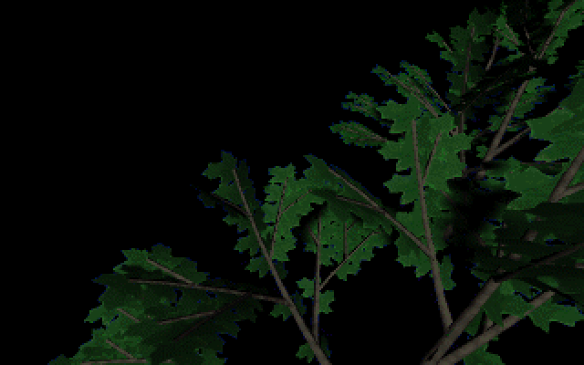
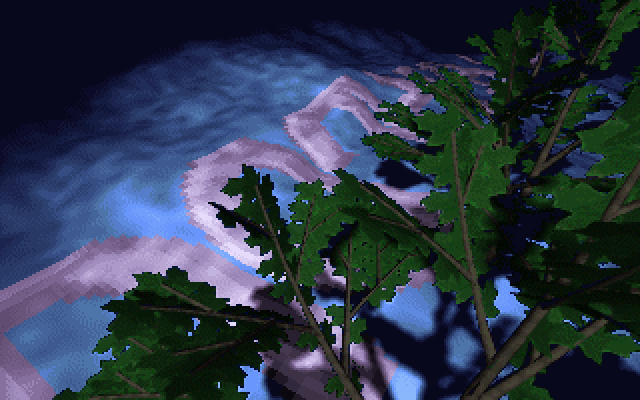
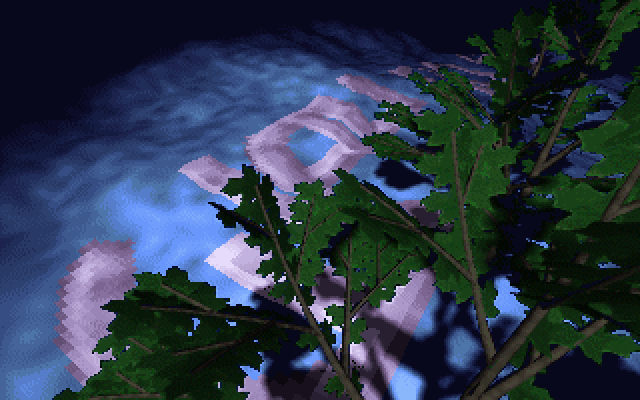
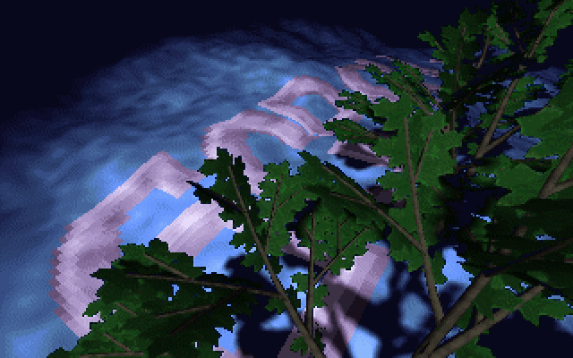

# MNTSCRL: the mountain scroller

MNTSCRL is the view up through a tree. Dark oak leaves fill the right of the screen, a cloudy blue
sky sits behind them, and a band of pale lilac lettering sweeps across the sky on a curved surface,
passing behind the leaves. The original's part list calls it `Vuori-Scrolli (TRUG)`, "mountain
scroller", and its source is in the `FOREST` directory. It follows [PANICEND](PANICEND), the fake
ending, and starts block 3 (`SECOND 3` starts the demo here). In the port's full run it begins
at frame 16,633, about 3 minutes 57 seconds in, and hands over to [LNS&ZOOM](LNS-ZOOM) about 29
seconds later. It is a short Turbo Pascal program with a small assembler blitter. All of the
3D in the effect is precomputed: the program only adds bytes.

## What you see






## The trick

### Forward texture mapping with a baked lookup

The lettering is a 640×31 strip, `O2.SCI`, with pixel values 0..7 (0 is empty, 1..7 a grey
ramp). The part holds a 237-column window of it in an array called `font`: 31 rows of 237 bytes,
7,347 **texels** (texture pixels) in all.

A normal texture mapper runs over screen pixels and asks which texel each one shows. MNTSCRL
runs the other way. For every texel of the window, a file on disk lists the screen offsets that
texel covers:

```text
POSn.DAT, for each of the 7,347 texels in order (row 0 col 0 .. row 30 col 236):
    count : u16              how many screen pixels this texel covers (0 = hidden)
    offset: u16 × count      screen offsets, x + 320·y
```

The perspective curve, the size of each texel on screen, and the occlusion by the leaves are all
in those lists. A texel behind a leaf, or off the screen, has a count of zero. One that is close
to the viewer covers more pixels; the largest covers 17. The texels that do appear cover 2.8
pixels on average. The curved band was rendered offline and the result recorded. At run time
there is no geometry, no division and no depth test.

### Draw and erase in one pass

The blitter writes every listed pixel as

```text
screen[o] = background[o] + font[texel]        (an 8-bit add, wrapping)
```

`background` is the unmodified picture, so a texel whose value is 0 puts the plain sky back. There
is no separate erase. Each pass over a list redraws its whole area, so the lettering's old
position is wiped where the new one is drawn.

### Additive colour through the palette

When the strip is loaded, every non-zero byte has 128 added to it (`:119`). The texel values are
therefore 0 or 129..135. The sky pixels behind the band use [palette entries](Hardware-primer) 1..18. The sum is

```text
sky b (1..18) + 128 + f (1..7)  =  128 + (b + f)    → entries 130..153
```

Entries 128..159 of the picture's palette are a lilac-to-white ramp, so a letter pixel shows the
lilac shade for "sky brightness plus letter brightness". The clouds' texture shows through the
lettering, and the band looks translucent and lit from behind. One 8-bit add per pixel blends the
two images. Entries 160..255 repeat entries 32..127 exactly. The few listed pixels whose background
is 32 or above (the lists cover roughly 200 such pixels each) land on the picture's own colour
`b + f`, a few steps along the same ramp.

### Smooth scrolling with three lists

There are three position lists, `POS1` to `POS3`, and the part blits one per frame in rotation.
Only after the third does it move the text. Each list holds the band at a slightly different
position. On row 0, where a texel column is about four pixels wide, texel column 7 starts at
x = 4 in `POS1`, x = 3 in `POS2` and x = 2 in `POS3`, and column 8 at x = 8, 7 and 6. Each list
moves the band about a pixel to the left, and the shift then hands column 8's contents to
column 7's positions, so the band glides in sub-texel steps instead of jumping one texel at a
time.

The three lists share no screen pixel at all: together they cover 15,592 distinct pixels, exactly
the sum of their sizes. A frame therefore rewrites a third of the band's pixels, and every pixel
is refreshed once every three frames. The text advances one strip column every three frames,
about 23 columns a second.

```text
frame n     blit POS1 with font as it is
frame n+1   blit POS2
frame n+2   blit POS3, then shift font left one column and append O2 column scp
```

### The shift

`font` is stored row after row, so moving one flat 7,347-byte array down by one byte shifts all
31 rows left at once. Each row's first byte slides into the previous row's last slot, and the
append loop then overwrites that slot with the new column from `O2.SCI`.

### The palette choreography

The part changes the palette in three stages:

1. **Fade-in, 64 frames.** Every channel steps up by one per frame towards the picture's palette,
   except that the two bands 0..31 (the sky) and 128..159 (the lettering) have black targets.
   Only the leaves appear (the first picture above).
2. **Pre-roll, 127 frames.** The scroller starts, and on every odd frame entries 0..176 step one
   level towards their real colours, so the sky and the lettering fade in behind leaves that are
   already lit.
3. **Fade-out, 65 frames.** It starts when the music player reports `dis_musplus() == -11`.
   Every channel then steps down to black, and the part ends.

## How the original did it

The whole blitter is one loop. `ds:si` walks the position list, `fs:bx` the font, and `gs` holds
the background
([`FOREST/ROUTINES.ASM:21-35`](https://github.com/mtuomi/SecondReality/blob/071a82eddb7a7390dbaa491a8a473e0e923a55c2/FOREST/ROUTINES.ASM#L21-L35)):

```asm
          mov    dx,237*31
@a:       lodsw                        ; get byte count
          or     ax,ax                 ; if 0 then hidden pixel
          je     @ei                   ; next pixel
          mov    cx,ax                 ; set loop value
@c:       lodsw                        ; get destination address
          mov    di,ax
          mov    al,byte ptr gs:[di]   ; get bground pixel
          add    al,byte ptr fs:[bx]   ; add font value to pixel
          mov    byte ptr es:[di],al   ; store pixel to screen
          loop   @c
@ei:
          inc    bx
          dec    dx
          jnz    @a
```

`scr(2)` blits the third list, then shifts the font and appends a column
([`FOREST/READ2.PAS:77-89`](https://github.com/mtuomi/SecondReality/blob/071a82eddb7a7390dbaa491a8a473e0e923a55c2/FOREST/READ2.PAS#L77-L89)):

```pascal
   2:begin
      asm
       mov   dx,seg hback
       mov   ax,seg posi3
       mov   si,offset posi3
       mov   cx,seg font
       mov   bx,offset font
       call  putrouts
      end;
      move(font[1],font[0],237*31);
      for ff := 0 to 30 do font[ff*237+236] := fbuf[ff*640+scp];
      if scp < 639 then inc(scp);
     end;
```

The +128 bias, the palette taken from the picture file, and the background blit
([`FOREST/READ2.PAS:119-123`](https://github.com/mtuomi/SecondReality/blob/071a82eddb7a7390dbaa491a8a473e0e923a55c2/FOREST/READ2.PAS#L119-L123)):

```pascal
     for x := 0 to sizeof(fbuf) do if fbuf[x] > 0 then inc(fbuf[x],128);
     move(mem[seg(hback):ofs(hback)+10],pal,768);
     move(mem[seg(hback):ofs(hback)+778], mem[seg(hback):ofs(hback)], 64000);
     for x := 0 to 255 do setrgb(x,0,0,0);
     move(mem[seg(hback):ofs(hback)],mem[$a000:0],64000);
```

The fade-out cue reads the music position through the demo's `int 0FCh` service, function 6.
It tests for exactly −11
([`FOREST/READ2.PAS:196-203`](https://github.com/mtuomi/SecondReality/blob/071a82eddb7a7390dbaa491a8a473e0e923a55c2/FOREST/READ2.PAS#L196-L203)):

```pascal
     asm
     mov   ax,0
     mov   bx,6
     int   0fch
     cmp   dx,-11
     jnz   @a
     mov   fadeout,1
@a:  end;
```

The program's `waitr` is function 1 of the same service, the demo's frame wait (see
[Demo structure](Demo-structure) and [Music](Music)).

## How the port does it

The part is
[`bins/secondreality/src/parts/mntscrl.rs`](https://github.com/waffleking32/SecondRealityRust/blob/main/bins/secondreality/src/parts/mntscrl.rs).
`Mntscrl` implements the `Part` trait (see [How the port works](How-the-port-works)). Its
`frame` method runs one tick through a `Phase` enum: `Setup`, `FadeIn`, `Wait`, `PreRoll`, `Main`
and `Done`. Each phase is one stretch of `READ2.PAS`'s straight-line program.

- `init` reads `O2.SCI` and `HILLBACK.CLX` through the port's RIX image decoder. It parses the
  three lists with `sr_assets::poslist::PosList` and checks each list against the blitter's 7,347
  columns. `pos_list` refuses any offset outside the 64,000-byte picture. `apply_bias` adds the
  +128.
- `scr` is `Putrouts` plus `scr(2)`'s shift. It uses `wrapping_add` for the 8-bit sum and
  `copy_within` for the one-byte move of the packed font.
- `ramp` and `black_bands` are the fades and the black bands. `ctx.musplus()` supplies the cue.
- The part uses no copper callbacks. It sets Mode 13h's view with `mode_view` and writes the
  surface directly.

The timeline, the mapping to the reference frames and the measurements are in
[`docs/fidelity/mntscrl.md`](https://github.com/waffleking32/SecondRealityRust/blob/main/docs/fidelity/mntscrl.md).
The four reference keyframes match the original to the pixel.

## Quirks kept

- The leaf-only fade-in: bands 0..31 and 128..159 are forced black, and the pre-roll ramps entries
  0..176 back on odd frames
  ([bugs.md §15.2](https://github.com/waffleking32/SecondRealityRust/blob/main/docs/fidelity/bugs.md)).
- The pre-roll's last upload is one step short, so entry 151's blue shows 62 instead of 63 until
  the fade-out
  ([bugs.md §15.3](https://github.com/waffleking32/SecondRealityRust/blob/main/docs/fidelity/bugs.md)).
- The fade-out fires only when `dis_musplus()` is exactly −11
  ([bugs.md §15.4](https://github.com/waffleking32/SecondRealityRust/blob/main/docs/fidelity/bugs.md)).
- The column counter `scp` stops at the release's 640, one past the tree's `639`. For row 30
  that reads `fbuf`'s last element, one past the 19,840 bytes the load fills
  ([bugs.md §15.1](https://github.com/waffleking32/SecondRealityRust/blob/main/docs/fidelity/bugs.md),
  [mntscrl.md §7](https://github.com/waffleking32/SecondRealityRust/blob/main/docs/fidelity/mntscrl.md)).
- The `veke = 2800` frame limit is dead code because `inc(frame)` is commented out. The part ends
  on the music cue
  ([mntscrl.md §8](https://github.com/waffleking32/SecondRealityRust/blob/main/docs/fidelity/mntscrl.md)).
- The wait after the fade-in is the release's measured 71 frames, not the tree's `musplus >= 0`
  test, which would hold the opening for half a minute
  ([APPROXIMATIONS.md A17](https://github.com/waffleking32/SecondRealityRust/blob/main/docs/fidelity/APPROXIMATIONS.md)).
- That wait ends on ESC, which the source's busy loop would not do
  ([APPROXIMATIONS.md A62](https://github.com/waffleking32/SecondRealityRust/blob/main/docs/fidelity/APPROXIMATIONS.md)).
- In a full run the part starts at the port's frame 16,633, four frames before the original's
  16,637
  ([APPROXIMATIONS.md A53](https://github.com/waffleking32/SecondRealityRust/blob/main/docs/fidelity/APPROXIMATIONS.md)).

---

**Previous:** [PANICEND](PANICEND) · **Next:** [LNS&ZOOM](LNS-ZOOM)
