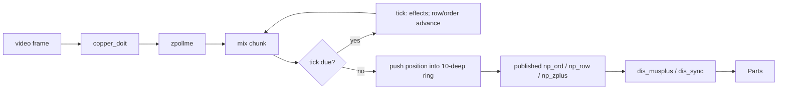

# Music

Second Reality's soundtrack is two Scream Tracker 3 modules, `MAIN/MUSIC0.S3M` (391,312 bytes, titled
"UnreaL ][ - The 2ND Reality") and `MAIN/MUSIC1.S3M` (600,860 bytes, titled "UnreaL ][ / PM"). The
demo's credits list two musicians, Skaven and Purple Motion (`CREDITS/MAIN.C`). The modules are played by
STMIK, the "Scream Tracker V3.0 Music Interface Kit" by Sami Tammilehto, which ships in the tree only as
object files (`MAIN/STMIK.300`, `MAIN/STMIKEMS.300`) and headers (`MAIN/STMIK.H`, `MAIN/STMIKA.INC`). The music is also the demo's clock: many parts wait
for a particular order and row before they start or change, so a port that gets the player's timing
wrong also gets the pictures wrong.

The port plays both modules from their shipped bytes with a player and mixer transcribed from that
object file (`crates/sr-audio`). This page covers the file format and its scrambling, how the player
keeps time, how the parts listen to it, and what the port's two sound qualities are.

## Which module plays when

On a full run ([Demo structure](Demo-structure) has the whole sequence) the shell restarts the music
three times:

| when | module, order | under |
|---|---|---|
| from the start | MUSIC0, order 0 | [ALKU](ALKU), [U2A](U2A), [PAM](PAM), [BEGLOGO](BEGLOGO) |
| just before GLENZ | MUSIC1, order 0 | [GLENZ](GLENZ) through [JPLOGO](JPLOGO) |
| just before U2E | MUSIC0, order 18 | [U2E](U2E), [ENDLOGO](ENDLOGO), [CRED](CRED), [ENDSCRL](ENDSCRL) |

Between [PANICEND](PANICEND) and [MNTSCRL](MNTSCRL) there is no restart. The shell waits for a music cue instead. Starting
at a later block restarts the music at that block's own entry: `SECOND 2` starts MUSIC1 at order 0,
`SECOND 3` MUSIC1 at 42, `SECOND 4` MUSIC0 at 18, `SECOND 5` MUSIC0 at 25 and the hidden `SECOND U`
MUSIC0 at 70. Loop mode starts MUSIC0 at order 0 again.

## The modules, and the scrambled patterns

An S3M file is a 0x60-byte header, an order list (one byte per entry: a pattern number, or 254 for a
marker, or 255 for the end), then tables of 16-bit pointers, counted in 16-byte "paragraphs", to the
instruments and patterns, then the data. Both files have 77 patterns. Both files follow the format in every respect except one: **each pattern's
packed data is XOR-scrambled**, so stock S3M players fail on them.

A pattern block starts with a 16-bit length `ln`, and that length counts its own two bytes. After it
come `ln - 2` bytes of packed rows. Each cell starts with a flag byte. Its low five bits are the
channel, bit 5 means a note and an instrument follow, bit 6 a volume, and bit 7 an effect and its
parameter. A zero byte ends the row, and every pattern has 64 rows. The demo's own loader in C,
`loads3mems`, copies those bytes into memory as they are. It never unscrambles them, so the
unscrambling has to happen inside STMIK:

```c
	for(a=0;a<patterns;a++)
	{
		b=parapat[a];
		if(!b) continue;
		lseek(h,filebase+((long)b<<4L),SEEK_SET);
		read(h,&u,2);
		p=getmem(u);
		*(int *)p=u;
		read(h,p+2,u-2);
		parapat[a]=((long)p>>16)-moduleseg;
	}
```
<sub>[MAIN/STARTEMS.C#L343-L353](https://github.com/mtuomi/SecondReality/blob/071a82eddb7a7390dbaa491a8a473e0e923a55c2/MAIN/STARTEMS.C#L343-L353)</sub>

### The keystream

For byte `i` of one pattern's packed data, counted from 0 for each pattern:

```
n      = (i >> 1) + 1
key(i) = (((n ^ (n >> 2)) << 3) | ((5*i + 2) & 7)) & 0xFF
plain[i] = stored[i] ^ key(i)
```

The key has two parts. The low three bits cycle through `2, 7, 4, 1, 6, 3, 0, 5` with period 8. The
high five bits depend only on the byte *pair* `i >> 1`, through `n ^ (n >> 2)`. The first sixteen
key bytes are

```
0a 0f 14 11 1e 1b 28 2d 22 27 3c 39 36 33 50 55
```

**Reading the keystream off the file.** The modules give the keystream away. An empty row packs to a
single zero byte, so an empty pattern is `ln = 66`: 64 zero bytes. XOR with zero changes nothing, so an
empty pattern stores the keystream itself. MUSIC0 has five such patterns (31, 73, 74, 75 and 76;
pattern 31 is played at orders 14 and 15) and MUSIC1 has three (74, 75, 76). Their stored bytes are
exactly `key(0..64)`. The longest pattern (in MUSIC1) holds 2,195 bytes of packed data, and over that
length the formula is held to a decode with no slack in it. In both files, all 77 patterns must decode as exactly 64
zero-terminated rows that end on the block's last byte, with no invalid command and no channel named
twice in one row. A wrong key byte anywhere breaks the framing of every row after it. Both files pass.

The decoded data has two traps for anyone writing their own reader. Effect bytes are ST3's numbers
(1 to 26 for `A` to `Z`), not ASCII letters. Note bytes are `(octave << 4) | semitone`, and MUSIC1
goes up to `0x80`, octave 8, one past the eight octaves STMIK's shift table covers (see Quirks kept). One MUSIC1 cell (pattern 13, row 19,
channel 5) stores a command byte of 0, which reads as "no command".

### Two load-time details

The shell's loader patches MUSIC0's initial tempo (header offset 50) from 125 to 120, and leaves
MUSIC1's alone:

```c
		switch(a)
		{
		case 0 :
			loadmodule2(0);
			//loadmodule("music0.s3m");
			module[50]=0x78;
			break;
		case 1 :
			loadmodule2(1);
			//loadmodule("music1.s3m");
			break;
```
<sub>[MAIN/STARTMUS.C#L252-L262](https://github.com/mtuomi/SecondReality/blob/071a82eddb7a7390dbaa491a8a473e0e923a55c2/MAIN/STARTMUS.C#L252-L262)</sub>

The samples are plain 8-bit unsigned PCM, with 128 as silence: 22 in MUSIC0 and 41 in MUSIC1. Both
headers enable eight channels in the channel table `0, 8, 1, 9, 2, 10, 3, 11`, where values 0-7 are
left positions and 8-15 right. So the eight channels are hard-panned left, right, left, right, and so
on.

## The trick: a tracker driven by the video frame

### Ticks, rows and the frame

A tracker counts time in **ticks**. A row lasts `speed` ticks, and the tempo sets the tick length:
`2.5 / tempo` seconds. Tempo 120 gives 48 ticks a second, so at speed 6 a row lasts 0.125 s. That is
8.76 frames of the 70.086 Hz VGA display. STMIK works the tick out in samples, as
`mixspeed × 125 / (50 × tempo)`: 833 samples at 40 kHz and tempo 120, 769 at tempo 130.

STMIK can mix from a timer interrupt, but a demo does not want interrupts arriving in the middle of
its raster tricks. So Second Reality sets `zpollmix = 1` and polls the player itself, as the header
suggests:

```c
extern char far		zpollmix;
/* if 0, the STMIK uses timer interrupt (at 70hz) to mix sound. This
   is the easiest way, but might cause problems with demos etc that
   don't want interrupts at inconvenient times, like when the VGA
   is in the retrace. if 1, then the program using the stmik must
   call the zpollme() routine often enought to keep the music
   going. In practice calling it once per frame is optimal. The
   bigger the dma buffer, the longer time the time between calls
   may be. The following procedure in using zpollmix is adviced:
```
<sub>[MAIN/STMIK.H#L150-L158](https://github.com/mtuomi/SecondReality/blob/071a82eddb7a7390dbaa491a8a473e0e923a55c2/MAIN/STMIK.H#L150-L158)</sub>

The poll sits in the shell's per-frame copper routine, after the part's frame callback (see the
[Hardware primer](Hardware-primer) for the copper):

```asm
	cmp	cs:copper_int0flag,0
	jne	@@1
	mov	cs:copper_int0flag,1
	PUSHALL
	call	cs:copper_int0
	POPALL
	mov	cs:copper_int0flag,0
@@1:
	call	_zpollme

	call	u2copperint
```
<sub>[MAIN/COPPER.ASM#L458-L468](https://github.com/mtuomi/SecondReality/blob/071a82eddb7a7390dbaa491a8a473e0e923a55c2/MAIN/COPPER.ASM#L458-L468)</sub>

Each poll mixes the next stretch of the Sound Blaster's DMA buffer, running a tick whenever a tick's
worth of samples has been mixed. The music therefore moves forward once per video frame, in
steps of about 571 samples (40000 / 70.086). The 48 Hz tick and the 70 Hz frame do not divide evenly,
so a row change falls on whichever frame is current. At speed 6 that is 8 frames on some rows and 9 on
others.



**The position a part sees is ten frames old.** STMIK publishes `np_row`, `np_pat`, `np_ord` and
`np_zplus` through a ring of position snapshots that starts ten entries deep. Each poll pushes the
player's current position and pops the oldest one, so the published words lag the player by ten
polls. A seek (`zplaysong`) does not refresh the ring. After a restart the parts go on reading the old
position until the new song's first row has worked through.

### From period to pitch

A note becomes a **period**: a 12-tone table gives C-4 = 1712, and each octave halves it. The period
is then scaled by the instrument's `c2spd` as `period × 8363 / c2spd`. Effects such as slides,
vibrato and arpeggio change the period tick by tick. The mixer turns the period into a 16.16
fixed-point step through the sample, in bytes per output frame:

```
step = (0x00DA7600 / period) × 65536 / divisor
```

`0x00DA7600` is 14,317,056 in decimal, 400 less than the textbook `8363 × 1712`. So a C-4 at 8363 Hz
plays at 8,362 bytes a second. In stereo the divisor is a word that holds **21111**, while the card
plays 20,000 stereo frames a second. As a result every voice plays `20000 / 21111` of its pitch,
5.26 % (about 94 cents) flat. The shell doubles the mono rate for the SB Pro but never writes the
stereo word, so the reference sounds this way, and the port keeps it.

### Mixing through two tables

The mixer reads one sample byte per output frame, with no interpolation. It looks the byte up in a
precomputed **volume table** of 64 levels × 256 values, `(sample × scale[level]) >> 8` where
`scale[level] = floor(level × 255 / 63)`, and adds the result into a 16-bit accumulator. One
accumulator collects the channels panned to positions 0-7 (left), the other those at 8-15 (right).
At the end of the buffer the channels' summed centres are taken off each word, and the signed `sum`
that is left goes through an **output curve**, a byte table indexed at `0x400 + sum`.

The curve is meant to be a long run of zeros, a ramp and then `0xFF`s. Its builder has a bug: a
`rep stosw` leaves `CX` at zero, so the `rep stosb` after it writes nothing, and the zero region comes
out half as long as intended. The table the machine actually holds puts the ramp at entries 768-1279,
one output level for every two entries:

```
out_byte = 0x00                     for sum <= -257
           floor((sum + 256) / 2)   on the ramp
           0xFF                     for sum >= +256
```

## How the parts sync to the music

A part never touches STMIK. It calls the Demo Interrupt Server (DIS), whose music services read the
published words. Three are in use:

- **`dis_musplus()`** gives a countdown to the order list's `254` markers. When an order is entered,
  STMIK sets `np_zplus` bit 0 if the *next* entry is a 254, and bit 1 if the order was reached by
  stepping *over* one. The DIS turns that into a number. Before a marker it is `row - 64`, clamped at
  -32, so it climbs -31 … -1 over the order's second half. After the marker it is the row itself
  while the row is below 32. Everywhere else it is the sentinel -32 (`mov dx,-32` at
  [DISINT.ASM#L252](https://github.com/mtuomi/SecondReality/blob/071a82eddb7a7390dbaa491a8a473e0e923a55c2/DIS/DISINT.ASM#L252)):

```asm
        cmp     es:_np_zplus,2
        je      @@1e
@@1eb:  cmp     bx,32
        ja      @@1b
@@1e:   mov     dx,bx
        cmp     dx,32
        jb      @@1a
        mov     dx,-32
        jmp     @@1a
@@1b:   ;plus coming
        mov     dx,bx
        sub     dx,64
        cmp     dx,-32
        jge     @@1a
        mov     dx,-32
```
<sub>[DIS/DISINT.ASM#L257-L271](https://github.com/mtuomi/SecondReality/blob/071a82eddb7a7390dbaa491a8a473e0e923a55c2/DIS/DISINT.ASM#L257-L271)</sub>

  As a picture, for an order whose successor is a 254:

  ```
  row:       0 ........ 32  33 34 ... 62 63 | (254 stepped over) | 0  1  2 ... 31  32 ...
  zplus:     1                              |                    | 2
  musplus:  -32 ...... -32 -31 -30 ... -2 -1 |                    | 0  1  2 ... 31 -32 ...
  ```

  So [GLENZ](GLENZ)'s `while(!dis_exit() && dis_musplus()<-19);`
  ([GLENZ/MAIN.C#L290](https://github.com/mtuomi/SecondReality/blob/071a82eddb7a7390dbaa491a8a473e0e923a55c2/GLENZ/MAIN.C#L290))
  waits until row 45 of the order before a marker. [TECHNO](TECHNO), [PLZPART](PLZPART) and JPLOGO use the same
  countdown.

- **`dis_sync()`** looks the position up in a 15-entry table `ordersync1` of `(order << 8 | row, code)`
  pairs. [ALKU](ALKU) uses it for its three title cards, the picture's fade-in and the text over the
  horizon pan, and [PAM](PAM) for its start
  (`while(dis_sync()<10&&!dis_exit());`). The lookup returns the code of the entry *before* the first
  key at or above the position. That is an off-by-one, and the callers depend on it:

```asm
sync_10 PROC NEAR
        IFDEF INDEMO
        mov     es,cs:stmikseg
        mov     dh,byte ptr es:_np_ord
        mov     dl,byte ptr es:_np_row
        mov     bx,OFFSET ordersync1
        mov     cx,16
@@2:    cmp     dx,cs:[bx]
        jbe     @@1
        add     bx,4
        loop    @@2
@@1:    mov     ax,cs:[bx-2]
        ENDIF
        ret
sync_10 ENDP
```
<sub>[DIS/DISINT.ASM#L449-L463](https://github.com/mtuomi/SecondReality/blob/071a82eddb7a7390dbaa491a8a473e0e923a55c2/DIS/DISINT.ASM#L449-L463)</sub>

  At `(0, 0)` the `[bx-2]` read lands on the two bytes before the table, the `pop es; ret` that ends
  the previous routine. A C caller receives them as -15609, so every `dis_sync() < N` keeps waiting
  there. The loop also runs 16 times over 15 entries, so above the last key it compares against the
  bytes that follow the table, `sync_10`'s own first instruction.

- **`dis_getmframe()` / `dis_setmframe()`** read and write `np_zframe`, a counter of *ticks* (not
  video frames) that parts reset and use as a clock.

`dis_muscode()` returns STMIK's `np_zinfo`. Nothing in either module sets it, and it reads 0 in every
measured run. No part the demo runs calls it: its callers are the parts in [the vault](The-Vault)
and an unshipped build of BEGLOGO (`ENDPIC/BEG.C`).

The shell's restarts go through `restartmus` (`ax` = module, `bx` = order). This is the one before
U2E:

```asm
        test    cs:whattorun,8
        jz      @@skipp4
        mov     ax,0
        mov     bx,18
        mov     cx,45000
        call    restartmus
        mov     si,OFFSET exe19
        call    partexecute
```
<sub>[MAIN/U2.ASM#L880-L887](https://github.com/mtuomi/SecondReality/blob/071a82eddb7a7390dbaa491a8a473e0e923a55c2/MAIN/U2.ASM#L880-L887)</sub>

## How the port does it

The music code is in four crates and files, with no third-party dependencies:

- [`crates/sr-audio/src/module.rs`](https://github.com/waffleking32/SecondRealityRust/blob/main/crates/sr-audio/src/module.rs)
  is the container. `Module::load` follows `loads3mems`'s layout, and `descramble` applies the
  keystream to each pattern as it loads, so no decoded copy is ever written to disk. `Cell` keeps a `present`
  mask, because a cell whose only content is a volume of 0 must still set the volume to 0. `Song`
  pairs a module with its load-time patch, and the tempo patch applies to MUSIC0 only.
- [`crates/sr-audio/src/player.rs`](https://github.com/waffleking32/SecondRealityRust/blob/main/crates/sr-audio/src/player.rs)
  is the tracker. `Player::poll` is one `zpollme`. It counts samples in units of 1/70,086 so a poll's
  fraction carries over exactly, runs ticks at `mix_rate × 2.5 / tempo`, does the order advance
  (`254` stepped over, `zplus` bits, `255` end or loop), and publishes through the ten-deep ring.
  `Player::restart_from` handles the shell's restarts.
- [`crates/sr-audio/src/effects.rs`](https://github.com/waffleking32/SecondRealityRust/blob/main/crates/sr-audio/src/effects.rs)
  holds `Channel`, the per-channel state, and the channel effects: `D E F G H J K O Q` and `SDx`
  (the player handles the song-level `A`, `B` and `C`), dispatched through the object's separate first-tick and later-tick tables.
- [`crates/sr-audio/src/mix.rs`](https://github.com/waffleking32/SecondRealityRust/blob/main/crates/sr-audio/src/mix.rs)
  is the mixer: `VOLUME_SCALE`, `step`, `Curve::build` (the builder bug included), and `Mixer`, whose
  bounded ring stands in for the DMA buffer.

STMIK has no source in the tree, so all of this is transcribed from a disassembly of the segment image
rebuilt from `STMIK.300`'s OMF records. A test reads the port's tables back out of that image.

On the engine side,
[`crates/sr-engine/src/music.rs`](https://github.com/waffleking32/SecondRealityRust/blob/main/crates/sr-engine/src/music.rs)
is the whole interface a part gets: a `Music` trait with the DIS calls, `musplus_from` and `sync_from`
(the DIS arithmetic, off-by-one and table ends included), and `NoMusic` for runs without a player. A
part reaches it through `PartCtx::musplus()`, `musrow()`, `getmframe()` and `music()`. The engine polls
the music once per tick, between copper slot 0 and the first band, as `copper_doit` does (see
[How the port works](How-the-port-works)).

The binary connects the two crates.
[`bins/secondreality/src/shell/music.rs`](https://github.com/waffleking32/SecondRealityRust/blob/main/bins/secondreality/src/shell/music.rs)
holds `MUSIC_RESTARTS`, the shell's restart table, and `MusicStart`, which decides when the clock
starts: frame 408, or 400 for block 1. A run that starts later polls ahead to catch up.
[`bins/secondreality/src/audio.rs`](https://github.com/waffleking32/SecondRealityRust/blob/main/bins/secondreality/src/audio.rs)
holds `PlayerMusic`, the SDL device and `fade_music`. The device only drains: it copies whatever the
ring holds and fills any shortfall with silence. It never stalls or resamples, because the music's
position belongs to the tick and not to the sound card. The frames do not depend on the sound card:
`--no-audio`, `--audio-dump <wav>` (16-bit stereo, 20,000 Hz with authentic sound) and `--headless`
still have the music drive the picture. The timing is checked against
traces of the original player's state (see [How it is verified](How-it-is-verified)).

The details and their evidence are in
[docs/fidelity/music.md](https://github.com/waffleking32/SecondRealityRust/blob/main/docs/fidelity/music.md)
(the container, player and mixer, read from the object) and
[docs/fidelity/music-clock.md](https://github.com/waffleking32/SecondRealityRust/blob/main/docs/fidelity/music-clock.md)
(what the traces show).

### Authentic and enhanced sound

`--sound-quality authentic` is the default. It is the object's own mixer: one sample byte held per
frame at 20 kHz, through the 8-bit curve, 5.26 % flat. The stepping is audible.

`--sound-quality enhanced` (also on the settings screen) is the port's own renderer at 48 kHz. It walks
the same voices with the same steps on the same tick schedule. It turns each authentic frame into 2
or 3 output frames with an exact 12/5 accumulator, interpolates each voice linearly between sample
bytes, applies the curve's small-signal gain and clamps to 16 bits. Pitch is the same by construction,
flatness included. Level is within 1 dB. Every published position matches the authentic path at every
poll, so the pictures are identical under either setting.

## Quirks kept

- `dis_sync()` returns the previous table entry's code and reads before the table at `(0,0)`:
  [bugs.md §3](https://github.com/waffleking32/SecondRealityRust/blob/main/docs/fidelity/bugs.md).
- A restart keeps the previous song's channel volumes, so MUSIC1's order 0 breaks after 4 rows on
  block 1: [bugs.md §28.1](https://github.com/waffleking32/SecondRealityRust/blob/main/docs/fidelity/bugs.md).
- The "volume 0" optimisation frees a silent channel before its `C00` pattern break can run:
  [bugs.md §28.2](https://github.com/waffleking32/SecondRealityRust/blob/main/docs/fidelity/bugs.md).
- `A` has no upper bound, so MUSIC1's `A7F` gives sixteen rows of 127 ticks:
  [bugs.md §28.3](https://github.com/waffleking32/SecondRealityRust/blob/main/docs/fidelity/bugs.md).
- The output curve's builder clobbers its own count:
  [bugs.md §28.4](https://github.com/waffleking32/SecondRealityRust/blob/main/docs/fidelity/bugs.md) (A14, closed).
- Stereo plays 5.26 % flat because the stereo divisor stays at 21111:
  [bugs.md §28.5](https://github.com/waffleking32/SecondRealityRust/blob/main/docs/fidelity/bugs.md).
- Note `0x80` reads past the eight-byte octave-shift table and plays octave 0's period; the base
  constant is 400 short of `8363 × 1712`:
  [music.md §9.2, §9.11](https://github.com/waffleking32/SecondRealityRust/blob/main/docs/fidelity/music.md).
- The tick clock is exact, while the reference's frame counter drifts slightly with host timing (row
  changes agree within 7 frames): A12 in
  [APPROXIMATIONS.md](https://github.com/waffleking32/SecondRealityRust/blob/main/docs/fidelity/APPROXIMATIONS.md).
- The curve's index is clamped at the table's ends, where the object would read neighbouring bytes of
  its code segment: A13.
- `dis_sync()` above key `0x8E2E` panics instead of returning a build-dependent word: A15.
- A run installs its own entry module, skipping the boot's twelve-frame MUSIC1 transient: A16.
- A mid-run restart starts a fresh position ring and does not carry the old one: A55.
- `dis_muscode()` returns 0, the only value `np_zinfo` is ever measured at: A56.
- The enhanced renderer is registered because it sounds different from the original: A60.
