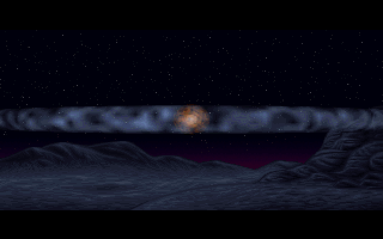

# PAM: the explosion

PAM is a short part, about two and a half seconds long. After the ships of [U2A](U2A) have gone, the screen flashes white. The landscape comes back with a planet-sized explosion in the sky above the horizon, a bright core with a flat shockwave ring spreading sideways across the sky. As the ring widens, everything washes out to white again, and from that white [BEGLOGO](BEGLOGO) fades in the Future Crew logo. It runs about 110 s into the demo. The demo's part table labels it `Alkutekstit III (TRUG/WILDF)`, opening credits part III, by Trug and Wildfire. The source is in `PAM/`. The animation comes from an Autodesk FLI file (`PRAX4.FLI`): `VFLI.C` decodes it to raw 320×200 frames (`out.u`) and its palette (`pal.pal`), and `ANIM.C` packs those frames into the part's own delta format (`OUT.ANI`).

## What you see




## The trick

PAM is a video player with two small ideas: a delta codec designed for planar VGA memory, and a white flash done entirely in the palette.

### 1. Deltas against the frame before last

The player shows the animation with **double buffering**. It draws a frame into the hidden page, flips, and draws the next frame into the other page. So when frame *n* is being drawn, the page underneath it still holds frame *n−2*, not *n−1*. The packer (`ANIM.C`) accounts for this: it compares each new frame with the frame **two back** and stores only what differs from it.

```
page 0:  f0 ──► f2 ──► f4 ──► ...     each arrow: "patch f(n-2) into f(n)"
page 1:     f1 ──► f3 ──► f5 ──► ...
```

Video memory starts cleared (`tw_opengraph` zeroes it after the mode set), and the packer's two frame buffers start zeroed too, so the first two frames are deltas against black.

The format is a byte stream per frame, which works well for an explosion over a still background:

| byte `c` | meaning |
|---|---|
| `c < 0` | skip `−c` pixels (unchanged) |
| `c > 0` | the next byte is a colour: fill `c` pixels with it |
| `c = 0` | end of frame |

Runs are capped at 119 pixels, so a count fits in a signed byte. Each frame starts on a 16-byte boundary, which lets the player move its segment register to the next frame without carrying a 32-bit pointer.

### 2. Filling runs four pixels at a time

In unchained 256-colour mode, pixel `n` of a 320×200 page lives in plane `n & 3` at byte `n >> 2` (see [Hardware primer](Hardware-primer)). The VGA's **map mask** register selects which planes a CPU write reaches, so one byte write can set up to four horizontally adjacent pixels to the same colour. That is exactly what a run-length fill needs:

```
pixels:   . . . X | X X X X | X X X X | X X . .
          start   |   middle bytes    |  end
mask:     1000    |    1111 (all)     | 0011
```

(Masks are written as binary with bit *k* = plane *k*, so `1000` is plane 3 alone, the last pixel of its byte.)

`ulosta_frame` handles every run as up to three pieces. A partial first byte uses a mask from table `taulu`. The middle uses mask `0Fh` with `rep stosw`, so each 16-bit word written sets 8 pixels. A partial last byte uses `ntaulu`. Short runs that fit in one or two bytes, and single pixels, have their own paths. A skip just adds to the destination pixel counter, so unchanged pixels cost nothing.

### 3. The flash is all palette

At start-up PAM computes 64 copies of the animation's palette, each one washed further toward white:

```
pal[a][c] = (63·a + (64 − a)·pal[0][c]) / 64        a = 0..63
```

Copy 0 is the true colours, and copy 63 is almost white. A fixed table `wfade` then picks a copy for each step of the animation:

```
step:   (start) 1   2   3  4  5  6  7 .. 29  30 31 32 33 34 35 36 37 38 39 40  41-45
copy:     63    32  16  8  4  2  1  0 ..  0   1  2  4  6  9 14 20 28 37 46 56   63
```

The palette is set to copy 63 before the loop, so the part opens on a flat white screen. The amount of white then halves on each step (63, 32, 16, ... 1, 0), which reads as the decay of a flash. Normal colours hold from step 7 to step 29, and from step 30 the wash rises again, slowly and then quickly, back to copy 63's near-white. Each step's copy is queued for the copper interrupt to upload during the retrace after the frame is drawn, so picture and palette change together.

### 4. Timing

The copper counts retraces in `frame_count`, and the loop waits for four of them before each step. That gives 70/4 ≈ 17.5 animation frames a second. There are 45 steps: 40 draw a frame, and the last 5 only hold the white. The part starts when the music's sync code reaches 10 (see [Music](Music)).

## How the original did it

The whole player, `OUTTAA.C`'s loop:

```c
	while(!dis_exit() && f++<45)
		{
		while(frame_count<4); frame_count=0;
		if(f<=40)
			{
			if(p)   {
				p=0;
				ulosta_frame(0x0a400);
				tw_setstart(16384);
				}
			else	{
				p=1;
				ulosta_frame(0x0a000);
				tw_setstart(0U);
				}
```
[PAM/OUTTAA.C#L46-L60](https://github.com/mtuomi/SecondReality/blob/071a82eddb7a7390dbaa491a8a473e0e923a55c2/PAM/OUTTAA.C#L46-L60), followed by `cop_pal=&pal[768*wfade[f]]; do_pal=1;`. Page 1 starts at segment `0A400h`, byte 16384 into video memory, and `tw_setstart` points the CRTC at it.

The washed palettes and the fade table:

```c
int	wfade[100]=    {63,32,16,8,4,2,1,0,0,0,
			0,0,0,0,0,0,0,0,0,0,
			0,0,0,0,0,0,0,0,0,0,
			1,2,4,6,9,14,20,28,37,46,
			56,63,63,63,63,63,63,63,63,63,63,63,63,63,63,63,63,63,63};
```
[PAM/OUTTAA.C#L22-L26](https://github.com/mtuomi/SecondReality/blob/071a82eddb7a7390dbaa491a8a473e0e923a55c2/PAM/OUTTAA.C#L22-L26) and
`pal[a*768+b]=(63*a+(64-a)*pal[b])/64;` ([L36-L37](https://github.com/mtuomi/SecondReality/blob/071a82eddb7a7390dbaa491a8a473e0e923a55c2/PAM/OUTTAA.C#L36-L37)).

The packer, comparing the new frame `p1` with what the page will hold, `p2` (two frames back):

```c
	while(cnt<64000)
		{
		if(*p1!=*p2)
			{
			for(a=1;*p1==*(p1+a) && *(p1+a)!=*(p2+a) && a<120 && cnt+a<64000;a++);
			fputc(a,out);
			fputc(*p1,out);
			p1+=a; p2+=a; cnt+=a;
			}
		else	{
			for(a=1;*(p1+a)==*(p2+a) && a<120 && cnt+a<64000;a++);
			fputc(-a,out);
			p1+=a; p2+=a; cnt+=a;
			}
		}
```
[PAM/ANIM.C#L44-L58](https://github.com/mtuomi/SecondReality/blob/071a82eddb7a7390dbaa491a8a473e0e923a55c2/PAM/ANIM.C#L44-L58)

The player's dispatch loop at the top of `ulosta_frame`. A negative byte is a skip, and skips can chain:

```asm
@@looppi:
	lodsb
	cmp	al, 0d
	jg	@@outtaa
	je	@@over
@@skip:
	cbw
	sub	di, ax

	lodsb
	cmp	al, 0d
	jl	@@skip
	je	@@over
```
[PAM/ASMYT.ASM#L41-L53](https://github.com/mtuomi/SecondReality/blob/071a82eddb7a7390dbaa491a8a473e0e923a55c2/PAM/ASMYT.ASM#L41-L53)

The start and end masks are the tables `taulu db 1111b,1110b,1100b,1000b` and `ntaulu db 0001b,0011b,0111b,1111b`, indexed by the pixel's position within its byte ([ASMYT.ASM#L12-L13](https://github.com/mtuomi/SecondReality/blob/071a82eddb7a7390dbaa491a8a473e0e923a55c2/PAM/ASMYT.ASM#L12-L13)); a single pixel uses `ptaulu db 1,2,4,8`.

## How the port does it

The part is [`bins/secondreality/src/parts/pam.rs`](https://github.com/waffleking32/SecondRealityRust/blob/main/bins/secondreality/src/parts/pam.rs) (`Pam`). `Pam::washes` builds the 64 palette copies with the original's integer arithmetic. `WFADE` is the table verbatim, and `step` draws one frame into the off-screen page and queues its palette copy. `CopperState::slot2` is `copper2`: it counts retraces and uploads the queued palette in the engine's retrace slot. The loop's `while(frame_count<4);` becomes a check at the top of each tick (see [How the port works](How-the-port-works)).

The `.ANI` decoder is in [`crates/sr-assets/src/anim.rs`](https://github.com/waffleking32/SecondRealityRust/blob/main/crates/sr-assets/src/anim.rs). It reads `OUT.ANI` in its original format, applying each frame onto the frame two back, and a test cross-checks all 42 frames against `PRAX4.FLI`. Because the port's surface addresses unchained memory as `4 × byte + plane`, `ulosta_frame`'s plane-and-byte writes come out as plain linear pixels, and page 1 sits at pixel `0x4000 × 4` (`PAGE_ORIGIN`). The timeline, the anchor at boot frame 7710 and the reference comparisons are in [docs/fidelity/pam.md](https://github.com/waffleking32/SecondRealityRust/blob/main/docs/fidelity/pam.md).

## Quirks kept

- The FLI header counts 41 frames, the container holds 42, and the loop draws 40. Steps 41-45 only re-queue white ([bugs.md §11](https://github.com/waffleking32/SecondRealityRust/blob/main/docs/fidelity/bugs.md)).
- `wfade` has 100 entries and only entries 1-45 are used. The opening white is the palette set before the loop, not a step ([pam.md §1](https://github.com/waffleking32/SecondRealityRust/blob/main/docs/fidelity/pam.md)).
- `ruudulle`, a second blitter in `ASMYT.ASM`, is never called and is not ported ([pam.md §7](https://github.com/waffleking32/SecondRealityRust/blob/main/docs/fidelity/pam.md)).
- The FLI decoder gives defined behaviour to malformed input, where the tree's player has none ([APPROXIMATIONS.md A3](https://github.com/waffleking32/SecondRealityRust/blob/main/docs/fidelity/APPROXIMATIONS.md)), and follows the FLI format on two points where `VFLI.C` reads it differently (A4).
- At the 7900 reference frame the captured index plane already holds BEGLOGO's white field, while PAM's palette is still in the DAC. The RGB matches exactly ([APPROXIMATIONS.md A21](https://github.com/waffleking32/SecondRealityRust/blob/main/docs/fidelity/APPROXIMATIONS.md)).

---

**Previous:** [U2A](U2A) · **Next:** [BEGLOGO](BEGLOGO)
