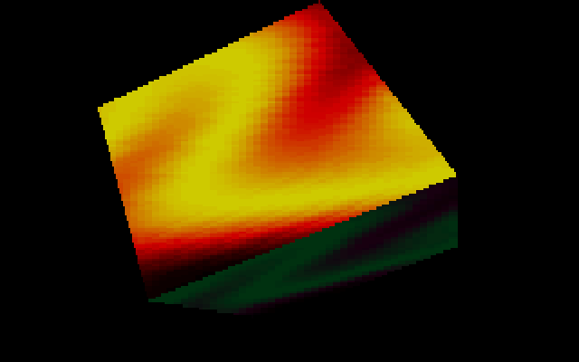

# PLZPART: the plasma and the plasma cube

PLZPART is two effects. First a full-width **plasma** of slowly flowing colour bands, in three
palettes, each of which falls off the bottom of the screen as if dropped before the next fades in.
Then a **cube** whose faces are covered in rippling sine-wave patterns turns towards and away from
the viewer, its faces shading as they turn to a light. The original's part list credits
`Plasma (WILDF)` + `Plasmacube (WILDF)`, in the `PLZPART` directory. It follows
[LNS&ZOOM](LNS-ZOOM) in block 3 and hands over to [MINVBALL](MINVBALL). In the port's full run it
begins at frame 21,928, about 5 minutes 13 seconds in. The plasma runs about 37 seconds and the
cube about 30.

## What you see




## The trick: the plasma

### Sines of sines

A plasma is a function of `(x, y, t)` drawn through a palette. This one adds two terms, each a
sine whose phase is itself shifted by another sine. That "sine of a sine" is what makes the bands
bend and flow instead of forming a regular grid. The four lookups use three tables, generated
offline by code that is still in `PLZ.C` behind `DO_TABLES`:

```text
psini[a]   = 55 sin(θ) + 5 sin(6θ) + 4 sin(21θ) + 64          θ = 2πa/4096   (16,384 bytes)
lsini4[a]  = (55 sin(θ) + 8 sin(5θ) + 2 sin(15θ) + 64) · 8                    (8,192 words)
lsini16[a] = (55 sin(θ) + 5 sin(4θ) + 3 sin(17θ) + 64) · 16                   (8,192 words)
```

The harmonics give each sine some wobble. For byte `r` of line `y`, and four phase parameters
`c1..c4`, the value is

```text
b     = lsini16[c2 + 320 − 4r + y]
d     = lsini4 [c4 + 16r + y]
value = psini[c1 + 8r + b] + psini[c3 + 320 − 4r + d + 2y]       (8-bit add, wrapping)
```

The palette index is simply that byte. Each frame the copper interrupt nudges the four phases by
small constants (`k1 −= 3`, `k2 −= 2`, `k3 += 1`, `k4 += 2`, each masked to 0..4095), and the
pattern drifts.

### No arithmetic at run time: patched addresses

`plzline` computes one line's 84 bytes as 336 memory reads and 84 adds. Each table lookup is an
instruction whose displacement already contains the table base, the parameter and the `r` term.
`setplzparas` writes those 336 displacements into the code before a pass, so the inner loop does
no index arithmetic of its own: the CPU's addressing adds `si`, `di` or `bx` to the patched
displacement.

### Two plasmas in a checkerboard

The screen is an unchained 320×400 mode (see [Hardware primer](Hardware-primer)). A byte address
is four pixels, one in each plane. `plz()` draws the screen in four passes, with the sequencer's
plane mask set to two planes at a time and with two parameter sets, `k` and `l`:

| pass | planes | lines | parameters |
|---|---|---|---|
| 1 | 1, 3 | even | `k` |
| 2 | 1, 3 | odd | `l` |
| 3 | 0, 2 | odd | `k` |
| 4 | 0, 2 | even | `l` |

Pixel `(x, y)` shows plasma `k` where `x + y` is odd and plasma `l` where it is even: two
different plasmas, moving at different speeds, woven into a checkerboard. The eye averages them
into one richer pattern.

The copper's `pompota` also alternates two registers every frame: the line-compare split between
lines 60 and 61, and the horizontal pan between 0 and 2 pixels. Moving the picture by one line and
two pixels lands each screen pixel on the other plasma's checkerboard square. The two plasmas
therefore alternate in time as well as in space.

### The screen, the split and the drop

The plasma occupies 280 lines of the 400. The upper part of the display points at black memory,
and the line-compare register (the split) starts the plasma below it at line 60. Switching
palette is a little physics show. `do_drop` moves the split down along a table of
`c²/4 · 43/128 + 60` for `c = 0..64`, a parabola, so the whole plasma accelerates off the bottom
of the screen like a falling object. Then the split snaps back, the phase parameters are reset
to that palette's starting values, and the new palette fades in.

### Palettes and the fade

The five palette tables are built from `ptau`, a half-cosine ease from 0 up to 63, laid out as
four 64-entry runs (in the first table: red rising, red falling, blue rising, then red rising
while blue falls). The fade is fixed point: `fadepal` holds an 8.8 accumulator per channel, and
during a fade the copper adds the table's step to it every frame and uploads the high bytes. The
tables are stored pre-scaled for that: `×8` for the later tables, which then fade up from black
in 31 frames. The first table is stored as `(v − 63)·2`, a negative step, and is faded over about
128 frames. Starting from zero (as the port has it), the colour byte steps down through 255, 254
and so on. The DAC keeps only the low six bits, so those read as 63, 62 and onwards, and each
colour descends from white to about `v`: the first plasma fades in from white.

On each switch, `memset(fadepal, 0, 768)` clears only the first 768 bytes of the 1,536-byte
accumulator array. Those are the colour bytes. The fractions survive, so the leftover fraction
from the previous table leaks into the next fade, and the port keeps that.

The timetable in `PLZ.C` switches tables at music-frame counts 723, 1491 and 1875. The plasma
shows three palettes and ends once the third switch's drop has finished.

## The trick: the cube

The cube is eight points, six quads and a camera path. Each frame:

1. **The camera spline.** `getspl` evaluates a four-point spline over a list of control
   points, with 256 steps per segment and weights from a coefficient table. It yields the cube's
   three rotation angles, its offset and distance, and two light angles. The cube moves to the
   next control point every 64 frames.
2. **Rotate and project.** A rotation matrix in fixed point is built from sine tables, then
   `x' = x·256/z + 320`, `y' = y·142/z + 66`.
3. **Cull and shade.** A face whose normal points away from the viewer is skipped. Each visible
   face's shade is `light · normal / 250000 + 32`, in the range 0..64.
4. **Texture.** `do_poly` scans the quad edge by edge in 16.16 fixed point, and the span loop
   walks the texture linearly.

Shading is done in the palette, not on the pixels. The faces come in three colours, and each
colour owns a 64-entry band of the palette. Each band is a black-to-white blue ramp, a
black-red-yellow ramp, or a dark violet-to-green one. The texture
`kuva[y][x] = sini[(y·4 + sini[x·2]) & 511]/4 + 32` is again a sine of a sine. It stays inside
one band, and `shadepal` scales that band's 64 colours by `shade/64`. The faces that share a
colour are opposite each other, so at most one of them is visible and the band's shade belongs to
it.

The ripple: each texel fetch first reads `dist1`, a sine of the texture row, and adds it to the
`x` coordinate. The routine starts `dist1` one row further every frame (`dd = frames & 63`), so
the sideways wave runs through the texture and loops every 64 frames.

The screen is a 134-row mode: CRTC register 9 shows each row on three of 400 scanlines. Rows are
160 bytes wide (640 pixels), and the display starts 160 pixels in, which is why the projection
centres x on 320. The span loop writes each texel to all four planes at once, so a texel is four
pixels wide. On alternate frames the cube is drawn two pixels to the right and the display is
panned two pixels back. The image stays in place while its 4-pixel grid alternates between two
positions. Three buffers rotate, and the screen always shows the one drawn on the previous frame.
Instead of clearing a buffer, `do_clear` compares each row's drawn extent with the extent from
the last time that buffer was used, and blanks only the slivers the new frame no longer covers.

## How the original did it

One plasma byte: two table reads that make the address of the third and fourth
([`PLZPART/ASMYT.ASM:43-52`](https://github.com/mtuomi/SecondReality/blob/071a82eddb7a7390dbaa491a8a473e0e923a55c2/PLZPART/ASMYT.ASM#L43-L52)).
The `0c100h`..`0c400h` displacements are placeholders that `setplzparas` overwrites:

```asm
IF (ccc AND 1) EQ 1

lc2_&ccc=$+2
        mov     bx, [ds:si+0c200h]
lc1_&ccc=$+2
        mov     ah, [ds:ccc*32 + bx + 0c100h]
lc4_&ccc=$+2
        mov     bx, [ds:ccc*64 + di + 0c400h]
lc3_&ccc=$+2
        add     ah, [ds:bx + di + 0c300h]
```

The first two of the four passes
([`PLZPART/PLZ.C:96-105`](https://github.com/mtuomi/SecondReality/blob/071a82eddb7a7390dbaa491a8a473e0e923a55c2/PLZPART/PLZ.C#L96-L105)):

```c
		asm	mov dx, 3c4h
		asm	mov ax, 0a02h
		asm	out dx, ax

		setplzparas(k1,k2,k3,k4);
		for(y=0;y<MAXY;y+=2)
			plzline(y,0x0a000+y*6+YADD*6);
		setplzparas(l1,l2,l3,l4);
		for(y=1;y<MAXY;y+=2)
			plzline(y,0x0a000+y*6+YADD*6);
```

`pompota`, run by the copper every frame, alternates the split line and the pan
([`PLZPART/COPPER.ASM:128-141`](https://github.com/mtuomi/SecondReality/blob/071a82eddb7a7390dbaa491a8a473e0e923a55c2/PLZPART/COPPER.ASM#L128-L141)):

```asm
	mov	[cs:cop_scrl], 4d
	mov	dx, 3d4h
	mov	ax, 3c18h
	out	dx, ax
	mov	ax, 0f07h
	out	dx, ax			; 8th bit
	mov	ax, 3c18h
	inc     [cs:pompi]
	test    [cs:pompi], 1d
	jz      @@l1
	mov	[cs:cop_scrl], 0d
	mov	ax, 3d18h
@@l1:
	out	dx, ax
```

The drop's parabola
([`PLZPART/COPPER.ASM:175-181`](https://github.com/mtuomi/SecondReality/blob/071a82eddb7a7390dbaa491a8a473e0e923a55c2/PLZPART/COPPER.ASM#L175-L181)):

```asm
LABEL	dtau Word
ccc=0
cccc=0
REPT	65				; 43=dy*512/dt²
	dw	ccc*ccc/4*43/128+60
ccc=ccc+1
ENDM
```

The cube's textures and the ripple table
([`PLZPART/PLZFILL.C:57-65`](https://github.com/mtuomi/SecondReality/blob/071a82eddb7a7390dbaa491a8a473e0e923a55c2/PLZPART/PLZFILL.C#L57-L65)):

```c
	for(y=0;y<64;y++) for(x=0;x<256;x++)
		{
		kuva1[y][x]=sini[(y*4+sini[x*2])&511]/4+32;
		kuva2[y][x]=sini[(y*4+sini[x*2])&511]/4+32+64;
		kuva3[y][x]=sini[(y*4+sini[x*2])&511]/4+32+128;
		}

	for(y=0;y<128;y++) for(x=0;x<256;x++)
		dist1[y][x]=sini[y*8]/3;
```

Back-face culling and palette shading in `sort_faces`
([`PLZPART/VECT.C:230-240`](https://github.com/mtuomi/SecondReality/blob/071a82eddb7a7390dbaa491a8a473e0e923a55c2/PLZPART/VECT.C#L230-L240)):

```c
		s = kx*nx + ky*ny + kz*nz;		// skalaaritulo

		if(s>0)  { a++; continue; }

		s=(ls_x*nx+ls_y*ny+ls_z*nz)/250000+32;
		light_src[p]=s;
		c=object.pg[a].color;
		if(lls[p]!=light_src[p])
			{
			shadepal(&fpal[c*64*3],&pal[c*64*3], light_src[p]);
			lls[p]=light_src[p];
```

(`skalaaritulo` is Finnish for "dot product".)

## How the port does it

The part is a directory,
[`bins/secondreality/src/parts/plzpart/`](https://github.com/waffleking32/SecondRealityRust/blob/main/bins/secondreality/src/parts/plzpart/mod.rs),
with one module per source file's job:

- [`tables.rs`](https://github.com/waffleking32/SecondRealityRust/blob/main/bins/secondreality/src/parts/plzpart/tables.rs)
  parses the original `.INC` table fragments in their own `db`/`dw` text format.
  `plasma_value` is the index expression above.
- [`copper.rs`](https://github.com/waffleking32/SecondRealityRust/blob/main/bins/secondreality/src/parts/plzpart/copper.rs)
  holds `CopperState`, shared between the part and its callbacks. The three copper routines are
  registered on the engine's copper slots, as the original registers them with the demo
  interrupt server: `pompota`, `moveplz`, `do_drop` and the palette upload run in the retrace
  slot. `build_pals` builds the five tables, and the accumulators are `u16`s whose colour half
  `clear_colour_half` clears.
- [`plasma.rs`](https://github.com/waffleking32/SecondRealityRust/blob/main/bins/secondreality/src/parts/plzpart/plasma.rs)
  is `plz()`: the four passes, and the split expressed as an engine `View` with a `Split`.
- [`cube.rs`](https://github.com/waffleking32/SecondRealityRust/blob/main/bins/secondreality/src/parts/plzpart/cube.rs)
  and
  [`raster.rs`](https://github.com/waffleking32/SecondRealityRust/blob/main/bins/secondreality/src/parts/plzpart/raster.rs)
  are `vect()`, the span rasteriser and `do_clear`. The cube keeps the four-plane image in its own
  buffer and composes the visible 320×200 window itself, because three of its pages wrap past the
  end of video memory.
- [`release.rs`](https://github.com/waffleking32/SecondRealityRust/blob/main/bins/secondreality/src/parts/plzpart/release.rs)
  reads the cube's camera path and sine table from the shipped `PLZPART.EXE` image. The release's
  cube differs from the source tree's (13-bit angles and a 1.15 matrix).

The measurements are in
[`docs/fidelity/plzpart.md`](https://github.com/waffleking32/SecondRealityRust/blob/main/docs/fidelity/plzpart.md).
The cube's keyframes are exact. The plasma's differ only by the tear described under A24 below.

## Quirks kept

- The palette-leak banding: the switch clears only the accumulators' colour bytes
  ([bugs.md §1](https://github.com/waffleking32/SecondRealityRust/blob/main/docs/fidelity/bugs.md)).
- `plzline` writes 84 bytes into an 80-byte visible line. The extra four land unseen in the
  96-byte stride's gap
  ([plzpart.md §1](https://github.com/waffleking32/SecondRealityRust/blob/main/docs/fidelity/plzpart.md)).
- The drop's 65th step resets the split and returns before accumulating, so each fade gets 31
  steps, not 32
  ([bugs.md §17.2](https://github.com/waffleking32/SecondRealityRust/blob/main/docs/fidelity/bugs.md)).
- `do_clear`'s edge mask for a row starting at x = 0 reads the byte before its table
  ([bugs.md §17.1](https://github.com/waffleking32/SecondRealityRust/blob/main/docs/fidelity/bugs.md)).
- The projection's `+160+160`
  ([bugs.md §17.3](https://github.com/waffleking32/SecondRealityRust/blob/main/docs/fidelity/bugs.md))
  and `count_const`'s subtraction inside the final shift
  ([bugs.md §17.4](https://github.com/waffleking32/SecondRealityRust/blob/main/docs/fidelity/bugs.md)).
- Two pieces of dead logic: the drop table's last entry, 404, is below the 400-line screen, and
  the fifth timetable entry is never reached
  ([plzpart.md §9](https://github.com/waffleking32/SecondRealityRust/blob/main/docs/fidelity/plzpart.md)).
- The plasma exits at the release's palette index 4, not the tree's 5
  ([APPROXIMATIONS.md A22](https://github.com/waffleking32/SecondRealityRust/blob/main/docs/fidelity/APPROXIMATIONS.md)).
- The cube's path, sine table and rotation are the release's. Four close-up frames keep a small
  palette-timing residue
  ([APPROXIMATIONS.md A23](https://github.com/waffleking32/SecondRealityRust/blob/main/docs/fidelity/APPROXIMATIONS.md)).
- The plasma loop has no frame wait, so on the original the copper can change the parameters
  between passes and tear the picture. The port draws all four passes with one set of parameters
  ([APPROXIMATIONS.md A24](https://github.com/waffleking32/SecondRealityRust/blob/main/docs/fidelity/APPROXIMATIONS.md)).
- ESC ends the part on the tick it is pressed, without the source's per-loop polls
  ([APPROXIMATIONS.md A62](https://github.com/waffleking32/SecondRealityRust/blob/main/docs/fidelity/APPROXIMATIONS.md)).

---

**Previous:** [LNS&ZOOM](LNS-ZOOM) · **Next:** [MINVBALL](MINVBALL)
