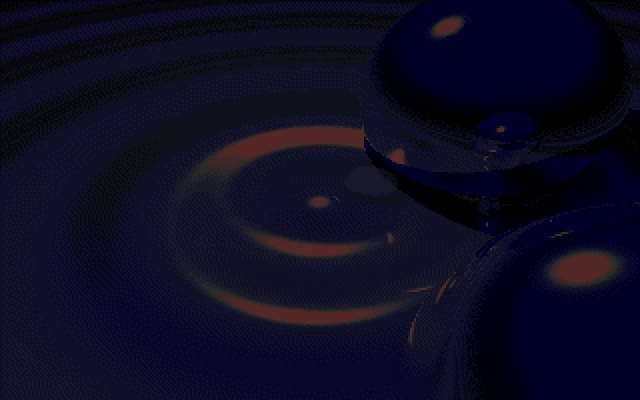
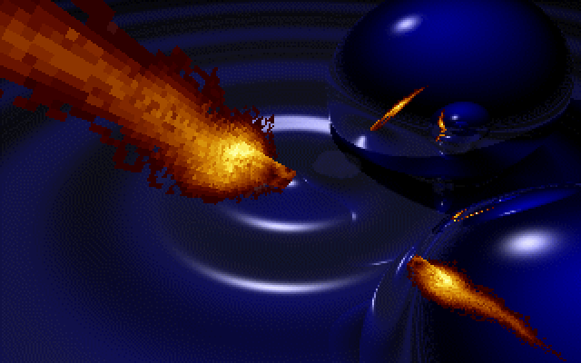
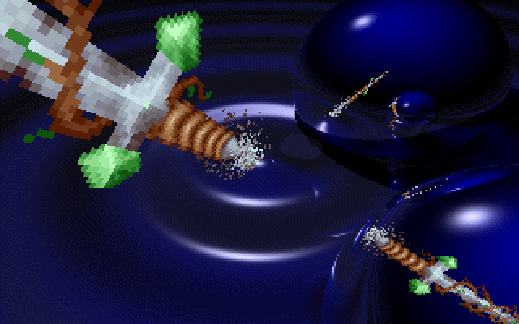
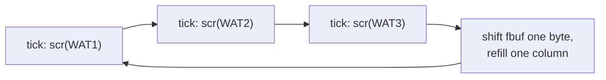

# RAYSCRL: the raytraced mirror-ball scroll

RAYSCRL is the scroller in the raytraced picture: a dark blue pool of rippling water with two
chrome spheres. A flame and then a jewelled sword pass in front of the camera, and both spheres
reflect them, every reflection distorted and moving with the scroll. It comes after
[MINVBALL](MINVBALL) and before [3DSINFLD](3DSINFLD). In a full run it starts about 6:56 in (boot
frame 29,150) and runs about 29 seconds. The upstream directory is `WATER/`. The demo's planning file
`SCRIPT` lists "Peilipalloscrl." (mirror-ball scroller) under TRUG and the picture under PIXEL
([SCRIPT#L16](https://github.com/mtuomi/SecondReality/blob/071a82eddb7a7390dbaa491a8a473e0e923a55c2/SCRIPT#L16-L16),
[SCRIPT#L35](https://github.com/mtuomi/SecondReality/blob/071a82eddb7a7390dbaa491a8a473e0e923a55c2/SCRIPT#L35-L35)),
and describes it as "vesisinus ja peilipallo + tietty scrolli", water sine and mirror ball plus a
scroller
([SCRIPT#L156-L157](https://github.com/mtuomi/SecondReality/blob/071a82eddb7a7390dbaa491a8a473e0e923a55c2/SCRIPT#L156-L157)).

## What you see








## The trick

### Nothing is raytraced at run time

The scene was rendered in advance with POV-Ray. What the demo stores is a **map**: for every
texel of the scrolling strip, the list of screen pixels in which that texel can be seen, directly
or in a reflection. Drawing a frame does not trace any rays. It walks the strip's texels and writes
each texel's colour to every pixel on its list:

```text
for each texel t of the 158×34 window (5,372 of them):
    for each screen offset p in list[t]:
        screen[p] = (window[t] != 0) ? window[t] : background[p]
```

The water, the spheres and the lighting are all in the background picture `BKG.CLX`, a 320×200
image that never changes. Only the pixels on some texel's list are ever rewritten. A sphere's
curved surface and the ripples' bending cost nothing at run time, because the renderer already
worked out where each texel lands. The converter gives each screen pixel to at most one texel in
all three maps together. Close to the camera one texel's list holds up to 24 pixels, which is why
the near sword is so blocky, while in a sphere's small reflection a list may hold one pixel. Many
lists are empty: in `WAT1` over half of the 5,372 are.

Zero is the **colour key**: where the strip's byte is 0 the background pixel is written back. So
as the strip scrolls, the pixels it leaves are restored from the picture without any separate erase
pass.

### How the map was made

The tree holds the scenes and the converter. `R1.POV` .. `R5.POV` place a flat box carrying an
image map in front of the camera, two reflective spheres, and a rippled reflective water surface.
The five files are identical except for one line, the box's "Scroll translate" (0, −0.5, −1, −1.5,
−2). `DATGEN.PAS` turns pairs of renders into `WAT1.DAT`..`WAT3.DAT`. For each rendered pixel it
reads:

- the **red** channel of the render as the strip column (1..158),
- a fixed mask, `GREEN.CLX`, as the strip row (1..34),

and it keeps the pixel only if its red differs between the pair's two renders, which drops
everything the moving strip does not reach. The pairs are renders 1 and 2 for `WAT1`, 2 and 3 for
`WAT2`, and 3 and 5 for `WAT3`. A pixel claimed once is marked and never taken again, and the
marks are not cleared between files, so the three maps cover three disjoint sets of pixels (20,858
in all). It then writes, texel by texel, a count followed by that many screen offsets. The three
files hold 6,176, 6,145 and 8,537 positions.

The batch files are in the tree as well: `RAYT.BAT` renders `R1`..`R5` through `P1.BAT`
(`povray -i%1 +w320 +h200 ...`), and the box's image map is `RGB.TGA`, not the sword. The renders
that `DATGEN.PAS` read (`o:k1.mtv` and so on) are not in the tree, so the shipped lists cannot be
regenerated and checked against it.

### The scroll: a sliding window and three in-between maps

The strip is `MIEKKA.SCI` ("miekka" is Finnish for sword), 400 columns by 34 rows. The program keeps
a 158×34 window of it, `fbuf`. Every tick it draws one of the three maps in turn, `WAT1`, `WAT2`,
`WAT3`. After the third it moves the whole window left by one byte and feeds the next strip column
in at the edge:



Because the maps are disjoint, each tick repaints only that map's share of the strip's pixels,
and a pixel is repainted once every three ticks. The window moves one column every three ticks,
about 23 columns a second.

### The fades

The [palette](Hardware-primer) is `MIEKKA.SCI`'s, for both the strip and the background. `BKG.CLX`'s own palette is
not used. The fade-in starts from black and makes 127 passes. On every second pass it uploads the
current values and steps each channel one unit towards its target. The step loop runs
`pf := 0 to 3` instead of `0 to 2`, so it also steps the *next* entry's red. Every red except entry
0's moves two units a pass, which is the orange cast of the first picture above. The fade-out is the
same loop run downwards towards zero.

### Music sync

The part has three gates on the music player (see [Music](Music)). It waits for `musplus ≥ 0` before
it blits the picture. After the fade-in it waits for the pattern order to change and the row to
reach 16. Inside the scroll loop it fades out when `musplus` is exactly −11. Between the fade-in
and the scroll the scene holds, still and empty, for about seven seconds.

## How the original did it

The blitter in `ROUTINES.ASM`. `ds:si` walks a map (a count, then offsets), `fs:bx` walks
`fbuf`, `gs` is the background and `es` is video memory:
([WATER/ROUTINES.ASM#L22-L36](https://github.com/mtuomi/SecondReality/blob/071a82eddb7a7390dbaa491a8a473e0e923a55c2/WATER/ROUTINES.ASM#L22-L36))

```asm
@a1:      lodsw
          or    ax,ax
          je    @no1
          mov   cx,ax
@b1:      lodsw
          mov   di,ax
          mov   al,byte ptr fs:[bx]
          or    al,al
          jne   @y
          mov   al,byte ptr gs:[di]
@y:       mov   byte ptr es:[di],al
          loop  @b1
@no1:     inc   bx
          dec   dx
          jnz   @a1
```

The scroll in the main loop of `DEMO.PAS`. `sss` picks the map, and after map 2 the window shifts
and is refilled:
([WATER/DEMO.PAS#L179-L186](https://github.com/mtuomi/SecondReality/blob/071a82eddb7a7390dbaa491a8a473e0e923a55c2/WATER/DEMO.PAS#L179-L186))

```pascal
      scr(sss);
      if sss = 2 then
       begin
        sss := 0;
        move(fbuf[1],fbuf,sizeof(fbuf));
        for x := 0 to 33 do fbuf[158+x*158] := font[x*400+scp];
        if scp < 390 then inc(scp);
       end else inc(sss);
```

The converter's inner pass in `DATGEN.PAS`. `sc` marks pixels already taken, `r`/`r1` are the
pair's red channels and `g` is the row mask:
([WATER/DATGEN.PAS#L58-L71](https://github.com/mtuomi/SecondReality/blob/071a82eddb7a7390dbaa491a8a473e0e923a55c2/WATER/DATGEN.PAS#L58-L71))

```pascal
     for y := 34 downto 1 do
     begin
       tc := 0;
       for x := 0 to 64000 do
         if (sc^[x] <> 40) and
            (r^[x] <> r1^[x]) and
            (g^[x] = y) then
         begin
           tmp[tc].c   := r^[x];
           tmp[tc].pos := x;
           sc^[x] := 40;
           mem[$a000:x] := 10;
           inc(tc);
         end;
```

The fade-in step, with its `0 to 3`:
([WATER/DEMO.PAS#L122-L126](https://github.com/mtuomi/SecondReality/blob/071a82eddb7a7390dbaa491a8a473e0e923a55c2/WATER/DEMO.PAS#L122-L126))

```pascal
        for x := 0 to 255 do
         begin
          setrgb(x,pal[x*3+0],pal[x*3+1],pal[x*3+2]);
          for pf := 0 to 3 do if pal[x*3+pf] < tmppal[x*3+pf] then inc(pal[x*3+pf]);
         end;
```

## How the port does it

The part is
[`bins/secondreality/src/parts/rayscrl.rs`](https://github.com/waffleking32/SecondRealityRust/blob/main/bins/secondreality/src/parts/rayscrl.rs)
(`Rayscrl`). It reads `BKG.CLX`, `MIEKKA.SCI` and `WAT1-3.DAT` in their original formats, and
`pos_list` refuses any offset outside the picture.

- `Phase` follows `DEMO.PAS` in order: `Init` (the first music wait), `Setup` (the blit), `FadeIn`,
  `Stage2` (the order-change wait), `Main` and `Done`. `Part::frame` advances one tick per `waitr`.
- `scr` is `Putrouts1`, colour key included. `shift_and_fill` is the shift and the refill with all
  their bugs. `ramp` is one fade step, with the `pf` loop that reaches one byte too far.
- `confirm` makes each music gate wait until its condition has held for `GATE_CONFIRM_TICKS` (7)
  ticks, which is how the released program behaves.

The music seek, the timeline and the measurements are in
[`docs/fidelity/rayscrl.md`](https://github.com/waffleking32/SecondRealityRust/blob/main/docs/fidelity/rayscrl.md).
Two of the four reference frames match exactly. The other two differ by 3 and 42 pixels, all in
the strip, where the release ships a slightly different `MIEKKA.SCI` from the tree's.

## Quirks kept

- The refill writes each new column at `158 + x·158`, the first byte of the band below, and the
  next shift carries it to its own band's right edge. The `move` reads one byte past `fbuf`. The
  feed stops at column 390, ten short of the strip's end
  ([bugs.md §19.1](https://github.com/waffleking32/SecondRealityRust/blob/main/docs/fidelity/bugs.md)).
- The fade-in is 127 passes, and the `pf := 0 to 3` loop steps the next entry's red, so reds lead
  ([bugs.md §19.2](https://github.com/waffleking32/SecondRealityRust/blob/main/docs/fidelity/bugs.md)).
- The last fade-in upload is one step short on the seven entries whose blue is 63
  ([bugs.md §19.3](https://github.com/waffleking32/SecondRealityRust/blob/main/docs/fidelity/bugs.md)).
- The fade-out starts from the array the fade-in left, so its first upload raises those seven blues
  while lowering every red
  ([bugs.md §19.4](https://github.com/waffleking32/SecondRealityRust/blob/main/docs/fidelity/bugs.md)).
- The fade-out cue is `musplus == −11` exactly, and the release acts on all three music gates seven
  ticks after the tree's condition
  ([bugs.md §19.5](https://github.com/waffleking32/SecondRealityRust/blob/main/docs/fidelity/bugs.md),
  [APPROXIMATIONS.md A18](https://github.com/waffleking32/SecondRealityRust/blob/main/docs/fidelity/APPROXIMATIONS.md)).
- The strip is the tree's `MIEKKA.SCI`, not the release's patched copy, which accounts for the
  3- and 42-pixel residue
  ([rayscrl.md §6](https://github.com/waffleking32/SecondRealityRust/blob/main/docs/fidelity/rayscrl.md)).

---

**Previous:** [MINVBALL](MINVBALL) · **Next:** [3DSINFLD](3DSINFLD)
