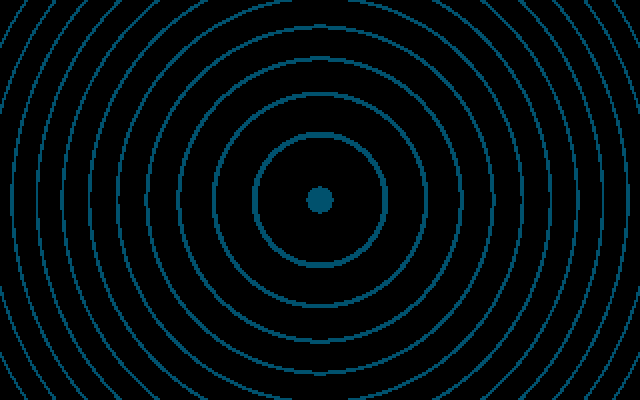
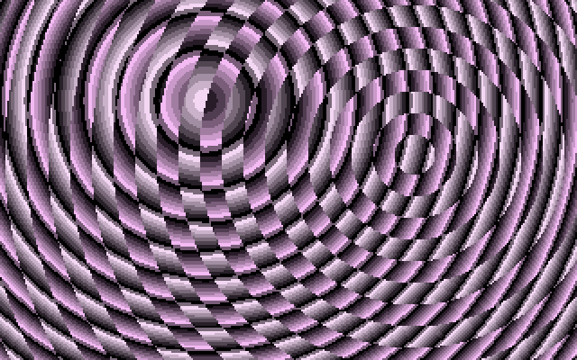
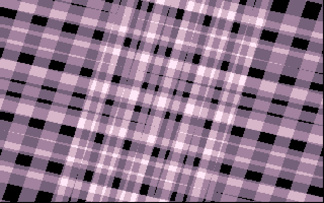
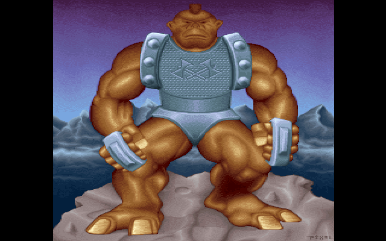

# TECHNO: the interference rings and the bars

TECHNO is the hard-edged centre of the demo's first half. It follows [TUNNELI](TUNNELI) and
comes before [PANICEND](PANICEND), about three minutes in, and runs for close to a minute. Two
sets of concentric rings slide over each other in a shimmering moiré. A white flash wipes them
away. Four columns of light fall off the screen on the beat, and then stripes of rotating bars
pile up in lilac and pink, each frame layered over the ones before it. At the end the bars slide
off to the right and a 320×400 painting of a troll slides in from the right, shudders as it
lands and stays there. The demo's shell labels the part `Techno (PSI)`. Its source is the
upstream `TECHNO/` directory: `KOE.C` drives it, over the assembly in `KOEA.ASM`, `KOEB.ASM`
and `POLYCLIP.ASM`.

## What you see









## The trick

TECHNO has three main effects, the rings, the bars and the troll, with a wipe between the
first two. Everything before the troll runs in EGA mode 0Dh (320×200, 16 colours). In that mode a pixel's colour index is
made of four bits, and each bit lives in a different *bit plane*: plane 0 holds bit 0 of every
pixel, plane 1 holds bit 1, and so on. One byte of a plane covers eight pixels. The
[Hardware primer](Hardware-primer) covers planes, the CRTC start address and the DAC in more
detail. TECHNO uses the planes as four independent 1-bit layers, and lets the palette decide
how they combine.

### 1. Ring interference: two pictures, one palette

The part builds a virtual screen of 640×400 (CRTC offset register `13h = 28h`, 80 bytes a row)
and fills it with two ring pictures, each stored as one quarter and mirrored into the other
three:

- **Planes 0-2** hold a 3-bit picture (`_circle`, shipped as `DDSTARS/PIC.EGA`). Its pixel
  values count 0, 1, …, 7 outward from the centre and then repeat, so every pixel says "which
  of eight ring phases am I".
- **Plane 3** holds a 1-bit picture of plain rings 12 pixels wide (`_circle2`, `CIRCLE2.EGA`).

The colour of a pixel is therefore `phase + 8 × ring_bit`. The palette does the animation.
Every frame the part moves a start offset (`palanimc`) back by three bytes, one colour, wrapping
within eight colours, and uploads eight colours from that offset in one table (`pal1`) into
entries 0-7 and eight from the same offset in another (`pal2`) into entries 8-15.
Rotating eight palette entries makes the rings appear to flow, although no pixel changes. Where
the plane-3 ring is set, the pixel takes its colour from the other table, which is out of step
with the first, so the two ring systems show through each other as an interference pattern.

The rings move by moving the display rather than by redrawing. The CRTC start address picks
which 320×200 window of the 640×400 screen is shown, and the attribute controller's *pel pan*
register shifts it by 0-7 pixels. The window's top-left corner runs round a circle:

```
scrnx = sin(scrnrot)/4 + 160        scrnrot += 5 each frame (1024 steps = 360°)
scrny = cos(scrnrot)/4 + 100        start = 80*scrny + scrnx/8,  pan = scrnx & 7
```

`sin1024` is a 1,024-entry table with amplitude 256, so `/4` gives a 64-pixel radius.

Plane 3 cannot simply be panned with the rest. Its ring system has to orbit separately, at its
own speed (`overrot += 7`), so plane 3 is redrawn every frame, a row at a time, from a copy in
ordinary memory. A planar byte holds eight pixels, and copying whole bytes would only place the
overlay to the nearest eight pixels. The part therefore keeps **eight pre-shifted copies** of
the plane-3 picture. `rotate1` builds each one from the previous one by shifting the whole
32,000-byte buffer right one bit with `rcr`, which carries the bit from byte to byte. To place
the overlay at any x, the part takes the copy shifted by `7 − (x & 7)` bits and offsets its
source by `x >> 3` bytes.
Positioning costs a table lookup rather than a shift on every byte.

The same row offset gives the wobble. Each row adds a horizontal displacement taken from the
sine table, with the phase advancing 9 steps a row and 7 a frame:

```
dx(row) = power0[sinuspower][ sin(phase + 9*row) >> 3 ]   // ±32 px at full power
```

`power0` is a 16×256 table of `value * power / 15`, a multiply done as a lookup. `sinuspower`
starts at 0, so the overlay begins as perfect rings. After 350 frames it rises by one every 16
frames up to 15, and the rings bend into waves.

The first pass, from `KOEB.ASM`, is a simpler version: plane 3 is never drawn and the palette
is `pal0`, which has one blue entry among black ones. The result is a single blue ring level
travelling through the picture. A fader (`palfader`, +2 a frame) first scales the colours up
from black and then, past 256, adds to every channel until all sixteen entries are white.

### 2. The wipe

After the second pass the part fades the DAC to white over four frames. It switches to a
320-pixel-wide screen and fills one page with colour 15. It then clears four 80-pixel columns
one at a time. Each column's cleared height grows as a running sum (`zya++`, `zy += zya`), so
the column accelerates downward like a falling object. Each new column waits for the next
`musrow & 7 == 7`, a beat in the music, and flashes white on it.

### 3. The bars: XOR-filled boxes and an eight-page time machine

Each frame draws eleven long, thin parallelograms (one "stripe") into a 1-bit, 320×200
off-screen buffer (`vbuf`). The corners come from two perpendicular vectors, a long one `h`
and a short one `v`, both rotated by `rot`:

```
h = (sin(rot)·16·6/5, cos(rot)·16)        // long half-axis, 4 fractional bits
v = (cos(rot)·6/5, −sin(rot)) · vm/100     // short half-axis, scaled by vm
corner = (±h ± v + c·2v) / 16 + (160,100),  c = −10, −8, …, 10
```

The `6/5` corrects for the 320×200 screen's non-square pixels. `h` is scaled by 16, so the sums
are fixed point with four fractional bits, and the final `/16` turns them back into whole
pixels (which also makes `v` sixteen times shorter than `h`). The width factor `vm` behaves like a
bouncing ball: `vma` drops by one each frame (gravity), `vm += vma`, and when `vm` falls below
its floor the step reverses. The stripes therefore breathe in and out.

The boxes are filled by **XOR edge filling**, not by scan-converting polygons. `drawline`
XORs a single pixel per scanline along each non-horizontal edge. After that, each row of the
buffer is filled by a running XOR from left to right: an edge pixel toggles "inside", and every
pixel takes the current state. `blit16` does this a byte at a time with a 256-entry table
(`blit16t`, built by `blitinit`). For each input byte the low byte of the entry is the filled
byte, and the high byte is `80h` if the run ends inside a box, else 0. XORing that into the
next input byte flips its leftmost pixel, which acts as an edge there and carries "inside"
across the byte boundary.

The layering is what makes the bars look rich. Video memory holds **eight pages** of
320×200 (8 KiB each), and each frame writes its filled stripe into **one plane of one page**:

```
frame n:  page = n mod 8            plane = (n div 8) mod 4
display:  the page just written
```

A page therefore always holds four stripes from four different moments: frames n, n−8, n−16
and n−24, one in each plane. The 16-entry palette is built by **popcount**: index `a` gets one
of five colours depending on how many of its four bits are set (black, then four lilac shades).
What appears on screen is a picture of how many of the last four snapshots cover each pixel,
which draws a motion trail of the rotating stripes for free. `waitborder` adds a beat pulse:
the palette has sixteen 16-colour blocks, each brighter and pinker than the last. On every row
where `musrow & 7 == 7` the part switches to the brightest block and then steps down one block
a frame.

`doit1`, `doit2` and `doit3` run this for 420, 840 and 980 frames with different speeds. In
`doit3` the screen is 640 pixels wide and only four pages are used (so the snapshots are four
frames apart). The stripes' centre wanders on a circle, and at the end the horizontal scroll
accelerates to the empty left half.

### 4. The troll

The last screen is 256-colour Mode 13h with chain-4 turned off (`inittwk`) and 400 lines. The
row is 160 bytes, so the screen is 640 pixels wide. The troll (`TROLL.UP`, run-length encoded)
is unpacked into the right half. The part shows the empty left half until the music passes order 35,
row 48, then scrolls the start address from 0 to 320 with an accelerating `xpos += xposa/4`. The
landing uses a damped oscillation: `xpos = 320 + sin(ripple)/ripplep`, with `ripplep` growing
×5/4 a frame from 8, so the shake falls below a pixel within about seventeen frames. At the same time sixteen precomputed
palettes (`palette + 45 − 3y`) fade the picture down from a near-white flash.

## How the original did it

The overlay wobble and the pre-shifted copy, from the second pass's `do_interference`
([KOEA.ASM#L793-L806](https://github.com/mtuomi/SecondReality/blob/071a82eddb7a7390dbaa491a8a473e0e923a55c2/TECHNO/KOEA.ASM#L793-L806)):

```asm
	mov	bx,cs:_sin1024[bp]
	sar	bx,3
	mov	bh,cs:sinuspower
	movsx	ax,byte ptr cs:power0[bx]
	sub	ax,cs:scrnposl
	add	ax,cs:overx
	mov	bx,ax
	and	bx,7
	shl	bx,1
	neg	bx
	mov	ds,cs:circles[bx+7*2]
	sar	ax,3
	add	si,ax
	add	si,cs:overya
```

`bh = sinuspower` turns `bx` into the index `power*256 + sine`, which is the multiply table.
`ax & 7` picks one of the eight shifted copies (`circles[7 − (ax & 7)]`) and `ax >> 3` is the
byte offset. The
`sub scrnposl` cancels the pel pan that the whole screen is about to get.

The stripe corners, from `doit1`
([KOE.C#L356-L370](https://github.com/mtuomi/SecondReality/blob/071a82eddb7a7390dbaa491a8a473e0e923a55c2/TECHNO/KOE.C#L356-L370)):

```c
hx=sin1024[(rot+0)&1023]*16*6/5;
hy=sin1024[(rot+256)&1023]*16;
vx=sin1024[(rot+256)&1023]*6/5;
vy=sin1024[(rot+512)&1023];
vx=vx*vm/100;
vy=vy*vm/100;
for(c=-10;c<11;c+=2)
{
    cx=vx*c*2; cy=vy*c*2;
    x1=(-hx-vx+cx)/16+160; y1=(-hy-vy+cy)/16+100;
    x2=(-hx+vx+cx)/16+160; y2=(-hy+vy+cy)/16+100;
    x3=(+hx+vx+cx)/16+160; y3=(+hy+vy+cy)/16+100;
    x4=(+hx-vx+cx)/16+160; y4=(+hy-vy+cy)/16+100;
    asmbox(x1,y1,x2,y2,x3,y3,x4,y4);
}
```

The XOR fill, two bytes per step. `dh` carries the inside state between bytes
([KOEA.ASM#L121-L133](https://github.com/mtuomi/SecondReality/blob/071a82eddb7a7390dbaa491a8a473e0e923a55c2/TECHNO/KOEA.ASM#L121-L133)):

```asm
@@1:	zzz=0
	xor	dh,dh ;line starts black
	REPT	40/2
	mov	bl,ds:[si+zzz]
	xor	bl,dh
	mov	ax,cs:_blit16t[ebx*2]
	mov	bl,ds:[si+1+zzz]
	xor	bl,ah
	mov	dx,cs:_blit16t[ebx*2]
	mov	ah,dl
	mov	es:[di+zzz],ax
	zzz=zzz+2
	ENDM
```

The page-and-plane schedule, after the stripe is blitted into plane `pl`
([KOE.C#L384-L396](https://github.com/mtuomi/SecondReality/blob/071a82eddb7a7390dbaa491a8a473e0e923a55c2/TECHNO/KOE.C#L384-L396)):

```c
asmdoit(vbuf,vram);
a=plv*0x20;
_asm mov dx,3d4h
_asm mov al,0ch
_asm mov ah,byte ptr a
_asm out dx,ax
plv++; plv&=7;
vram=(char *)(0xa0000000L+0x2000000L*(long)plv);
if(!plv)
{
    pl<<=1;
    if(pl>15) pl=1;
}
```

Writing `plv*0x20` to CRTC register 0Ch (the high byte of the start address) shows page
`plv` at `plv * 0x2000`. The popcount palette is built at
[KOE.C#L119-L167](https://github.com/mtuomi/SecondReality/blob/071a82eddb7a7390dbaa491a8a473e0e923a55c2/TECHNO/KOE.C#L119-L167),
and the troll's pan, ripple and waits are at
[KOE.C#L638-L726](https://github.com/mtuomi/SecondReality/blob/071a82eddb7a7390dbaa491a8a473e0e923a55c2/TECHNO/KOE.C#L638-L726).

The part waits on the music in several places: `dis_musplus()` gates the start, the wipes and
the troll's final hold; the second interference pass stops at music frame 925 and `doit3` at
2520; the wipes' columns and the bars' beat pulses use `dis_musrow()`; and the troll waits for
order 35. [Music](Music) explains these calls.

## How the port does it

The port is [`parts/techno/`](https://github.com/waffleking32/SecondRealityRust/blob/main/bins/secondreality/src/parts/techno/mod.rs),
a single `Techno` that implements the `Part` trait. The source is one straight line of code
broken up by waits for vertical retrace. The port turns that line into a `Phase` state
machine, and each `frame` call runs exactly what the original ran between two waits. See
[How the port works](How-the-port-works) for the general pattern.

- [`interference.rs`](https://github.com/waffleking32/SecondRealityRust/blob/main/bins/secondreality/src/parts/techno/interference.rs):
  `init_interference` (the mirrored blits, `rotate1`'s eight copies) and the two passes.
- [`bars.rs`](https://github.com/waffleking32/SecondRealityRust/blob/main/bins/secondreality/src/parts/techno/bars.rs):
  `mode16`, the wipes, `waitborder`'s palette blocks and `doit1/2/3` (`doit_tick`, `doit3_tick`).
- [`boxes.rs`](https://github.com/waffleking32/SecondRealityRust/blob/main/bins/secondreality/src/parts/techno/boxes.rs):
  the `POLYCLIP.ASM` clipper (`clipanypoly`), `drawline`, `asmbox` and the prefix-XOR `blit`.
- [`tables.rs`](https://github.com/waffleking32/SecondRealityRust/blob/main/bins/secondreality/src/parts/techno/tables.rs):
  `pal0/1/2`, `flip8`, the `blit16t` table, `power0`, the popcount `bar_palette` and
  `troll_fade`, each built by the source's rule.
- [`troll.rs`](https://github.com/waffleking32/SecondRealityRust/blob/main/bins/secondreality/src/parts/techno/troll.rs):
  the order wait, pan, ripple and final wait.

For the 16-colour screens, `Techno` keeps four 64 KiB planes of its own and composes the
visible window into the engine's surface in `present`. For the troll, it writes the decoded
picture straight into the 640×400 surface and drives the engine's `View` (start address in
pixels, fine pan). The original registers no copper callbacks, so the port registers none.
The timeline, the music mapping and the frame-by-frame evidence are in
[docs/fidelity/techno.md](https://github.com/waffleking32/SecondRealityRust/blob/main/docs/fidelity/techno.md).

## Quirks kept

- The ranged palette upload writes `2*count + start` bytes, so the troll's 256-colour upload
  sets only entries 0-169 and part of 170 ([bugs.md §4](https://github.com/waffleking32/SecondRealityRust/blob/main/docs/fidelity/bugs.md)).
- `patdir` is only ever set to −3, so the palette window always moves the same way
  ([bugs.md §14.1](https://github.com/waffleking32/SecondRealityRust/blob/main/docs/fidelity/bugs.md)).
- `rotate1` shifts 31,936 of its 32,000 bytes, and the last 64 keep their old contents
  ([bugs.md §14.2](https://github.com/waffleking32/SecondRealityRust/blob/main/docs/fidelity/bugs.md)).
- `clipanypoly` starts with the closing edge before it has been clipped
  ([bugs.md §14.3](https://github.com/waffleking32/SecondRealityRust/blob/main/docs/fidelity/bugs.md)).
- `setborder` returns before its assembly, and `flash(-2)` uploads nothing
  ([techno.md §7](https://github.com/waffleking32/SecondRealityRust/blob/main/docs/fidelity/techno.md)).
- The first pass's size fade (`sizefade`) stays 0 and its plane-3 loop is skipped, so its
  window never moves ([techno.md §3](https://github.com/waffleking32/SecondRealityRust/blob/main/docs/fidelity/techno.md)).
- No approximation is registered for the effect itself. In a full run its first frame comes
  two frames later than in the original, part of the hand-over between parts
  ([APPROXIMATIONS.md A53](https://github.com/waffleking32/SecondRealityRust/blob/main/docs/fidelity/APPROXIMATIONS.md)).

---

**Previous:** [TUNNELI](TUNNELI) · **Next:** [PANICEND](PANICEND)
