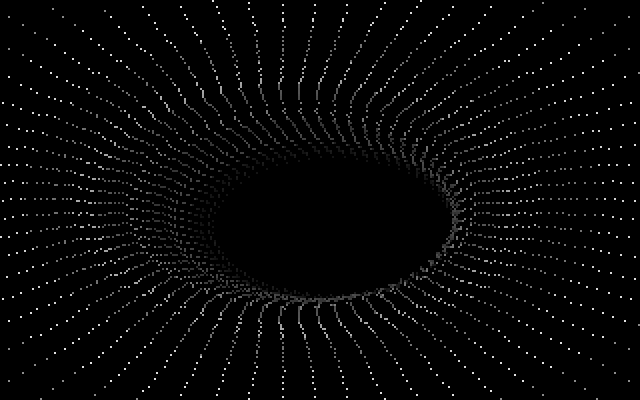
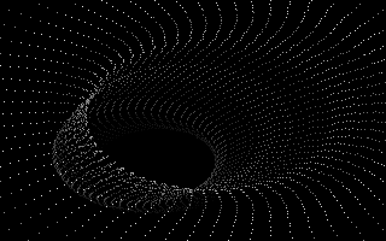
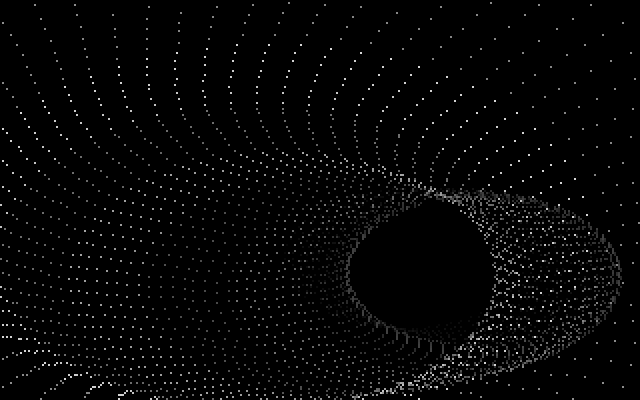

# TUNNELI: the dot tunnel

TUNNELI flies you down a winding tunnel made of nothing but dots: 77 rings of 64 white and grey
points each, with the rings fading into darkness at the far end. As the tunnel bends, the mouth
swings across the screen. The part follows [GLENZ](GLENZ) and comes before [TECHNO](TECHNO). In a
full run it starts about 2:39 in (boot frame 11,131; the first rings appear 20 frames later) and
runs for 1,060 frames, about 15 seconds.
It ends on a fixed frame count, not a music cue. The demo's part list credits it as
[`Dottitunneli (TRUG)`](https://github.com/mtuomi/SecondReality/blob/071a82eddb7a7390dbaa491a8a473e0e923a55c2/MAIN/PARTS#L5-L5)
(Finnish for "dot tunnel"). It is Turbo Pascal with an inline-assembly inner loop, in `TUNNELI/`,
and the shipped program is `TUN10.PAS`
([X.BAT](https://github.com/mtuomi/SecondReality/blob/071a82eddb7a7390dbaa491a8a473e0e923a55c2/TUNNELI/X.BAT#L1-L1)).

## What you see







## The trick

There is no 3-D maths at run time: no rotation, no divide, no square root. Each frame is table
lookups and adds. The illusion comes from three precomputed pieces.

### 1. A table of ellipses, one per size

`TUNNEL.DAT` is `pcalc[0..137][0..63]`: 138 ellipses of 64 points, already centred on the screen at
(160, 100). The generator `BALLGEN2.PAS` writes row `r` with radius `z = r + 10`:

```
x = 160 + round( sin(a·π/32) · round(1.7·z) )
y = 100 + round( cos(a·π/32) · z )            a = 0..63
```

Every one of the file's 8,832 pairs matches this formula. The 1.7 widens the ellipse to fill the
320×200 screen.

### 2. Perspective as a 1/z table

Rings are numbered by depth, `x = 4` (nearest) to `80` (furthest). The ring's size comes from

```
sade[x] = 16384 div (7·x + 95)
```

which is perspective (size ∝ 1/distance) with distance `7x + 95`. Ring 4 picks ellipse 133, which
is mostly off screen. Ring 80 picks ellipse 25, whose half-axes are 60 pixels across and 35 down. A ring is drawn by
reading its ellipse's 64 points and adding the ring's 2-D offset. That is the whole per-dot cost.

### 3. The tunnel is the path's history

The rings sit in a chain, `putki[0..100]`. Every frame computes a new head position from two sine
tables and a frame counter:

```
head.x = cosit[sy & 2047] − sinit[3·sy & 4095] − cosit[sx & 2047]
head.y = sinit[2·sx & 4095] − cosit[sx & 2047]
```

and then shifts the whole chain down by one record. Ring `x` is therefore where the head was
`100 − x` frames ago. The far rings show where the path is now, and the near rings show where it
was. A ring is drawn at its position **minus ring 5's position**, so the camera always rides
ring 5, near the front, and the tunnel seems to bend ahead of you.

```
 time ──────────────────────────────────────────────────▶
 putki: [0]  …  [4] [5] [6]  …               [80]  …  [100]
               near  ▲                         far        head (new this frame)
                camera here: every ring is drawn relative to [5]
```

The sine tables (`SINGEN.PAS`) are not plain sines. Each value's amplitude grows with its index:
`sinit[i] = round(sin(i·π/128) · (3i div 128))` and
`cosit[i] = round(cos(i·π/128) · (4i div 64))`. Over the part's run the path starts almost
straight and wanders more and more widely.

### Colour: a depth fog and a travelling stripe

The [DAC](Hardware-primer) gets two grey ramps, entries 64..128 and 128..192, each running from bright to black. A
ring's colour is

```
bbc = putki[x].c + round(x / 1.3)
```

where `putki[x].c` is 64 or 128 (which ramp) and `x/1.3` moves further down the ramp the deeper the
ring is. Far rings are dimmer: a fog for free. The head's ramp switches every 8 frames
(`(sy and 15) > 7`), so bands of 8 bright and 8 dim rings travel along the chain toward you.
Entries 68 and 132 are forced to black. Only ring 5 gets the offset 4 (`round(5/1.3) = 4`), so the
ring the camera sits on is never visible.

A ring whose `bbc` is below 64 is skipped completely. That is how the part starts and ends. All
rings begin with `c = 0`; coloured rings enter at the far end of the chain and travel toward the
camera, so the tunnel grows toward you from the far end, one ring a frame. In the last 102 frames new rings get `c = 0` again, and the tunnel empties from the far
end.

### Erase only what you drew

The screen is never cleared. `oldpos` holds the address of every dot plotted last frame. Before
plotting each dot, the loop writes 0 at that dot's old address. With about 4,900 dots, that is far
cheaper than clearing 64,000 bytes.

## How the original did it

The frame loop walks the rings from far to near and sets up the offset, the ellipse and the colour
for each one:

```pascal
    for x := 80 downto 4 do
     begin
     _bx := putki[x].x-putki[5].x;
      by := putki[x].y-putki[5].y;
      br := sade[x];
      bbc := putki[x].c+round(x / 1.3);
      pcp := ofs(pcalc[br][0]);

      if bbc >= 64 then
```
[TUNNELI/TUN10.PAS#L153-L161](https://github.com/mtuomi/SecondReality/blob/071a82eddb7a7390dbaa491a8a473e0e923a55c2/TUNNELI/TUN10.PAS#L153-L161)

The inner loop is assembly. It erases the old dot, adds the ring's x offset to the table's x,
rejects any x outside 0..319, turns y into a row address through `rows[y] = y·320`, and plots:

```asm
@a:     mov    bx,ax
        mov    di,word ptr ds:oldpos[bx]
        mov    byte ptr es:[di],0

        mov    di,word ptr ds:[si]
        add    di,dx
        cmp    di,319
        ja     @yli
        mov    bx,bp
        add    bx,word ptr ds:[si+2]
        add    bx,bx
        add    di,word ptr ds:rows[bx]
@c:     mov    byte ptr es:[di],15
@yli:
        mov    bx,ax
```
[TUNNELI/TUN10.PAS#L175-L189](https://github.com/mtuomi/SecondReality/blob/071a82eddb7a7390dbaa491a8a473e0e923a55c2/TUNNELI/TUN10.PAS#L175-L189)

Two things in this loop are worth noting. `cmp di,319 / ja` is an *unsigned* compare, so a negative
x wraps to a large number, and one test rejects both sides. The `15` at `@c` is a placeholder:
before the loop, `mov byte ptr cs:[@c+3],al` patches the ring's colour into the instruction
itself. That is self-modifying code: every general register is already in use in the loop, so
the colour travels inside the instruction instead.

The animation step runs `frames` times per drawn frame. `frames` is the number of vertical retraces
`waitr` reports, normally 1:

```pascal
     putki[100].x := cosit[sy and 2047]-sinit[sy*3 and 4095]-cosit[sx and 2047];
     putki[100].y := sinit[sx*2 and 4095]-cosit[sx and 2047]+sinit[y and 4095];
     move(putki[1],putki[0],ofs(putki[100])-ofs(putki[0]));
     inc(sy);
     inc(sx);
```
[TUNNELI/TUN10.PAS#L202-L206](https://github.com/mtuomi/SecondReality/blob/071a82eddb7a7390dbaa491a8a473e0e923a55c2/TUNNELI/TUN10.PAS#L202-L206)

The global `y` in the second line is set to 0 at startup and never changed, so that term is
`sinit[0] = 0`. The `move` copies 100 records, so the new head's colour goes into `putki[99]`
(lines 219-220).

The ellipse table comes from the generator:

```pascal
    for Z := 10 to 147 do
     for a := 0 to 63 do
      with pcalc[z-10][a] do
       begin
         x := 160+round(sin(a*pi/32)*round(z*1.7));
         y := 100+round(cos(a*pi/32)*z);
       end;
```
[TUNNELI/BALLGEN2.PAS#L55-L61](https://github.com/mtuomi/SecondReality/blob/071a82eddb7a7390dbaa491a8a473e0e923a55c2/TUNNELI/BALLGEN2.PAS#L55-L61)

## How the port does it

The part is
[`bins/secondreality/src/parts/tunneli.rs`](https://github.com/waffleking32/SecondRealityRust/blob/main/bins/secondreality/src/parts/tunneli.rs)
(`Tunneli`). `init` reads `TUNNEL.DAT` and `SINIT.DAT` as raw words (they are data segments, not
pictures), computes `sade`, sets Mode 13h and installs the ramps through `dac_writes`. Each tick,
`frame` writes DAC entry 0 black, as `waitr` does, calls `Tunneli::draw` (the ring loop, with the
patched immediate turned into an ordinary colour variable) and then `Tunneli::sync` (one animation
step).

The surface is used as Mode 13h's flat 64 KB (`View::y_line_offset = Some(320)`), so a dot address
is `x + y·320`, as in the original. The original has no y bound: `rows[bx]` is read even when `y`
is outside 0..200. `Tunneli::rows_word` reproduces those reads from the data segment's real layout
instead of returning 0 for them.

The fidelity note
[`docs/fidelity/tunneli.md`](https://github.com/waffleking32/SecondRealityRust/blob/main/docs/fidelity/tunneli.md)
has the timeline, the data files and the comparison against the reference.

## Quirks kept

- The y term is never bounds-checked. Out-of-range dots read the words around `rows` (all
  64,000), which send them past the visible screen. Reading 0 instead would paint row 0
  ([bugs.md §22](https://github.com/waffleking32/SecondRealityRust/blob/main/docs/fidelity/bugs.md)).
- The shipped build's second grey ramp is `(64−x)·3 div 5`, not the source's `3 div 4`, and the
  port uses the shipped one. A residual of a few hundred pixels per keyframe remains
  ([APPROXIMATIONS.md A6](https://github.com/waffleking32/SecondRealityRust/blob/main/docs/fidelity/APPROXIMATIONS.md)).
- `waitr` rewrites DAC entry 0 every frame. The Scroll Lock blue it allows is not modelled
  ([tunneli.md §5](https://github.com/waffleking32/SecondRealityRust/blob/main/docs/fidelity/tunneli.md)).

---

**Previous:** [GLENZ](GLENZ) · **Next:** [TECHNO](TECHNO)
