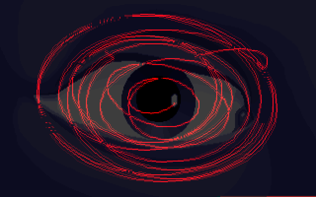
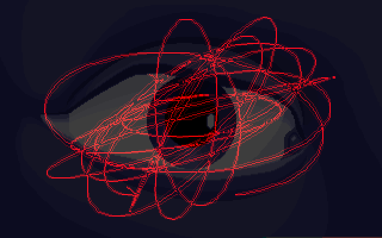
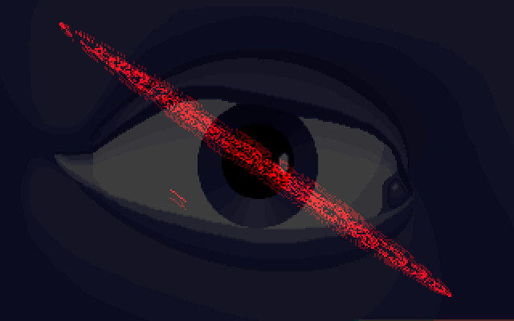
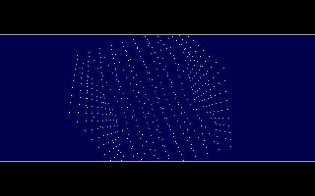
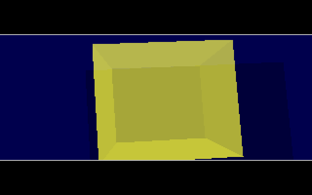
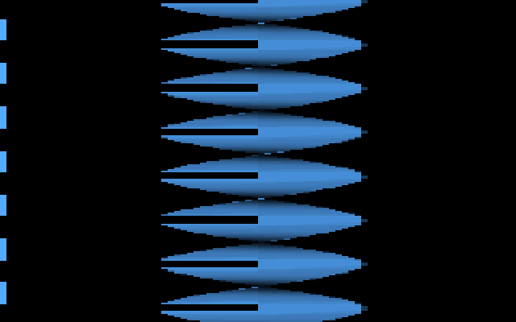
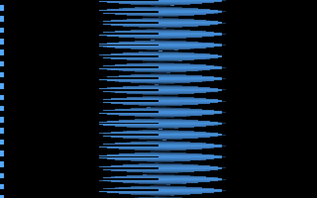

# The Vault: GRID, HARD and TWIST

The upstream source tree holds three finished-looking effects that are not in the demo:

- **GRID**: a red curve that scribbles over a staring eye.
- **HARD**: the words FUTURE CREW RULES FOREVER spelt out in flying dots, a rotating lattice of
  dots, and a see-through cube that casts a shadow.
- **TWIST**: a shaded ribbon that twists tighter and tighter down the screen.

Each is a complete DOS program in its own directory ([`GRID/`](https://github.com/mtuomi/SecondReality/tree/071a82eddb7a7390dbaa491a8a473e0e923a55c2/GRID),
[`HARD/`](https://github.com/mtuomi/SecondReality/tree/071a82eddb7a7390dbaa491a8a473e0e923a55c2/HARD),
[`TWIST/`](https://github.com/mtuomi/SecondReality/tree/071a82eddb7a7390dbaa491a8a473e0e923a55c2/TWIST)),
with its executable built and committed: `GRID/P.EXE`, `HARD/B.EXE` and `TWIST/T.EXE`. The
sources carry no author credit. The port plays them on their own, outside the demo:

```bash
cargo run --release --bin secondreality -- --vault        # a menu of the three
cargo run --release --bin secondreality -- --part grid    # or hard, or twist
```

## Why they are separate from the demo

`SECOND.EXE` runs its parts from a fixed list. The list's names appear in
[`MAIN/PARTS`](https://github.com/mtuomi/SecondReality/blob/071a82eddb7a7390dbaa491a8a473e0e923a55c2/MAIN/PARTS#L1-L20),
and none of the three is on it (see [Demo structure](Demo-structure)). Each one is a development
build. It links the C client of the **Demo Interrupt Server** (`DIS/DISC.OBJ`), the resident
service that gives every part its retrace waits, exit key and music cues. In the demo,
`SECOND.EXE` provides that service. During development a coder ran the standalone `DIS/DIS.EXE`
first and then the part from the DOS prompt. The header says so:

```c
extern int dis_indemo(void);
/* Returns status if the actual demo is running.
** 0=part run from dos
** 1=part run from demo (no mode switches etc)
*/
```
([DIS/DIS.H#L11-L15](https://github.com/mtuomi/SecondReality/blob/071a82eddb7a7390dbaa491a8a473e0e923a55c2/DIS/DIS.H#L11-L15))

The standalone server has no music player, and its copper service does nothing. So the three
effects are silent. The port's runs are silent too, and that is why `--vault` refuses
`--sound-quality enhanced`. They also keep developer conveniences that a released part would not
have:

- GRID stops at a `getch()` key wait, showing a debug dot screen.
- HARD takes a command-line argument that jumps straight to a later scene.
- TWIST quits on any key and, while Scroll Lock is on, shows its drawing time as a border colour.

They are not in the demo's part order, any block or any boot anchor. They are held to the same
standard as the demo's parts, though: each is compared with frames captured from its own `.EXE`
running behind `DIS.EXE` in the emulator ([How it is verified](How-it-is-verified)). Every
filed HARD and TWIST frame matches the port byte for byte. GRID differs by a few dozen pixels,
explained below. The notes are
[`grid.md`](https://github.com/waffleking32/SecondRealityRust/blob/main/docs/fidelity/grid.md),
[`hard.md`](https://github.com/waffleking32/SecondRealityRust/blob/main/docs/fidelity/hard.md) and
[`twist.md`](https://github.com/waffleking32/SecondRealityRust/blob/main/docs/fidelity/twist.md).

---

## GRID: the line rider

### What you see

The effect shows a grey eye on a dark blue face, with a tangle of red lines over it. The tangle
keeps changing shape. Sometimes it is a knot, sometimes rings around the pupil, and once in every
cycle it collapses into a single diagonal stroke. GRID has no end of its own and runs until ESC.
Its shapes repeat every 1,024 frames, about 14.6 seconds.







### The trick

**One waveform, read twice.** Everything comes from one 1,024-entry table, `sinus1`, which is a
sum of three sines:

```
sinus1[a] = ( sin(12.125·θ) + 2·sin(10.875·θ) + sin(8.375·θ + φ) ) · 256 / 8      θ = 2π·a/1024
sinus2[a] = sinus1[(a + 277) & 1023] · 7/10
```

The odd frequencies come from cursors that step by 97, 87 and 67 and are shifted right by 3
before indexing a 1,024-step sine table of amplitude 256; `φ` is the phase that `d`'s start value
gives the third sine. The frequencies are not whole numbers, so the table does not join up
smoothly where it wraps from entry 1023 back to 0.

Each frame `i` draws a curve through 1,001 points:

```
x_k = sinus1[(i + k) & 1023] + 160          y_k = sinus2[k] + 100          k = 0..1000
```

`y` is the same waveform as `x`, 0.7 times as tall and shifted by 277 entries, and it never moves.
Only `x` slides along the table. The result is a Lissajous figure whose phase difference is
`s = i − 277`.

- When `s ≡ 0`, `y` is exactly `0.7·x` and the whole curve is one diagonal line (the third
  picture).
- When `s = 24`, the three component sines are 102°, 92° and 71° out of phase. All three are close
  to a quarter turn, so the curve becomes a stack of rough ellipses (the first picture).
- In between it is a knot.

**Bit planes in the palette.** The eye uses only 32 colours. At start-up every pixel of it is
shifted left by three bits, so the eye's colour lives in bits 3-7 of each byte and bits 0-2 are
free. The curve is drawn by **XOR** into one of those three low bits, in turn. Frame `i` uses bit
`(i+1) mod 3`, so three successive curves are on screen at once. When a bit's turn comes round
again, the curve it drew three frames earlier is XORed a second time, which erases it.

The palette does the compositing. Entry `x` is the eye's colour number `x >> 3`, with red added for
each of the three line bits that is set. The amounts are 40 for the newest curve's bit, 20 for the
previous one and 10 for the oldest, clamped at 63. Three palettes rotate which bit counts as
newest, so the two older curves dim without being redrawn.

```
pixel byte:   e e e e e | p2 p1 p0       e = eye colour (0..31)
palette[x] = eye[x>>3] + red( 40·newest + 20·previous + 10·oldest )      (red clamped at 63)
```

XOR has one side effect: if a curve crosses itself, the crossing pixel is flipped twice and
disappears. If two different curves cross, they use different bits, so both stay lit.

**A line drawer with no loop.** The 1,000 segments are short because neighbouring table entries
are close. `DOLINE.C` therefore ran a Bresenham line once for every offset
`dx ∈ −10..10`, `dy ∈ −8..8` and wrote out a straight-line routine for each of those **357**
cases. Each routine XORs the pixels at fixed offsets from a base address. A segment becomes one
table lookup and one `call`.

### How the original did it

The tables, with the uninitialised `d` (see Quirks kept):

```c
	b=c=0;
	for(a=0;a<1024;a++)
	{
		b+=97;
		c+=87;
		d+=67;
		sinus1[a]=(sin1[(b>>3)&1023]+sin1[(c>>3)&1023]*2+sin1[(d>>3)&1023])/8;
	}
	for(a=0;a<1024;a++)
	{
		sinus2[a]=sinus1[(a+277)&1023]*7/10;
	}
```
([GRID/MAIN.C#L51-L62](https://github.com/mtuomi/SecondReality/blob/071a82eddb7a7390dbaa491a8a473e0e923a55c2/GRID/MAIN.C#L51-L62))

Each frame the C side fills in the points. The line before this loop sets `d = 0`, so `y` always
starts at `sinus2[0]`:

```c
		for(u=0;u<1001*RECLEN;u+=RECLEN)
		{
			xyzdata[u+0]=sinus1[(c)&1023]+160;
			xyzdata[u+1]=sinus2[(d)&1023]+100;
			c++; d++;
		}
		asmloop1();
		setborder(0);
		dis_waitb();
		setborder(1);
		setpalette(pal[plane]);
```
([GRID/MAIN.C#L166-L176](https://github.com/mtuomi/SecondReality/blob/071a82eddb7a7390dbaa491a8a473e0e923a55c2/GRID/MAIN.C#L166-L176))

`asmloop1` first erases: it replays every routine stored for this bit three frames ago. Then it
draws. For each segment it packs the two deltas into one word, `dy` in the high byte and `dx` in
the low byte, and uses it to index a 64 KB table of routine addresses. It stores the base address
and the routine in the point's record, ready for the erase, and calls the routine:

```asm
	mov	cx,ds:[si+zzz+2+RECLEN] ;Y2
	mov	bx,ds:[si+zzz+2] ;Y1
	sub	cl,bl
	add	bx,bx
	mov	di,ds:rows[bx]
	mov	bx,ds:[si+zzz+0+RECLEN] ;X2
	mov	ax,ds:[si+zzz+0] ;X1
	sub	bl,al
	add	di,ax
	mov	ds:[si+zzz+bp+0],di
	mov	bh,cl
	add	bx,bx
	mov	cx,fs:[bx]
	mov	ds:[si+zzz+bp+2],cx
	call	cx
```
([GRID/ASM.ASM#L177-L193](https://github.com/mtuomi/SecondReality/blob/071a82eddb7a7390dbaa491a8a473e0e923a55c2/GRID/ASM.ASM#L177-L193), blank lines dropped)

A generated routine is a straight run of XORs. Each one updates the off-screen copy of the eye in
`gs:` and writes the result to the screen in `es:`. Two horizontally adjacent pixels become one
16-bit operation. `dx` holds the bit pattern twice (`0101h`, `0202h` or `0404h`,
[ASM.ASM#L43](https://github.com/mtuomi/SecondReality/blob/071a82eddb7a7390dbaa491a8a473e0e923a55c2/GRID/ASM.ASM#L43-L43)).
The segment's last point is left out, so consecutive segments never XOR their shared point twice:

```asm
lblt_3b2:
mov al,gs:[di+0]
xor al,dl
mov gs:[di+0],al
mov es:[di+0],al
mov ax,gs:[di+321]
xor ax,dx
mov gs:[di+321],ax
mov es:[di+321],ax
ret
```
([GRID/LINEBLIT.INC#L4887-L4896](https://github.com/mtuomi/SecondReality/blob/071a82eddb7a7390dbaa491a8a473e0e923a55c2/GRID/LINEBLIT.INC#L4887-L4896):
the line to (+3, +2))

### How the port does it

[`parts/vault/grid.rs`](https://github.com/waffleking32/SecondRealityRust/blob/main/bins/secondreality/src/parts/vault/grid.rs)
transliterates the effect. It has three pieces:

- `sinus_tables` builds `sinus1`/`sinus2` with 16-bit wrapping cursors.
- `palettes` builds the three palettes from `EYE4.UH`.
- `LineBlitter` XORs the same pixel set as each generated routine, into a 65,536-byte buffer that
  models the 16-bit `di` segment.

The port does not run the generated code. A test reads the committed `LINEBLIT.INC` and checks
that the port produces the same pixels for all 357 routines. `Grid::advance` is one loop body. It
stores each plane's segments, so the erase three frames later replays them. `Grid` implements the
port's `Part` trait ([How the port works](How-the-port-works)) in Mode 13h with no copper: `init`
performs the start-up frame, and `frame` sets the palette and draws one iteration per 70 Hz tick.

### Quirks kept

- `d` in the `sinus1` loop is never initialised. Its start value is measured from the shipped
  `P.EXE` as `0x7FE`, and the port uses that, not the `0x116` the object file predicts
  ([bugs.md §6](https://github.com/waffleking32/SecondRealityRust/blob/main/docs/fidelity/bugs.md)).
- The eye shift `for(u=784;u<64684;u++)` stops 100 bytes short, so the last 100 pixels of row 199
  keep their raw colours ([bugs.md §24](https://github.com/waffleking32/SecondRealityRust/blob/main/docs/fidelity/bugs.md)).
- A segment whose delta is outside the 357-entry table draws the table's default routine, the
  line to (−10, −8). That happens at the static `dy = 56` jump in the `y` waveform, and from
  iteration 24 on at the `x` waveform's `dx = 82` wrap seam
  ([bugs.md §24](https://github.com/waffleking32/SecondRealityRust/blob/main/docs/fidelity/bugs.md)).
- The `getch()` pause becomes a start event, and the dot screen it shows is not drawn
  ([APPROXIMATIONS.md A40](https://github.com/waffleking32/SecondRealityRust/blob/main/docs/fidelity/APPROXIMATIONS.md)).
- The captured frames catch the original part-way through drawing the newest curve, so 2-36
  pixels on rows 14-15 differ
  ([APPROXIMATIONS.md A41](https://github.com/waffleking32/SecondRealityRust/blob/main/docs/fidelity/APPROXIMATIONS.md)).

---

## HARD: dots, a lattice and a shadowed cube

### What you see

`B.C`'s first line calls it "blue screen dots". It runs for 1,903 frames, about 27 seconds:

1. The screen is white. A black line wipes across row 100 from the right, and black then pours
   down from it, faster and faster.
2. A letterbox appears: black bars, thin grey rules, and a 128-row dark blue band between them.
   Everything that follows happens inside the band.
3. The words **FUTURE**, **CREW**, **RULES** and **FOREVER** form one at a time, each out of dots
   that fly in from a scattered, enlarged copy of the word. Each word fades in while the previous
   one fades out.
4. FOREVER breaks apart. Its dots stream away, leaving fading trails, and land on the points of a
   small square of dots.
5. That square is the near face of a 10×10×10 lattice of dots. The lattice tumbles towards you for
   500 frames, with near dots white and far dots dim.
6. A yellow see-through cube turns for 800 frames. Its shadow moves over the band as an unseen
   light circles.






### The trick

**The work band is video memory.** `vram` is declared as `0xa2d00000L`, segment `A2D0h`. That is
byte `0x2D00` = 11,520 = 36 × 320 of the screen, so "row 0" of every routine is screen row 36.
The effect draws straight into a 128-row window of the screen with no copy, and the letterbox is
simply the rows it never touches.

**Dots in 10.6 fixed point.** Each of the 2,048 dots stores `x·64` and `y·64`, a velocity in
1/64-pixel units, a colour and a 66-frame life. A word's dot starts at its scattered position `s`
with velocity `t − s` in 1/64-pixel units, where `t` is its place in the word. It is set up one
step behind `s`, so after 65 steps of `(t − s)/64` pixels it is exactly on `t`, and on its 66th
frame it dies there. The scattered position alternates between 3× and 4× the target's offset from the
centre, plus a random jitter of −15 to +16 pixels on each axis.

Every frame, a dot restores the background pixel under its old position and draws itself at the
new one. When its life runs out, it writes its colour into the **background buffer** too. That is
the only reason the finished word stays on screen after its dots die.

The word pictures come from `FCRZ.U`, a 320×200 picture with the four words in four 40-row
bands. `BDO.C` turns each band into a stream of `(value, 0, x−160, y−20)` records for its pixels
of value 1-3, which are three anti-aliasing levels. Each level gets its own palette entry: each
word uses three entries in its own block of four, and a fade table, `pal1`, lets one word's block
brighten while the previous word's dims.

**Trails by not erasing.** In step 4 a second dot routine, `dot3d2`, runs. It skips the restore
and **decrements the dot's colour** every frame. A dot spawned at colour 254 leaves a smear down
the palette, 253, 252, …, and ends at 189 after 65 frames. A 66-entry ramp of greys slides down
the palette one entry per frame, in step with the dots, so each smear is bright grey at its head
and fades into the band's blue behind it. The destinations are `_GRID1.TMP`, the 100 screen points
of the lattice's first frame, which a disabled (`#if 0`) block in `part2` writes out. The trails
end where the lattice appears, and entry 189 is forced to white, so the landed dots are white.

**Depth cueing by table.** The lattice is the shell of a 10×10×10 cube with spacing 100, which is
488 points (10³ − 8³). After rotation and projection (the 3-D engine is a fork of the one
[GLENZ](GLENZ) uses), each point's z selects its colour from `depthcol[z]`. The table is 127 up to
z ≈ 1000 and then drops by one for every 32 units of depth. Points beyond z = 3000 are skipped.
Palette entries 64-127 form a ramp that ends in white at 127. Its first eight entries are pulled
up towards cyan, and since the farthest drawn point gets `depthcol[3000] = 65`, the farthest dots
show cyan rather than a dim blue. Each frame the angles step by (9, 10, 11) and
the distance shrinks by 10 a frame from 3500 to 2000. At the start only the face nearest the
viewer is within z = 3000, which is why the lattice first appears as a flat square of 100 dots.

**The shadow is a second, scaled cube.** The cube is drawn with the GLENZ technique: polygon edges
toggle colour bits as a span walker crosses them, so overlapping faces **XOR** their colour bits
and the palette decides what each combination looks like. Faces carry bits `0x01`-`0x20`, and
each set bit adds equal red and green, so overlaps are a brighter yellow. Before the cube, the effect draws a
second copy of its eight projected corners pushed away from a light point `(lix, liy)` that
circles the band's centre at a radius of 128 pixels:

```
x' = (x − lix) · 5000 / (z + 2000) + lix         (and the same for y; z is the corner's depth)
```

The cube's corners lie nearer than z = 3000, so the factor is above 1: the copy is the cube
magnified about the light point.

That copy is filled with colour `0x40` and only its front faces are drawn, so it is a solid
silhouette. Bit `0x40` lowers the blue from 20 to 15, so the shadow is a slightly darker blue, and
where the cube overlaps it the colours combine by XOR (for example `0x40 ^ 0x08 ^ 0x10`).

### How the original did it

`adddot` sets up the fixed-point flight. A colour of 0 kills the slot instead:

```c
void	adddot(int a,int b,int x,int y,int c)
{
	static int doti=0,sc=0;
	if(!c) dotxyz[doti*6+5]=dotxyz[doti*6+4]=0x100;
	else
	{
		dotxyz[doti*6+0]=x*64+32-(a-x);
		dotxyz[doti*6+1]=y*64+32-(b-y);
		dotxyz[doti*6+2]=(a-x);
		dotxyz[doti*6+3]=(b-y);
		dotxyz[doti*6+4]=c+(66)*256;
		dotxyz[doti*6+5]=x+y*320;
	}
	doti++; doti&=2047; /* 2048 */
}
```
([HARD/B.C#L84-L98](https://github.com/mtuomi/SecondReality/blob/071a82eddb7a7390dbaa491a8a473e0e923a55c2/HARD/B.C#L84-L98))

The life counter is in `dh` and the colour in `dl`. In `dot3d` the colour decrement is commented
out. When `dh` reaches zero the code jumps to `a2`, which stores the colour into both the
background (`ds:`) and the screen (`es:`). Otherwise it restores the old pixel and moves on:

```asm
a4:	;dec	dl 
	dec	dh
	jz	a2
	mov	cs:[si+8],dx
	mov	bx,cs:[si+10]
	mov	al,ds:[bx]
	mov	es:[bx],al
	mov	bx,cs:[si+2]
	add	bx,cs:[si+6]
	mov	cs:[si+2],bx
```
([HARD/BA.ASM#L95-L104](https://github.com/mtuomi/SecondReality/blob/071a82eddb7a7390dbaa491a8a473e0e923a55c2/HARD/BA.ASM#L95-L104);
`dot3d2` at [#L144](https://github.com/mtuomi/SecondReality/blob/071a82eddb7a7390dbaa491a8a473e0e923a55c2/HARD/BA.ASM#L144-L150)
has `dec dl` live and the restore commented out)

The lattice shell, which keeps a point if any coordinate is on a face:

```c
	a=1;
	for(x=0;x<10;x++) for(y=0;y<10;y++) for(z=0;z<10;z++)
		if(!x || !y || !z || x==9 || y==9 || z==9)
	{
		gridpoints[a++]=(x-5)*100;
		gridpoints[a++]=(y-5)*100;
		gridpoints[a++]=(z-5)*100;
	}
	gridpoints[0]=(a-1)/3;
```
([HARD/BP.C#L156-L164](https://github.com/mtuomi/SecondReality/blob/071a82eddb7a7390dbaa491a8a473e0e923a55c2/HARD/BP.C#L156-L164))

The shadow corners are appended after the cube's eight as points 8-15, which the shadow's
polygon list (`cubepolyss`) refers to:

```c
	for(a=0;a<8*8;a+=8)
	{
		x=points3[2+a+0];
		y=points3[2+a+1];
		z=points3[2+a+4];
		z+=2000;
		lz=3000+2000;
		x=(long)(x-lix)*lz/(long)z+lix;
		y=(long)(y-liy)*lz/(long)z+liy;
		points3[8*8+2+a+0]=x;
		points3[8*8+2+a+1]=y;
		points3[8*8+2+a+4]=3000;
	}
```
([HARD/BP.C#L276-L288](https://github.com/mtuomi/SecondReality/blob/071a82eddb7a7390dbaa491a8a473e0e923a55c2/HARD/BP.C#L276-L288))

The whole effect is one state machine in `main`
([B.C#L203-L324](https://github.com/mtuomi/SecondReality/blob/071a82eddb7a7390dbaa491a8a473e0e923a55c2/HARD/B.C#L203-L324)).
Each pass is one retrace wait, the palette uploads, the dots, and then a `switch(mode)` whose
`NEXTMODE` macro moves on to the next scene.

### How the port does it

[`parts/vault/hard/`](https://github.com/waffleking32/SecondRealityRust/blob/main/bins/secondreality/src/parts/vault/hard/mod.rs)
splits the program into five modules:

- [`part.rs`](https://github.com/waffleking32/SecondRealityRust/blob/main/bins/secondreality/src/parts/vault/hard/part.rs)
  holds the `Hard` part and its state machine. A `Phase` enum covers the pre-roll (wipe, fill,
  wait, letterbox) and then `main_tick` runs one source iteration per tick. The palette is held
  exactly as the C writes it: the pending `pal` and a mirror of the DAC, with `loadpal(n)` copying
  only `n` bytes.
- [`dots.rs`](https://github.com/waffleking32/SecondRealityRust/blob/main/bins/secondreality/src/parts/vault/hard/dots.rs)
  has `add_dot`, `dodots`, `dodots2` and `do3dots`, the stream extraction `dots_from_fcrz`, the
  `depthcol_table` and the lattice.
- [`math.rs`](https://github.com/waffleking32/SecondRealityRust/blob/main/bins/secondreality/src/parts/vault/hard/math.rs),
  [`poly.rs`](https://github.com/waffleking32/SecondRealityRust/blob/main/bins/secondreality/src/parts/vault/hard/poly.rs)
  and [`span.rs`](https://github.com/waffleking32/SecondRealityRust/blob/main/bins/secondreality/src/parts/vault/hard/span.rs)
  are HARD's own fork of the GLENZ engine. Its rotation stores the axes in a different order, it
  has a 16-bit `crotprojlist`, a full-polygon hidden-face test and a `clipz = 4000` clipper, and
  its `Compositor` paints 128 opaque rows that are never cleared.

The random jitter replays the Microsoft C `rand()` sequence (`MsRand`).

### Quirks kept

- `part2init`'s `depthcol` loop reads `b` before it is assigned. The table it builds is reproduced
  ([bugs.md §7](https://github.com/waffleking32/SecondRealityRust/blob/main/docs/fidelity/bugs.md)).
- The trail ramp forces palette entries 189 and 1 to white. They are the white pixels that become
  the lattice's first frame
  ([bugs.md §8](https://github.com/waffleking32/SecondRealityRust/blob/main/docs/fidelity/bugs.md)).
- The lattice's fade-out passes a negative level to `fadepal`. An unsigned compare clamps it to
  255, so the palette only dims by 255/256
  ([bugs.md §9](https://github.com/waffleking32/SecondRealityRust/blob/main/docs/fidelity/bugs.md)).
- The dot engine's clips are unsigned, `do3dots` compares only z's low word (signed), and record 0
  of each dot stream is never read
  ([bugs.md §25](https://github.com/waffleking32/SecondRealityRust/blob/main/docs/fidelity/bugs.md)).
- The start key is one start event, and the `0xff` music cut can never fire
  ([APPROXIMATIONS.md A46](https://github.com/waffleking32/SecondRealityRust/blob/main/docs/fidelity/APPROXIMATIONS.md)).
- One port tick stands for one `waitb`, with the display phase measured
  ([A47](https://github.com/waffleking32/SecondRealityRust/blob/main/docs/fidelity/APPROXIMATIONS.md)).
  The two extra displays the original shows between the trails and the lattice are inserted as
  static frames
  ([A48](https://github.com/waffleking32/SecondRealityRust/blob/main/docs/fidelity/APPROXIMATIONS.md)).
- The command-line shortcut, its debug strip and the border colour are not ported
  ([A49](https://github.com/waffleking32/SecondRealityRust/blob/main/docs/fidelity/APPROXIMATIONS.md)).
- Two one-byte differences between the data files and the linked copies are recorded, not fitted
  ([A50](https://github.com/waffleking32/SecondRealityRust/blob/main/docs/fidelity/APPROXIMATIONS.md)).
- An out-of-array read in `do3dots` is modelled for a branch that is never reached
  ([A51](https://github.com/waffleking32/SecondRealityRust/blob/main/docs/fidelity/APPROXIMATIONS.md)).

---

## TWIST: the planar twister

### What you see

A shaded blue ribbon hangs down the middle of a black screen and twists, pinching to an edge and
opening again. At first it barely turns; by frame 100 it turns through about 110 degrees from
top to bottom. Every frame the twist gets tighter, until after about a minute the ribbon is a fine
stack of lens shapes. A broken blue stripe runs down the left edge. The program stops itself after 4,444 frames, 63.4 seconds.






### The trick

**The ribbon is pre-drawn.** The texture holds 200 rows, each a cross-section of the same ribbon
at a different angle. Near the top and bottom it is widest, about 30 bytes (120 pixels) centred on
the screen; around row 100 it is edge-on, a single byte. Going down the texture is half a turn of
the ribbon. (Rows 0-5 and 198-199 have an empty left half, which is the notch in the widest
parts.) Each
frame then chooses, for each of the 200 screen lines, **which texture row to show**:

```
row(y) = 100 + 100 · cos(π · k / 512)        k = (y · (frame+1) / 64)  mod 512
```

(The cosine is `sin1024[k + 256]`, amplitude 256, scaled by 25/64, with truncation, so the row is
1..200.) Down the screen, `k` climbs at a rate set by the frame number, and each sweep of `k`
walks the texture from row 200 down to row 1: one more half-turn. There are about
`200·(frame+1)/32768` half-turns on screen, so the twist tightens as the frame count grows. The
wrap is seamless: at `k = 0` the formula gives 200, which a modulo-200 clamp turns into row 0, next
to row 1 where the previous sweep ended and the same section as row 199 where the new one goes on.
Near the cosine's flat ends many screen lines share nearly the same row, so the wide sections
linger and the narrow ones flash past: the ribbon bulges broadly and pinches sharply.

**Four pixels per byte.** The program switches the VGA to unchained mode (Mode X, see
[Hardware primer](Hardware-primer)) and sets the map mask to all four planes. Every byte written
then appears as four identical pixels, so a 320-pixel line costs 80 bytes, 40 word stores. The
price is the coarse, four-pixel-wide look.

**Each texture row is code.** `DOL.C` turned the picture into `TWSTLOOP.INC`, 200 left-half and
200 right-half routines. Each one is a run of `mov ds:[di+N],ax` with the pixel values as
immediates, reloading `ax` only when the value changes. Drawing a screen line means calling two
routines. No texture data is read at all.

**Double buffering.** The 256 KB of VGA memory holds two pages, at plane offsets `0x0000` and
`0x8000`. TWIST draws one and points the CRTC start address (register `0x0C`) at it, then
alternates.

### How the original did it

The row choice, with `r` as a 16-bit accumulator:

```c
	while(!kbhit() && frame<4444)
	{
		twistvram=vram;
		ra++;
		r=0;
		for(y=0;y<200;y++)
		{
			w=sin1024[ ((r>>6)&511) +256]*25/64+100;
			twist[y*4+0]=w;
			r+=ra;
		}
		twister();
```
([TWIST/MAIN.C#L49-L60](https://github.com/mtuomi/SecondReality/blob/071a82eddb7a7390dbaa491a8a473e0e923a55c2/TWIST/MAIN.C#L49-L60))

`twister` folds each row into 0..199 and calls the two routines for it:

```asm
@@1:	mov	bx,cs:[si]
@@4:	cmp	bx,0
	jge	@@2
	add	bx,200
	jmp	@@4
@@2:	cmp	bx,200
	jl	@@3
	sub	bx,200
	jmp	@@2
@@3:	shl	bx,2
	call	cs:twistt[bx]
	call	cs:twistt[bx+2]
	add	di,80
	add	si,8
	loop	@@1
```
([TWIST/TWIST.ASM#L26-L40](https://github.com/mtuomi/SecondReality/blob/071a82eddb7a7390dbaa491a8a473e0e923a55c2/TWIST/TWIST.ASM#L26-L40))

The start of one generated routine, for the right half of row 100. Each `ax` holds two plane
bytes, eight pixels:

```asm
twist100r:
mov dx,3c4h
mov ax,0f02h
out dx,ax
mov ax,00007h
mov ds:[di+40],ax
mov ax,00000h
mov ds:[di+42],ax
mov ds:[di+44],ax
```
([TWIST/TWSTLOOP.INC#L6036-L6044](https://github.com/mtuomi/SecondReality/blob/071a82eddb7a7390dbaa491a8a473e0e923a55c2/TWIST/TWSTLOOP.INC#L6036-L6044))

The generator
([TWIST/DOL.C#L61-L109](https://github.com/mtuomi/SecondReality/blob/071a82eddb7a7390dbaa491a8a473e0e923a55c2/TWIST/DOL.C#L61-L109))
replaces each pixel of `TMP.UH` with its palette entry's red value (0-63). It takes a row's left
half from picture row `y` and its right half from row `6 + y·192/200`. The palette is a single
blue ramp, `(a/3, 2a/3, a)`
([MAIN.C#L91-L99](https://github.com/mtuomi/SecondReality/blob/071a82eddb7a7390dbaa491a8a473e0e923a55c2/TWIST/MAIN.C#L91-L99)).

### How the port does it

[`parts/vault/twist.rs`](https://github.com/waffleking32/SecondRealityRust/blob/main/bins/secondreality/src/parts/vault/twist.rs)
is small:

- `rows(frame)` is the loop above in 16-bit wrapping arithmetic, with the C compiler's
  round-toward-zero division and the modulo-200 fold.
- `TEXTURE` is the 200 × 80 bytes taken from the shipped `TWSTLOOP.INC`. A test rebuilds every
  byte from the include, and the port uses those bytes rather than regenerating them.
- `draw_page` writes each byte as four pixels.
- `twist_palette` is the C palette masked to the DAC's six bits.

The port's surface is 640×400 so that it holds both pages, `PAGE_1` at pixel 0 and `PAGE_2` at
131,072 (plane offset `0x8000` × 4). Each `frame` draws the page for its parity and sets the view
origin to it, which is the CRTC start write.

### Quirks kept

- `r` is a 16-bit `int`, so `y·ra` overflows it on later frames. The `& 511` after `>> 6` keeps
  only bits 6-14, so the overflow does not change which row is chosen. The sine peak's `w = 200` becomes row 0
  ([bugs.md §26](https://github.com/waffleking32/SecondRealityRust/blob/main/docs/fidelity/bugs.md)).
- The blue stripe at the left edge is the generator's bug. After writing each row, `DOL.C` sets
  `v[0]=63` in the picture row it just used for the right half, and later rows read that row for
  their left half. 121 of the 200 texture rows begin with `0x3F`
  ([bugs.md §26](https://github.com/waffleking32/SecondRealityRust/blob/main/docs/fidelity/bugs.md)).
- The copper routine TWIST registers is never called, because the standalone DIS ignores it
  ([APPROXIMATIONS.md A42](https://github.com/waffleking32/SecondRealityRust/blob/main/docs/fidelity/APPROXIMATIONS.md)).
- Any-key exit becomes ESC or Ctrl, and the Scroll-Lock border flash is dropped
  ([A43](https://github.com/waffleking32/SecondRealityRust/blob/main/docs/fidelity/APPROXIMATIONS.md)).
- One 70.086 Hz tick stands for one retrace
  ([A44](https://github.com/waffleking32/SecondRealityRust/blob/main/docs/fidelity/APPROXIMATIONS.md)).
- The frames are compared in RGB only
  ([A45](https://github.com/waffleking32/SecondRealityRust/blob/main/docs/fidelity/APPROXIMATIONS.md)).

All three effects run silent, and GRID and HARD start on a modelled start key, which is the vault's
shared substitution ([APPROXIMATIONS.md A52](https://github.com/waffleking32/SecondRealityRust/blob/main/docs/fidelity/APPROXIMATIONS.md)).

---

**Previous:** [ENDSCRL](ENDSCRL)
