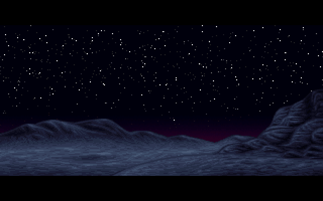
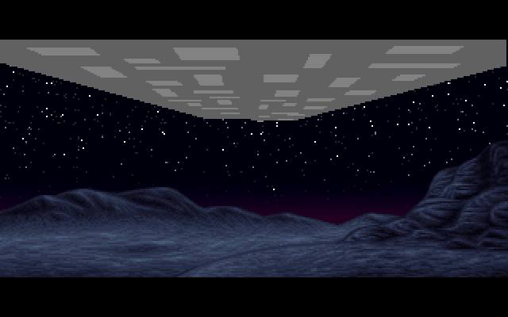
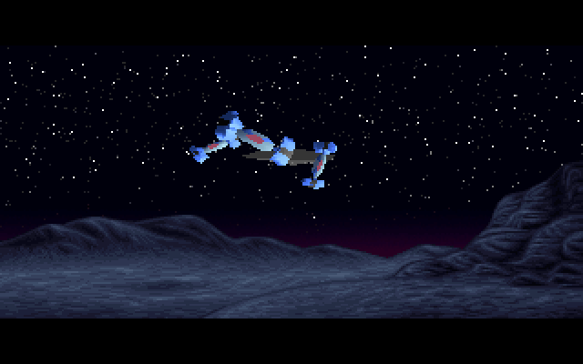
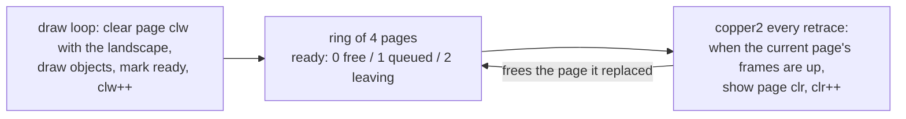

# U2A: the first ships over the landscape

U2A follows [ALKU](ALKU) and shows the same night landscape, now still. After a pause, solid shaded 3D spacecraft fly in over the horizon. One large flat-shaded craft passes overhead, and Gouraud-shaded ships bank across the sky and shrink into the distance. The part runs from about 85 s to about 107 s into the demo. It ends on the bare landscape, which [PAM](PAM) keeps showing until its own cue. The demo's part table labels it `Alkutekstit II (PSI)`, opening credits part II, by Psi. It is the first of the two parts built on Psi's **VISU** vector engine (`VISU/`, file headers "Sami Tammilehto / Fennosoftec OY"). The other is [U2E](U2E), the city flight near the end. The part's own code is `VISU/C/U2A.C`. The scene comes from 3D Studio: `VISU/C/MAIN.C` is the "3DS converter" that writes VISU's packed object and animation files.

## What you see





## The trick

U2A is a complete little 3D pipeline. The pieces worth understanding are how the animation is stored, how the engine sorts and shades polygons without a z-buffer, and how it keeps the animation on music time when a frame takes longer than one [retrace](Hardware-primer) to draw.

### 1. The animation is a stream of deltas

Each object has a 3×4 transform `r0`: a 3×3 rotation matrix `m[9]` and a position `x, y, z`. Matrix entries are fixed point with `UNIT = 16384` (1.0 = 2^14, so values are "1.14"). The scene file (`U2A.0AB`) holds one record per animation frame. Each record lists only the objects whose transform changed, and for those only the **difference** from the last frame:

```
[obj byte] [flag bytes 0-3] [dx] [dy] [dz] [dm0..dm8]
 obj byte: low nibble = object number (plus a high-bits prefix byte if needed)
           0x80 = switch on, 0x40 = switch off
           0x30 = how many flag bytes follow
 flags:    2 bits each for dx, dy, dz: 0 none, 1 byte, 2 word, 3 dword
           0x40: matrix deltas are words (else bytes)
           bits 7..15: which of the 9 matrix entries have a delta
 0xFF n    end of frame; n<=0x7F also sets the field of view to n<<8
 0xFF 0xFF end of the animation
```

A slowly turning ship costs a few bytes a frame instead of 48. Object 0 is the camera, and its matrix is applied to every other object before drawing (`calc_applyrmatrix`).

### 2. Fixed-point transform and projection

Every vertex is rotated and translated with integer arithmetic on the 386's 32-bit registers. Each product of a coordinate and a 1.14 matrix entry is summed, and the result is shifted right by 14 (`UNITSHR`). The vertex rotation keeps the sum in a 64-bit register pair (`shrd`), and the matrix-times-matrix multiply truncates to 32 bits. Projection is the textbook perspective divide:

```
x' = projmulx · x / z + projaddx
y' = projmuly · y / z + projaddy
```

The scale factors come from the field of view through a `256/tan` table. Each projected vertex also gets **outcode bits**, as in Cohen-Sutherland clipping (`VF_UP`, `VF_DOWN`, `VF_LEFT`, `VF_RIGHT`, `VF_NEAR`, `VF_FAR`). If the AND of all of an object's vertex flags is non-zero, every vertex is off the same edge, and the object is skipped whole. U2A's window is `x 0..319, y 25..174`, which gives the letterboxed 150-line picture, with the near plane at z = 512.

### 3. Sorting without a z-buffer

There is no depth buffer. The engine uses the painter's algorithm at two levels:

- **Between objects.** Each enabled object's distance is the depth of one "centre" vertex (`calc_singlez`). An insertion sort orders the objects far to near, and they are drawn in that order.
- **Within an object.** The object file carries pre-sorted polygon lists, each tagged with a reference vertex: an `ORD0` list, whose reference vertex is the "centre" used above, and one or more `ORDE` lists. At draw time `vis_drawobject` picks, among the `ORDE` lists, the one whose reference vertex is nearest the camera (smallest z); `ORD0` is drawn only when an object has no `ORDE` list. This is a cheap view-dependent sort that was computed offline.

Back faces are dropped by the sign of `normal · vertex` in camera space (`checkculling`), unless the face is flagged two-sided (`F_2SIDE`).

### 4. Lighting

There is one fixed light direction, `(12118, 10603, 3030)`, which is a unit vector in 1.14. A face's brightness is the dot product with its rotated normal (also 1.14), so the raw sum is scaled by 2^28; `normallight` keeps its top word and shifts it right by 5 more, 21 bits in all, which maps the range −1..1 onto −128..128:

```
b = clamp(128 + ((n · L) >> 21), 0, 255)
shade = clamp(b >> s, 1, 30)        s = 5, 4, 3 for F_SHADE8, F_SHADE16, F_SHADE32
colour = face base colour + shade
```

A face with no shade flag gets shade 1.

Flat faces use the face normal. `F_GOURAUD` faces compute a shade at each vertex from its vertex normal, add the face's colour, and interpolate the result across the polygon. Because the shade is added to the face's base colour index, each material occupies a run of palette entries from dark to light.

### 5. A four-page ring paced by the copper

Drawing a frame can take longer than one 70 Hz retrace, and the animation must not slow down when it does. U2A keeps **four** 320×200 pages in video memory:



The copper interrupt (`copper2`) counts retraces (`syncframe`). When the page on screen has been up for its allotted number of retraces, and the next page is ready, it flips the display start to that page. Every retrace on which the next page is not ready yet adds one to `avgrepeat`. After drawing, the main loop compares how many retraces have passed with how many animation frames it has consumed (`syncframe − currframe`), smooths that into `avgrepeat`, and does two things with the result:

1. it asks the copper to keep the new page up for `repeat` retraces;
2. it parses `repeat` frames of the animation stream before drawing the next page.

On a fast machine `repeat` is 1 and every animation frame is drawn. On a slow one, frames are skipped and the motion stays in step with the music. If the loop finds its next page still busy for more than 16 retraces, it draws into it anyway (the "deadlock" escape).

Every page starts as a copy of the landscape picture `U2ABG.UH` (`vid_clearbg`). To make that copy fast, the loader reorders the picture into plane order once. The scene's palette keeps entries 0-191 for the ships, and the landscape's 64 colours are copied into 192-255, so both share one DAC.

### 6. Music cues

The part waits until the music's order is above 10 and its row above 46 (read with DIS's `int 0fch`, function 6) before it starts drawing. The animation ends when the stream's end marker comes up. See [Music](Music) for how order and row work.

## How the original did it

The copper side of the page ring:

```c
	if(copperdelay>0)
	{
		copperdelay--;
	}
	if(copperdelay>0) return;
	copperdelay=0;
	if(cl[clr].ready)
	{
		cl[(clr-1)&3].ready=2;
		vid_setswitch(-1,clr);
		copperdelay=cl[clr].frames;
		clr++; clr&=3;
	}
	else avgrepeat++;
```
[VISU/C/U2A.C#L119-L132](https://github.com/mtuomi/SecondReality/blob/071a82eddb7a7390dbaa491a8a473e0e923a55c2/VISU/C/U2A.C#L119-L132)

And the drawing side, after the objects are drawn:

```c
		avgrepeat=(avgrepeat+(syncframe-currframe)+1)/2;
		repeat=avgrepeat;
		if(repeat<1) repeat=1;
		cl[clw].frames=repeat;
		cl[clw].ready=1;
		clw++; clw&=3;
		// advance that many frames
		repeat=repeat;
		currframe+=repeat;
	    while(repeat-- && !xit)
	    {
```
[VISU/C/U2A.C#L327-L337](https://github.com/mtuomi/SecondReality/blob/071a82eddb7a7390dbaa491a8a473e0e923a55c2/VISU/C/U2A.C#L327-L337)

Decoding one object's record, first the object number and on/off bits:

```c
			if((a&0xc0)==0xc0)
			{
				onum=((a&0x3f)<<4);
				a=*sp++;
			}
			onum=(onum&0xff0)|(a&0xf);
			b=0;
			switch(a&0xc0)
			{
			case 0x80 : b=1; co[onum].on=1; break;
			case 0x40 : b=1; co[onum].on=0; break;
			}
```
[VISU/C/U2A.C#L358-L369](https://github.com/mtuomi/SecondReality/blob/071a82eddb7a7390dbaa491a8a473e0e923a55c2/VISU/C/U2A.C#L358-L369)

then the position deltas (`lsget(f)` reads a 0-, 1-, 2- or 4-byte signed value, chosen by `f & 3`):

```c
			l=lsget(pflag);
			r->x+=l;
			l=lsget(pflag>>2);
			r->y+=l;
			l=lsget(pflag>>4);
			r->z+=l;
```
[VISU/C/U2A.C#L400-L405](https://github.com/mtuomi/SecondReality/blob/071a82eddb7a7390dbaa491a8a473e0e923a55c2/VISU/C/U2A.C#L400-L405)

and the matrix deltas, as words here (the `else` branch reads bytes):

```c
			if(pflag&0x40)
			{ // word matrix
				for(b=0;b<9;b++) if(pflag&(0x80<<b))
				{
					r->m[b]+=lsget(2);
				}
			}
```
[VISU/C/U2A.C#L411-L417](https://github.com/mtuomi/SecondReality/blob/071a82eddb7a7390dbaa491a8a473e0e923a55c2/VISU/C/U2A.C#L411-L417)

Choosing an object's pre-sorted face list, in `vis_drawobject`:

```c
	o->vf=calc_project(o->vnum,o->pv,o->v);
	if(o->vf) return; // object was completely out of screen
	a=0; al=0x7fffffffL;
	for(b=1;b<o->plnum;b++)
	{
		c=o->pl[b][1];
		bl=(o->v+c)->z;
		if(bl<al)
		{
			al=bl;
			a=b;
		}
	}
	draw_polylist(o->pl[a],o->pd,o->v,o->pv,o->n,o->flags);
```
[VISU/VISU.C#L111-L124](https://github.com/mtuomi/SecondReality/blob/071a82eddb7a7390dbaa491a8a473e0e923a55c2/VISU/VISU.C#L111-L124)

The perspective divide and outcodes in `_calc_project` (y shown; x follows the same pattern):

```asm
	imul	ds:_projmuly
	idiv	ebx
	add	eax,ds:_projaddy
	cmp	eax,ds:_projclipy[CLIPMAX]
	jng	@@41
	or	bp,VF_DOWN
@@41:	cmp	eax,ds:_projclipy[CLIPMIN]
	jnl	@@42
	or	bp,VF_UP
@@42:	mov	es:[di+pvlist_y],ax ;store Y
```
[VISU/ACALC.ASM#L783-L792](https://github.com/mtuomi/SecondReality/blob/071a82eddb7a7390dbaa491a8a473e0e923a55c2/VISU/ACALC.ASM#L783-L792)

The light, `normallight` in the polygon drawer:

```asm
	mov	ax,es:[di+nlist_x]
	imul	cs:newlight[0]
	mov	bp,ax
	mov	cx,dx
	mov	ax,es:[di+nlist_y]
	imul	cs:newlight[2]
	add	bp,ax
	adc	cx,dx
	mov	ax,es:[di+nlist_z]
	imul	cs:newlight[4]
	add	ax,bp
	adc	dx,cx
	mov	ax,dx
	sar	ax,2*unitshr-7-16
	add	ax,128
```
[VISU/ADRAW.ASM#L49-L63](https://github.com/mtuomi/SecondReality/blob/071a82eddb7a7390dbaa491a8a473e0e923a55c2/VISU/ADRAW.ASM#L49-L63)

## How the port does it

The part is [`bins/secondreality/src/parts/u2a.rs`](https://github.com/waffleking32/SecondRealityRust/blob/main/bins/secondreality/src/parts/u2a.rs) (`U2a`). It loads the scene and the landscape, merges the palettes, holds the landscape until the cue, installs the ring in copper slot 2, and runs one loop iteration per tick (`loop_tick`). The engine is shared with U2E and lives in three modules:

- [`parts/visu/math.rs`](https://github.com/waffleking32/SecondRealityRust/blob/main/bins/secondreality/src/parts/visu/math.rs) is the fixed-point core, transliterated from `ACALC.ASM`. The original's three different multiply paths (32-bit truncating, 64-bit `shrd`, signed-word reads) are kept apart, because they round differently.
- [`parts/visu/draw.rs`](https://github.com/waffleking32/SecondRealityRust/blob/main/bins/secondreality/src/parts/visu/draw.rs) is the polygon pipeline: culling, lighting, clipping, and the flat and Gouraud fillers. It writes to a linear page but keeps the original's 4-pixel planar quantisation and its edge rounding.
- [`parts/visu/mod.rs`](https://github.com/waffleking32/SecondRealityRust/blob/main/bins/secondreality/src/parts/visu/mod.rs) holds the scene loader and animation cursor (`Scene`, `Scene::step_frame`), the page ring (`Ring`, whose `isr` is `copper2` line for line), and the per-frame draw (`Driver::draw_frame`, with `order_instances` and `pick_list`).

The original spins in `while(cl[clw].ready)` waiting for a free page. In the port, `Ring::next_page` returns `None`, and that tick does nothing. The four pages sit one after another in the engine's surface, and the copper callback moves the view's origin to the page being shown (see [How the port works](How-the-port-works)). Measurements and the reference comparisons are in [docs/fidelity/u2a.md](https://github.com/waffleking32/SecondRealityRust/blob/main/docs/fidelity/u2a.md).

## Quirks kept

- The deadlock escape draws into a page the display may still hold, and the 16-retrace start-up delay makes the first draws skip 8, 8, 4 and 1 frames ([bugs.md §12.1](https://github.com/waffleking32/SecondRealityRust/blob/main/docs/fidelity/bugs.md)).
- An exit during the cue wait leaves the landscape up, and an exit in the loop clears all four pages ([bugs.md §12.2](https://github.com/waffleking32/SecondRealityRust/blob/main/docs/fidelity/bugs.md)).
- The second music gate (order 12, row 55) never fires, because the stream's end comes first ([u2a.md §6](https://github.com/waffleking32/SecondRealityRust/blob/main/docs/fidelity/u2a.md)).
- The `fov` variable is read before it is set. The first draw shows only the background, so the value never shows ([u2a.md §6](https://github.com/waffleking32/SecondRealityRust/blob/main/docs/fidelity/u2a.md)).
- The "city hacks" that force some objects' depth are present but inactive for this scene ([u2a.md §6](https://github.com/waffleking32/SecondRealityRust/blob/main/docs/fidelity/u2a.md)).
- Before the cue the port shows the landscape, as the release does at most emulated speeds. It does not reproduce one capture's neon palette ([APPROXIMATIONS.md A32](https://github.com/waffleking32/SecondRealityRust/blob/main/docs/fidelity/APPROXIMATIONS.md)).
- The release's Gouraud shading differs slightly from the tree's on some faces; the silhouettes match exactly ([APPROXIMATIONS.md A28](https://github.com/waffleking32/SecondRealityRust/blob/main/docs/fidelity/APPROXIMATIONS.md)).
- The pose at the 7300 reference frame is a few animation frames off, because of the sessions' phase ([APPROXIMATIONS.md A29](https://github.com/waffleking32/SecondRealityRust/blob/main/docs/fidelity/APPROXIMATIONS.md)).

---

**Previous:** [ALKU](ALKU) · **Next:** [PAM](PAM)
