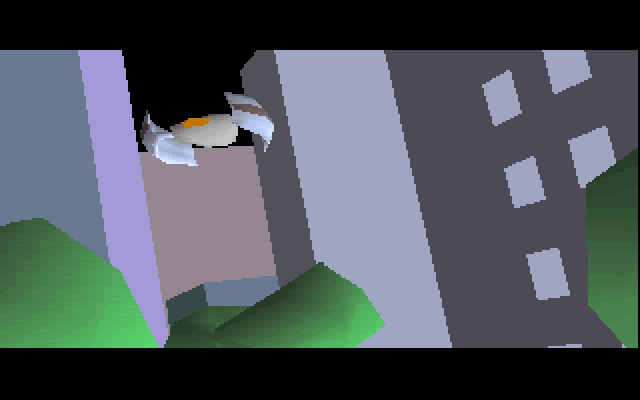

# U2E: the city flight

U2E is the city flight, the last big effect before the ending. It follows [JPLOGO](JPLOGO) about
eight minutes into the demo and runs for just under a minute before [ENDLOGO](ENDLOGO) flashes up
the end picture. The jelly picture turns white and becomes a white letterboxed screen. Then the
camera dives into a city of flat-shaded tower blocks, trees and streets, chases ships between the
buildings, and pulls out to a 3D "Future Crew" logo before the screen fades to white. The demo's
part table labels it `Vector Part II`. It is the second part built on Psi's VISU vector engine
(`VISU/`, file headers "Sami Tammilehto / Fennosoftec OY"), after [U2A](U2A). The part's own code
is `VISU/C/U2E.C`, and the scene is the packed 3D Studio export `U2E.00M`, `.0AA`, `.0AB` and
`.001`-`.042`.

## What you see





## The trick

The 3D pipeline is U2A's, and the [U2A](U2A) page explains it: the delta-compressed animation
stream, 1.14 fixed-point transforms, the perspective divide with outcodes, painter's-algorithm
sorting with pre-sorted face lists, the fixed light, and the four-page ring flipped by the [copper](Hardware-primer).
This page covers what U2E does differently: the handover from JPLOGO, done with nothing but
palette writes, the half-rate animation clock, and two hand-written sorting fixes for a scene that
the centre-vertex sort gets wrong.

### 1. Turning a jelly into a letterbox with the palette

When U2E starts, JPLOGO's picture is still on screen. U2E reads the BIOS video mode. If it is
above 3 (a graphics mode, so a previous part left a picture), it reads the live DAC into `fpal`
instead of initialising the screen and starting from a palette of its own. The intro is then 100 retraces of palette and
memory tricks:

```
33 steps   fpal entries 1..253 += 2 (clamp 63)       picture -> white, entry 0 stays black
16 waits
fadeset    draw the letterbox pattern into page 0, switch CRTC 9 to 200-line double scan,
           draw it into pages 1-3
16 waits
33 steps   entries 1..252 -= 2,  entries 253, 254 += 2 (towards white)
```

The fade-in brightens every entry except 0, 254 and 255, 33 steps of +2, 66 levels in all on
a 0-63 scale, so every brightened entry saturates at white. JPLOGO's picture never uses entry 0 (its own blacks were
remapped to entry 64), and entry 0 is the black outside it, so after 33 steps the settled picture
is a solid white column 185 pixels wide (x 68-252) on black. `fadeset` then redraws that same picture from scratch in U2E's own
320×200 layout, using four special colours:

| rows | x 0-67 | x 68-252 | x 253-319 |
|---|---|---|---|
| 0-24 | 0 | 252 | 0 (x 256-319 not written) |
| 25-174 | 254 | 253 | 254 |
| 175-199 | 0 | 252 | 0 |

Under the whitened palette, 252 and 253 are white and 254 is still black, so the new screen looks
exactly like the old one: a white column. The switch from JPLOGO's 400-line mode to U2E's
200-line mode happens behind an unchanged picture. The fade-out then does the transition. 252
goes to black, which removes the column's top and bottom 25 rows, and 254 rises to white, which
fills in the sides of the middle band. The column widens into a white 320×150 band between black
bars, the letterbox the city will be drawn in (`vid_window(0,319,25,174,...)`). The main palette
keeps 253 and 254 white for the same reason, so the fadeset page can be the first page the copper
shows.

The white cells are the same screen positions JPLOGO's picture occupied. That only works because
the picture's column (184 pixels plus the border byte, centred at x 160) was known in advance.

### 2. A music gate, then the city at 35 frames a second

After the intro the part loads the scene palette, installs its copper routine `copper2`, and
waits for the music. It polls the player's order (DIS function 6, see [Music](Music)) until it is
past 18. The shell restarted the first music module, MUSIC0, at order 18 just before U2E loaded, so
the city starts as order 19 begins.

The draw loop is U2A's: wait for a free page, clear it, sort and draw the enabled objects, hand
the page to the copper, then parse stream frames to catch up with the music clock. U2E differs in
three ways:

- **No background.** Each page is cleared to 255 (`vid_clear255`), which the main palette makes
  black. The sky is the absence of polygons.
- **Two retraces a stream frame.** The city's animation stream is meant to be played at half the
  retrace rate. If the draw was `a` retraces late, the copper is told to hold the new page for
  `a+1` retraces, but the parser advances `(a+2)/2` stream frames and counts each as two retraces
  (`currframe += repeat*2`). On a fast machine one stream frame is drawn every two ticks, and the
  1,801-frame flight lasts about 51 seconds.
- **The first draw is skipped.** On the first iteration nothing is drawn. The clock is reset and
  page 0, which still holds the fadeset's white band, is queued as the first page.

### 3. Fixing the painter's algorithm by name

VISU sorts whole objects by the camera-space depth of one centre vertex and draws them far to
near. For ships in open sky that is enough. A city has large flat pieces (ground slabs and
platforms) whose centre can be nearer the camera than a building standing on
them. The ground would then be painted over the building. U2E fixes this with two hacks keyed on
object names:

```
name starts with '_'                         distance = 1,000,000,000   (always drawn first)
name begins "s01", 1800 < currframe < 2200   distance = 1               (always drawn last)
```

The scene has nine underscore objects, such as `_platform`, `_L_pohja` and `_laatta01` ("pohja"
and "laatta" are Finnish for base and slab), so the floor is always behind everything else. The
second rule forces the object `s01` in front of everything for stream frames 900-1100. The
source gives no reason; the effect is that nothing whose centre vertex is nearer can cover it
during that stretch.
(The names are stored with their quote marks, which is why the test reads `name[1]`.)

### 4. Out to white

When the stream's end marker comes up, the part removes its copper routine, reads the DAC back,
and adds 4 to every component 16 times, one upload per retrace. The screen fades to white, and
ENDLOGO starts from there. The upload starts at DAC entry 255, so each upload
writes every colour one entry down (entry `j` gets `fpal[j+1]`, and 255 gets `fpal[0]`).

## How the original did it

`fadeset`'s middle band. The memory is planar with all four planes enabled, so one byte address
is four pixels. `3c5=2+4+8` masks off plane 0 for one byte, and that splits the 4-pixel group at
x 252-255:

```c
	for(y=25;y<175;y++)
	{
		memset(vram+y*80+0,254,17);
		memset(vram+y*80+17,253,47);
		outp(0x3c4,2);
		outp(0x3c5,2+4+8);
		*(vram+y*80+63)=254;
		outp(0x3c4,2);
		outp(0x3c5,15);
		memset(vram+y*80+64,254,16);
	}
```
[VISU/C/U2E.C#L161-L171](https://github.com/mtuomi/SecondReality/blob/071a82eddb7a7390dbaa491a8a473e0e923a55c2/VISU/C/U2E.C#L161-L171)

The fade-out that turns the column into the letterbox:

```c
	for(b=0;b<33;b++)
	{
		for(a=3;a<768-9;a++) 
		{
			fpal[a]-=2;
			if(fpal[a]<0) fpal[a]=0;
		}
		for(a=768-9;a<768-3;a++) 
		{
			fpal[a]+=2;
			if(fpal[a]>63) fpal[a]=63;
		}
		dis_waitb();
		outp(0x3c8,0);
		for(a=0;a<768;a++) outp(0x3c9,fpal[a]);
```
[VISU/C/U2E.C#L320-L334](https://github.com/mtuomi/SecondReality/blob/071a82eddb7a7390dbaa491a8a473e0e923a55c2/VISU/C/U2E.C#L320-L334)

The two sorting hacks, inside the loop that gathers enabled objects:

```c
			b=o->pl[0][1]; // center vertex
			if(co[a].o->name[1]=='_') co[a].dist=1000000000L;
			else co[a].dist=calc_singlez(b,o->v0,o->r);
			if(currframe>900*2 && currframe<1100*2)
			{
				if(co[a].o->name[1]=='s' &&
				   co[a].o->name[2]=='0' &&
				   co[a].o->name[3]=='1')
				   	co[a].dist=1L;
			}
```
[VISU/C/U2E.C#L407-L416](https://github.com/mtuomi/SecondReality/blob/071a82eddb7a7390dbaa491a8a473e0e923a55c2/VISU/C/U2E.C#L407-L416)

The half-rate catch-up after a draw:

```c
		a=(syncframe-currframe);
		repeat=a+1;
		if(repeat<0) repeat=0;
		if(repeat==0) cl[clw].frames=1;
		else cl[clw].frames=repeat;
		cl[clw].ready=1;
		clw++; clw&=3;
		// advance that many frames
		repeat=(repeat+1)/2;
		currframe+=repeat*2;
```
[VISU/C/U2E.C#L435-L444](https://github.com/mtuomi/SecondReality/blob/071a82eddb7a7390dbaa491a8a473e0e923a55c2/VISU/C/U2E.C#L435-L444)

The fade to white, written from entry 255:

```c
	for(b=0;b<16;b++)
	{
		for(a=0;a<768;a++) 
		{
			fpal[a]+=4;
			if(fpal[a]>63) fpal[a]=63;
		}
		dis_waitb();
		outp(0x3c8,255);
		for(a=0;a<768;a++) outp(0x3c9,fpal[a]);
	}
```
[VISU/C/U2E.C#L545-L555](https://github.com/mtuomi/SecondReality/blob/071a82eddb7a7390dbaa491a8a473e0e923a55c2/VISU/C/U2E.C#L545-L555)

## How the port does it

The part is
[`bins/secondreality/src/parts/u2e.rs`](https://github.com/waffleking32/SecondRealityRust/blob/main/bins/secondreality/src/parts/u2e.rs)
(`U2e`). It is a state machine with one `Phase` per act: `FadeIn`, `FadeInHold`, `FadeSetFirst`,
`Crtc`, `FadeSetRest`, `FadeRestHold`, `FadeOut`, `Setup`, `Gate`, `Loop`, `Teardown`. Every
`dis_waitb()` in the source is one tick. In the source a palette mutation is computed, then
`dis_waitb()`, then uploaded, so the port computes it on one tick and uploads it on the next
(`flush_palette`, `flush_teardown`). `U2e::prepare` always takes the "previous part left graphics"
branch: every port run starts on the graphics surface, either after the shell's boot screen or
after the previous part.

The engine is shared with U2A:
[`parts/visu/mod.rs`](https://github.com/waffleking32/SecondRealityRust/blob/main/bins/secondreality/src/parts/visu/mod.rs)
(`Scene`, `Ring`, `Driver::draw_frame` with `Clear::Byte(255)`, `Driver::skip_first_draw`, and
the name hacks in the object ordering),
[`parts/visu/draw.rs`](https://github.com/waffleking32/SecondRealityRust/blob/main/bins/secondreality/src/parts/visu/draw.rs)
and
[`parts/visu/math.rs`](https://github.com/waffleking32/SecondRealityRust/blob/main/bins/secondreality/src/parts/visu/math.rs).
`install_copper` registers `copper2` as copper slot 2. Each retrace it runs `Ring::isr` and moves
the view's origin to the page being shown, as `vid_setswitch` moves the CRTC start address (see
[How the port works](How-the-port-works)). U2E is the one part that keeps running after an exit
request (`drains_after_exit`), because its source runs the 16-step fade to white whichever way the
loop ends. The intro is byte-exact against the original. The measurements are in
[docs/fidelity/u2e.md](https://github.com/waffleking32/SecondRealityRust/blob/main/docs/fidelity/u2e.md).

## Quirks kept

- The deadlock escape draws into a page the display may still hold ([bugs.md §12.1](https://github.com/waffleking32/SecondRealityRust/blob/main/docs/fidelity/bugs.md)).
- The first draw is skipped, and the fadeset page is queued in its place ([bugs.md §12.3](https://github.com/waffleking32/SecondRealityRust/blob/main/docs/fidelity/bugs.md)).
- The teardown writes 768 bytes from DAC entry 255, one tick after each step is computed ([bugs.md §12.4](https://github.com/waffleking32/SecondRealityRust/blob/main/docs/fidelity/bugs.md)).
- The name hacks run, with their strict bounds on `currframe` ([bugs.md §12.5](https://github.com/waffleking32/SecondRealityRust/blob/main/docs/fidelity/bugs.md)).
- `fadeset`'s top band clears 16 bytes at `+252`, past its own row, and later rows overwrite them ([u2e.md §4](https://github.com/waffleking32/SecondRealityRust/blob/main/docs/fidelity/u2e.md)).
- `fov` is read before it is set. The skipped first draw hides it ([u2e.md §6](https://github.com/waffleking32/SecondRealityRust/blob/main/docs/fidelity/u2e.md)).
- The release's Gouraud shading differs slightly from the tree's. Silhouettes and flat faces are exact ([APPROXIMATIONS.md A30](https://github.com/waffleking32/SecondRealityRust/blob/main/docs/fidelity/APPROXIMATIONS.md)).
- At the same boot frame the reference keyframes show the stream two frames (four ticks) behind the port, a music-clock phase between capture sessions ([APPROXIMATIONS.md A31](https://github.com/waffleking32/SecondRealityRust/blob/main/docs/fidelity/APPROXIMATIONS.md)).
- Polygons fill a linear page instead of planar VGA memory, with the same pixels ([APPROXIMATIONS.md A34](https://github.com/waffleking32/SecondRealityRust/blob/main/docs/fidelity/APPROXIMATIONS.md)), and the four pages are packed 64,000 pixels apart ([APPROXIMATIONS.md A35](https://github.com/waffleking32/SecondRealityRust/blob/main/docs/fidelity/APPROXIMATIONS.md)).

---

**Previous:** [JPLOGO](JPLOGO) · **Next:** [DDSTARS](DDSTARS)
